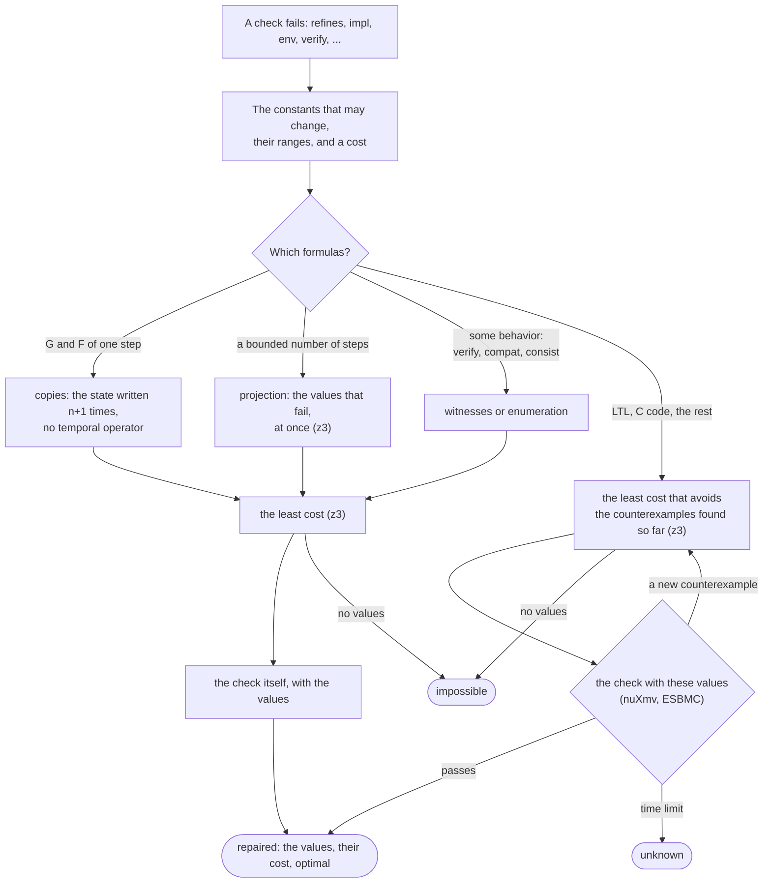

# Repair

When a check fails, `repair` finds values of named constants of the
contracts that make it pass, at the least cost, and changes nothing else.
The check and its arguments are those of the checks (`verify`, `compat`,
`consist`, `refines`, `impl`, `env`, as in `to_smv`); each parameter is a
constant with a range, `(low, high)` for a real and `(low, high, "int")` for
an integer. The cost is `minimize` or `maximize`, a term over the
parameters, and by default the change: the sum of |p - p0|.

```python
from chase_cps import Contract, repair

impl = Contract.from_strings(name="Impl", inputs={"x": (0, 9)}, outputs={"y": (0, 20)},
                             guarantees=["y = x + 5"])
spec = Contract.from_strings(name="Spec", inputs={"x": (0, 9)}, outputs={"y": (0, 20)},
                             guarantees=["y <= x + lam"], constants={"lam": 4})
r = repair("refines", impl, spec, parameters={"lam": (0, 10)})
print(r.status, r.values, r.cost, r.optimal)     # repaired {'lam': 5} 1 True
```


*How a repair goes: the method is chosen by the formulas, and the values found always pass the check itself.*

The result is `holds` when the check passes with the present values (a
repair is then a verification), `repaired` (the values, their cost,
`optimal` when no values of lower cost pass, and `check`, the result of
the check with the values), `impossible` (no values in the ranges pass,
with the evidence), or `unknown` with the reason. The values of a repair
are always checked by the check itself, with its usual back end. The
method is chosen by the formulas:

- `copies` (0.6.4), when every term is `G` or `F` of one step, or a
  condition on the first step: the truth of such terms depends only on the
  states a behavior visits, so a counterexample needs one state for each
  term and the first one. The question is written on that many copies of
  the state, with the constants shared and no temporal operator, and z3
  finds the least cost exactly. This is the small-model property of the
  formulas of temporal height one (Demri and Schnoebelen, Information and
  Computation 2002, Proposition 7.2; for `F` and `G`, Sistla and Clarke,
  JACM 1985, Theorem 3.4). It takes contracts only: with a state machine,
  or a term that links two steps (`X`, `x'`), the states cannot be chosen
  freely, and a nested term (`G F p`) depends on the order of the states.
- `projection`, on formulas over a bounded number of steps with real
  parameters: the values for which the check fails are computed at once
  by eliminating the other variables (z3), then one optimization.
- `counterexamples`, on the other checks of every behavior (LTL with
  nuXmv, C with ESBMC, integers): the least cost under the conditions that
  the counterexamples found so far are no longer counterexamples; the
  check with these values; its new counterexample is added, until the
  check passes.
- `witnesses` (chosen by `auto`), on checks of some behavior (`verify`,
  `compat`, `consist`) over bounded formulas: the parameters and a
  behavior for each question, in one optimization.
- `enumeration`, on checks of some behavior over other formulas with
  integer parameters: the values in the order of their cost, until one
  passes.

The conditions of `counterexamples` only remove values that cannot repair,
so the cost of each round is a lower bound: the values that pass are
optimal. On formulas over a bounded number of steps, a counterexample is
generalized: its integers and Booleans as they are and its reals free, it
removes every value for which some behavior of that kind still fails, not
only one value. A counterexample of a C function is not generalized (its
behaviors are those of its code). With two or more real constants inside
`G` and a term that `copies` does not take (`X`, `U`, a state machine),
the rounds may not end: give `time_limit`, and the result is unknown with
the least cost proved so far. `method=` forces a method, `rounds=` (50)
limits the rounds. Repair optimizes with z3 (`pip install chase-cps[z3]`).

On the command line, with the checks of `chase-cps check` and
`--param NAME=LOW..HIGH` (`:int` for an integer):

````
$> chase-cps repair heater.ltl --refines Room+Thermostat Comfort --param theta=60..90:int
repair      repaired  (counterexamples, 5 rounds, 0.13 s)
  theta = 74
  change 2 (optimal)
````

The demos [Drone timing](../demos/drone-timing.md), [Room
thermostat](../demos/heater.md), [Resource arbiter](../demos/deadline.md),
and [Drone climb](../demos/drone-altitude.md) repair the timing of a drone
(the bounds of ContrACT, MEMOCODE 2026), a thermostat in signal temporal
logic and its C code, a deadline in LTL, and two constants at once.
