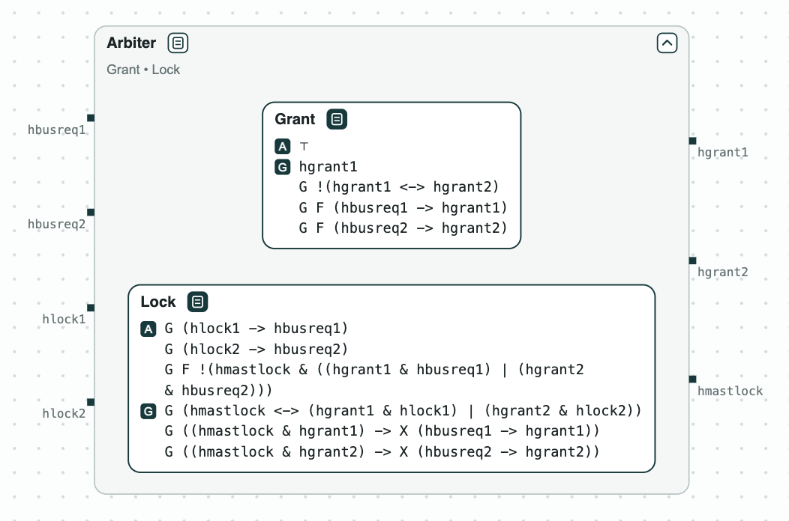
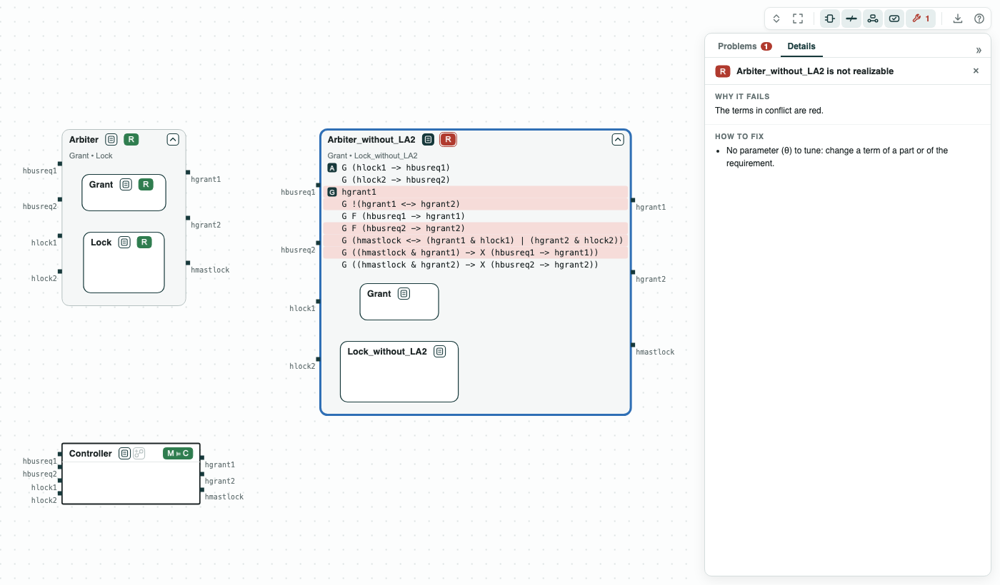
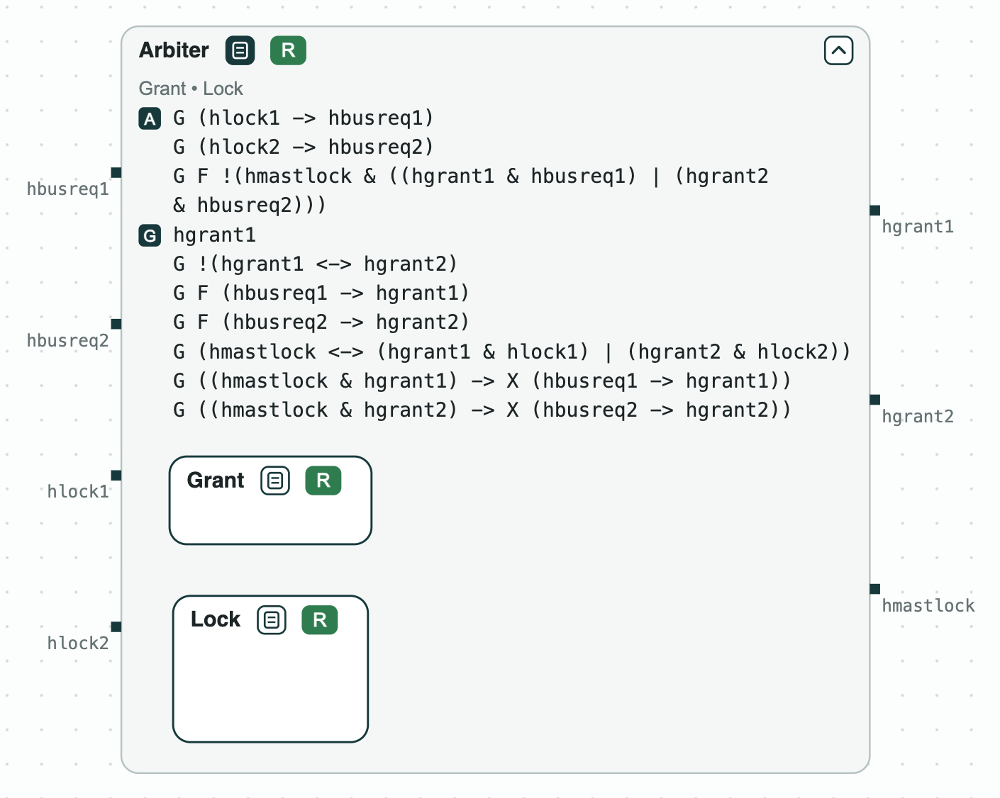
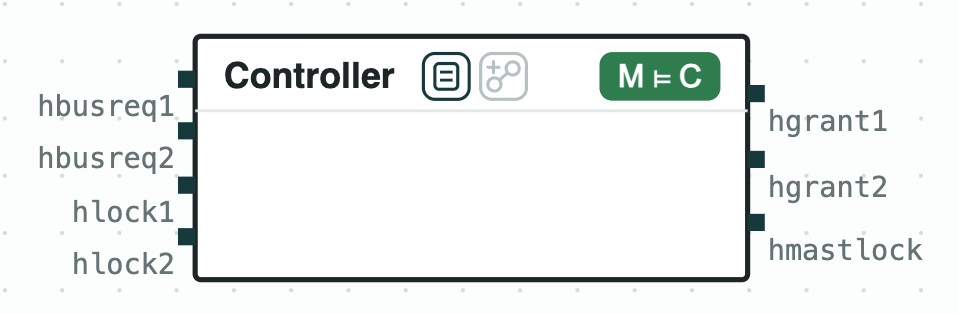

# AMBA AHB bus arbiter: two viewpoints that cannot be merged, and the assumption that fixes them

**The system.** AMBA AHB is the on-chip bus of ARM processors. Several
masters (processors, DMA engines) share it, and an arbiter decides which
one has the bus. This demo has two masters, simplified from Bloem et al.,
"Specify, Compile, Run: Hardware from PSL" (COCV 2007). A master asks for
the bus (`hbusreq1`, `hbusreq2`) and may ask for a locked access
(`hlock1`, `hlock2`): a series of transfers that nobody may interrupt. The
arbiter gives the bus (`hgrant1`, `hgrant2`) and says when it is locked
(`hmastlock`). Two teams wrote two viewpoints of the arbiter in
SystemVerilog Assertions: _Grant_ (the bus goes to exactly one master, to
master 1 at the start, and no master waits forever) and _Lock_ (a master
that has locked the bus keeps it while it asks for it). Merging (•) puts
two viewpoints of one component together: the arbiter must meet both.
slugs checks realizability and synthesizes controllers; nuXmv checks the
controller.

**The question.** Is there an arbiter that meets both viewpoints, and if
not, what must it assume of the masters? Each team's viewpoint can be
fine on its own while the two together ask for the impossible, and this
is best found before the arbiter is built.

[{ width="520" }](../assets/demos/ahb/system-arbiter.png)
_The system: the arbiter, the merge of the two viewpoints._

## The steps

The tags on the boxes give the results of the checks: green holds, red
fails; [Diagrams](../interfaces/diagrams.md) says
how to read them.

**Step 1. Each viewpoint.** A contract is
[realizable](../tools/synthesis.md#realizability-and-synthesis)
when some controller meets it whatever the masters do. _Grant_ and _Lock_
are each realizable.

**Step 2. The merge, without the last assumption of Lock.** Without
`G F !(hmastlock & ((hgrant1 & hbusreq1) | (hgrant2 & hbusreq2)))`, the
merge is unrealizable. CHASE finds the
[unrealizable core](../tools/synthesis.md#unrealizable-cores),
5 of its 7 guarantees: when master 1 locks the bus and keeps asking for
it, _Lock_ lets it keep the bus
(`G ((hmastlock & hgrant1) -> X (hbusreq1 -> hgrant1))`), and _Grant_ says
that master 2 does not wait forever (`G F (hbusreq2 -> hgrant2)`). The
initial grant, the single grant, and the lock rule complete the core.

[](../assets/demos/ahb/step2-merge-core.png)
_Step 2: the merge without the assumption is unrealizable; the terms of the core are red._

**Step 3. What the arbiter must assume.** The core points at the missing
assumption: a master that has locked the bus stops asking for it sooner
or later (the third assumption of _Lock_, LA2 in the paper). With it, the
merge _Arbiter_ is realizable, and slugs synthesizes a controller of 81
states. _Arbiter_ is also written as SVA in `out/arbiter.sv`, for a tool
that checks an arbiter written by hand.

[{ width="465" }](../assets/demos/ahb/step3-arbiter.png)
_Step 3: Arbiter, the merge with the assumption, is realizable._

**Step 4. The controller.** The synthesized controller, read as a state
machine, implements _Arbiter_ (M ⊨ C).

[{ width="268" }](../assets/demos/ahb/step4-controller.png)
_Step 4: the controller implements Arbiter (M ⊨ C)._

## Run it

```
pip install chase-cps
chase-cps install nuxmv --accept-license
chase-cps install slugs
python ahb.py --expect
```

The files of the demo are in the [repository](https://github.com/chase-cps/demos/tree/main/AHB); [Running the demos](running.md) says what the scripts print and how to use the diagrams.
