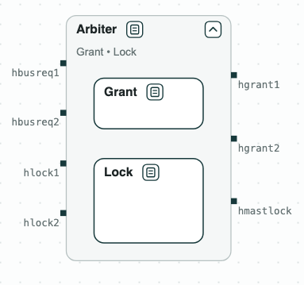
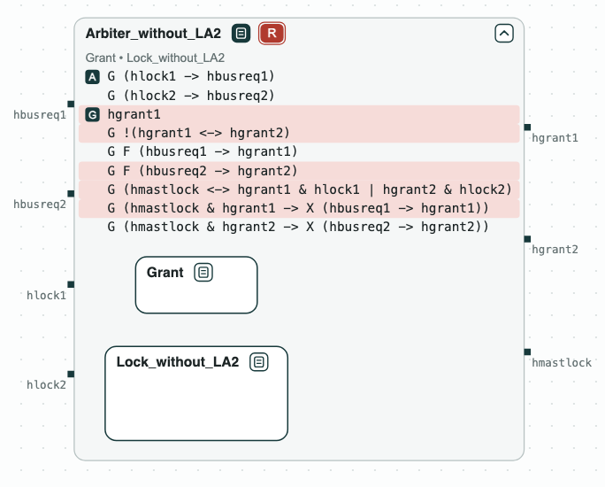
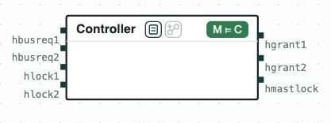

# Bus arbiter: merging two viewpoints

**The question.** Two teams wrote two viewpoints of the same arbiter of the
AMBA AHB bus: one on how the bus is given to the masters, one on how a
master locks it. Is there an arbiter that meets both, and what must it
assume of the masters?

[](../assets/demos/ahb/merge-of-grant-and-lock.png)
_The arbiter: the merge of the two viewpoints, Grant and Lock._

The arbiter gives the bus to one of two masters. The requirements are
simplified from Bloem et al., "Specify, Compile, Run: Hardware from PSL"
(COCV 2007), and written in
[SystemVerilog Assertions](../tools/systemverilog.md). The variables are:

- `hbusreq`: a master asks for the bus;
- `hlock`: a master asks for a locked access;
- `hgrant`: the arbiter grants the bus;
- `hmastlock`: the bus is locked.

The requirements are written as two viewpoints:

- _Grant_ gives the bus to master 1 at the start (GR1) and to exactly one
  master (GR2), and no master waits forever (GR3.1, GR3.2).
- _Lock_ locks the bus for a master that asks for a locked access (LK1),
  and keeps it while that master asks (LK2.1, LK2.2). It assumes that a
  master that asks for a locked access also asks for the bus (LA1.1,
  LA1.2).

The two viewpoints are put together by
[merging](../contracts/algebra.md#what-each-one-is-for) (•), the operation
for viewpoints of one component.

## The steps

**Step 1. Each viewpoint.** _Grant_ and _Lock_ are each realizable.

**Step 2. The merge.** The merge is unrealizable. When master 1 locks the
bus and keeps asking for it, _Lock_ says that master 1 keeps the bus
(LK2.1), and _Grant_ says that master 2 does not wait forever (GR3.2). The
core is these two, with GR1, GR2, and LK1, which make the conflict
possible.

[](../assets/demos/ahb/merge-unrealizable-core.png)
_Step 2: the merge is unrealizable; the core highlighted in red._

**Step 3. What the arbiter must assume.** The core points to the missing
assumption: a master that has locked the bus stops asking for it sooner or
later (LA2). With LA2 in _Lock_, the merge _Arbiter_ (the diagram at the
top) is realizable, and slugs synthesizes a controller of 81 states.
_Arbiter_ is also written as SVA (`AHB/out/arbiter.sv`).

**Step 4. The controller.** The synthesized controller, read as a state
machine, implements _Arbiter_ (M ⊨ C).

[](../assets/demos/ahb/controller-implements-arbiter.png)
_Step 4: the controller implements Arbiter._

## Run it

```
$> git clone https://github.com/chase-cps/demos && cd demos
$> pip install chase-cps
$> chase-cps install nuxmv --accept-license
$> chase-cps install slugs
$> python3 AHB/ahb.py
```

The script prints the result of each step and writes the diagrams above in
`AHB/out/arbiter.html`. The viewpoints are in `AHB/sva/grant.sv` and
`AHB/sva/lock.sv`, with the number of each requirement as its label.
