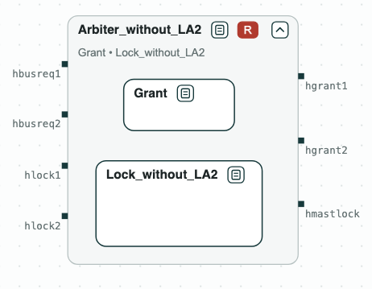

# Bus arbiter: merging two viewpoints

**The question.** Two teams wrote two viewpoints of the same arbiter of the
AMBA AHB bus: one on how the bus is given to the masters, one on how a
master locks it. Is there an arbiter that meets both, and what must it
assume of the masters?

[](../assets/diagram-ahb-system.png)
_The arbiter: the merge of the two viewpoints, Grant and Lock._

The arbiter gives the bus to one of two masters, and a master can lock the
bus. The requirements are simplified from Bloem et al., "Specify, Compile,
Run: Hardware from PSL" (COCV 2007). The viewpoints are written in
[SystemVerilog Assertions](../tools/systemverilog.md): _Grant_ gives the bus
to exactly one master, and no master waits forever (GR1 to GR3.2); _Lock_
locks the bus for a master that asks for a locked access, and keeps it while
that master asks (LK1 to LK2.2), assuming that a master that has locked the
bus stops asking for it sooner or later (LA2). They are put together by
[merging](../contracts/algebra.md#what-each-one-is-for), the operation for
viewpoints of one component.

## The steps

**Step 1. Each viewpoint.** _Grant_ and _Lock_ are each realizable.

**Step 2. The merge without LA2.** Without the assumption LA2, the merge is
unrealizable. When master 1 locks the bus and keeps asking for it, _Lock_
says that master 1 keeps the bus (LK2.1), and _Grant_ says that master 2
does not wait forever (GR3.2). The core names these two, with GR1, GR2, and
LK1, which make the conflict possible.

[](../assets/diagram-ahb-2.png)
_Step 2: without LA2 the merge is unrealizable; its core on a red ground._

**Step 3. The merge.** With LA2, the merge _Arbiter_ (the diagram at the
top) is realizable, and slugs synthesizes a controller of 81 states.
_Arbiter_ is also written as SVA (`out/arbiter.sv`), for a model checker of
the RTL of the arbiter.

**Step 4. The controller.** The synthesized controller implements
_Arbiter_.

[](../assets/diagram-ahb-3.png)
_Step 4: the controller implements Arbiter._

## Run it

```
$> git clone https://github.com/chase-cps/demos && cd demos
$> pip install chase-cps
$> chase-cps install nuxmv --accept-license && chase-cps install slugs
$> python3 AHB/ahb.py
```

The script prints the result of each step and writes `out/arbiter.html`,
the diagrams above, to open in a browser: a click on a name opens a
contract, and a click on a red tag shows its core. The viewpoints are in
`AHB/sva/grant.sv` and `AHB/sva/lock.sv`, with the number of the
requirement as the label of each assertion.
