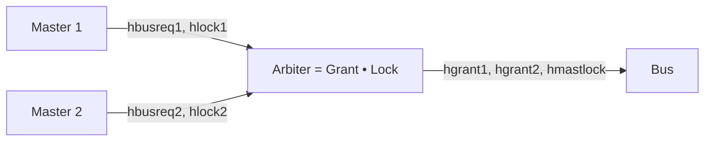

# Bus arbiter: merging two viewpoints

**The question.** Two teams wrote two viewpoints of the same arbiter of the
AMBA AHB bus: one on how the bus is given to the masters, one on how a
master locks it. Is there an arbiter that meets both, and what must it
assume of the masters?

The arbiter gives the bus to one of two masters, and a master can lock the
bus. The requirements are simplified from those of R. Bloem et al.,
"Specify, Compile, Run: Hardware from PSL" (COCV 2007), a case study of
GR(1) synthesis: two masters, no bursts, and no HREADY. The viewpoints are
written in [SystemVerilog Assertions](../tools/systemverilog.md), and put
together by [merging](../contracts/algebra.md#what-each-one-is-for), the
operation for viewpoints of one component.



## The contracts

<div class="tbl-ag" markdown>

| Viewpoint | Assumes | Guarantees |
|---|---|---|
| _Grant_ | nothing | GR1: master 1 has the bus at the start; GR2: the bus is given to exactly one master; GR3.1, GR3.2: no master waits forever |
| _Lock_ | LA1.1, LA1.2: a master asks for the bus when it asks for a locked access; LA2: a master that has locked the bus stops asking for it sooner or later | LK1: the bus is locked when its master asks for a locked access; LK2.1, LK2.2: while a master has locked the bus and asks for it, it keeps the bus |

</div>

## The steps

<div class="tbl-steps" markdown>

| Step | Operation | Result |
|---|---|---|
| 1. Each viewpoint | `is_realizable(Grant)`, `is_realizable(Lock)` | each is realizable |
| 2. The merge without LA2 | Grant • Lock′, with Lock′ = Lock without LA2; `is_realizable(..., core=True)` | unrealizable, with the core GR1, GR2, GR3.2, LK1, LK2.1 |
| 3. The merge | Arbiter = Grant • Lock, with discharge; `synthesize`, `to_sva` | realizable: slugs gives a controller of 81 states, and _Arbiter_ is written as SVA |
| 4. The controller | `is_implementation(Model.from_controller(...), Arbiter)` | valid |

</div>

Step 2 is the answer to the question. Each viewpoint alone has an arbiter,
but together they conflict when master 1 locks the bus and keeps asking for
it: _Lock_ says that master 1 keeps the bus (LK2.1), and _Grant_ says that
master 2 does not wait forever (GR3.2). The core names these requirements,
with the ones that make the conflict possible (GR1, GR2, LK1). The
assumption LA2 of _Lock_, that a master releases a locked bus sooner or
later, removes the conflict: with it, the merge is realizable (step 3). The
merge with discharge keeps the terms of both viewpoints,
(A1 & A2, G1 & G2), so it is in GR(1) and goes to slugs as it is.

_Arbiter_ as SVA (`out/arbiter.sv`) is a checker module, with the
assumptions as `assume property` and the guarantees as `assert property`,
for a tool that reads SVA, such as a model checker of the RTL of the
arbiter.

## Run it

```
$> git clone https://github.com/chase-cps/demos && cd demos
$> pip install chase-cps
$> chase-cps install nuxmv --accept-license && chase-cps install slugs
$> python3 AHB/ahb.py
```

The directory also has the requirements (`requirements.txt`) and the
viewpoints in SVA (`sva/grant.sv`, `sva/lock.sv`, with the number of the
requirement as the label of each assertion).
