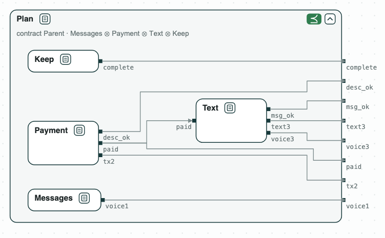
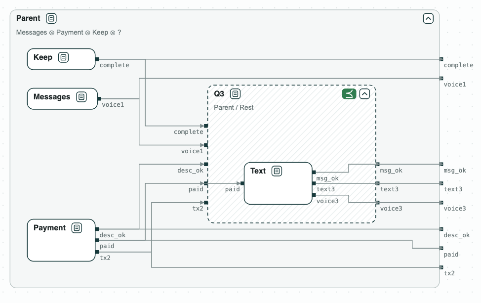

# AI agents: decomposing a task

**The question.** An AI agent splits a task among three sub-agents, each
with a contract over its tool calls. Do the contracts of the sub-agents,
together, refine the contract of the parent? If not, what is missing, and
which sub-agent must do it?

## From the task to contracts

The task is in natural language, with rules of the user (task 530b157_1 of
[AppWorld](https://arxiv.org/abs/2407.18901), Trivedi et al., ACL 2024):

> Kristin paid for the groceries. Pay her back on Venmo the amount in her
> text messages, with the note "Groceries", then send her the text message
> "It is done." (a text message, not a voice message).

The rules and what the user asked for become the contract of the parent
agent, a set of formulas over the tool calls. Each tool call of a sub-agent
is a Boolean variable (`tx2`: sub-agent 2 creates a Venmo transaction,
`text3`: sub-agent 3 sends a text, ...), and `paid` is the fact that the
Venmo tool writes once the payment is done.

<div class="tbl-rules" markdown>

| | Rule of the user | Formula |
|---|---|---|
| H1 | the text comes after the payment | `G (text3 -> paid)` |
| H2 | pay once | `G (paid -> G !tx2)` |
| H3 | the note is "Groceries" | `G (tx2 -> desc_ok)` |
| H4 | the text is "It is done." | `G (text3 -> msg_ok)` |
| H5 | no voice message | `G (!voice1 & !voice3)` |
| H6 | the payment is made | `F tx2` |
| H7 | the text is sent | `F text3` |
| H8 | the task is marked complete | `F complete` |

</div>

## The decomposition

The parent splits the task among three sub-agents, in this order, and keeps
the completion of the task. Each sub-agent gets the rules of the tools it
holds, and the payment goes to the only one that holds Venmo:

<div class="ctree">
  <div class="cnode parent">
    <h4>Parent</h4>
    <p class="what">does not use the apps itself; keeps the completion of the task</p>
    <p class="side">Guarantees (H)</p>
    <div class="cols">
      <ul>
        <li>H1 <code>G (text3 -&gt; paid)</code></li>
        <li>H2 <code>G (paid -&gt; G !tx2)</code></li>
        <li>H3 <code>G (tx2 -&gt; desc_ok)</code></li>
        <li>H4 <code>G (text3 -&gt; msg_ok)</code></li>
      </ul>
      <ul>
        <li>H5 <code>G (!voice1 &amp; !voice3)</code></li>
        <li>H6 <code>F tx2</code></li>
        <li>H7 <code>F text3</code></li>
        <li>H8 <code>F complete</code></li>
      </ul>
    </div>
  </div>
  <div class="stem"></div>
  <div class="kids">
    <div class="kid"><div class="cnode">
      <h4>1 Messages</h4>
      <p class="what">finds the amount in the text messages; holds the phone tools, voice messages among them</p>
      <p class="side">Guarantees</p>
      <ul><li><code>G !voice1</code></li></ul>
    </div></div>
    <div class="kid"><div class="cnode">
      <h4>2 Payment</h4>
      <p class="what">pays on Venmo; the only one with the Venmo tools</p>
      <p class="side">Guarantees</p>
      <ul>
        <li><code>G (paid -&gt; G !tx2)</code></li>
        <li><code>G (tx2 -&gt; desc_ok)</code></li>
        <li><code>F tx2</code></li>
        <li>and the Venmo tool writes <code>paid</code></li>
      </ul>
    </div></div>
    <div class="kid"><div class="cnode">
      <h4>3 Text</h4>
      <p class="what">sends the text; holds the phone tools</p>
      <p class="side">Assumes</p>
      <ul class="q"><li class="q"><code>F paid</code></li></ul>
      <p class="side">Guarantees</p>
      <ul>
        <li><code>G (text3 -&gt; paid)</code></li>
        <li><code>G (text3 -&gt; msg_ok)</code></li>
        <li><code>G !voice3</code></li>
        <li class="q"><code>F text3</code></li>
      </ul>
    </div></div>
    <div class="kid"><div class="cnode">
      <h4>Keep</h4>
      <p class="what">the part the parent keeps</p>
      <p class="side">Guarantees</p>
      <ul><li><code>F complete</code></li></ul>
    </div></div>
  </div>
  <p class="legend">The clauses in yellow are not in the first contract of sub-agent 3, which has
  only the rules of its tools: the quotient of step 2 asks for them.</p>
</div>

## The steps

<div class="tbl-steps" markdown>

| Step | Operation | Result |
|---|---|---|
| 1. The decomposition | `refines(Messages || Payment || Text || Keep, Parent)`, with the first contract of _Text_ | invalid: the payment is made, and the text is never sent |
| 2. What sub-agent 3 must do | Q3 = Parent / (Messages ∥ Payment ∥ Keep), with discharge | H1, H4, `G (!voice1 & !voice3)`, and `F text3` |
| 3. The repaired decomposition | `refines(Text, Q3)`, `refines(Messages || Payment || Text || Keep, Parent)` | valid |
| 4. A clause against the rules | `is_consistent(Parent with G !tx2, core=True)` | unsat, with the core `F tx2` and `G !tx2` |

</div>

Following the tools is not enough (step 1): two sub-agents hold the tools
to send the text, so no contract says which one must. The quotient (step 2)
is the weakest contract of sub-agent 3 with which the decomposition meets
the contract of the parent: it asks for the text. Sub-agent 3 with that
clause, starting once the payment is done, refines it, and the
decomposition refines the contract of the parent (step 3). A clause that
contradicts the rules of the user is found by consistency, and the unsat
core points to it (step 4).

Once checked, the contracts of the sub-agents can be enforced on their tool
calls at run time, for instance with
[ContrAgent](https://arxiv.org/abs/2609.18128). The formulas are read on
infinite traces, as CHASE reads them.

## Diagram

`agents.py` writes `out/agents.html`, the diagram of the demo, which opens in a browser: a click on a name shows the contract, and a click on a red tag marks its core.

[](../assets/diagram-ai-agents-1.png)
_The four sub-agents inside the contract of the parent: their composition refines it._

[](../assets/diagram-ai-agents-2.png)
_Q3 = Parent / Rest, what sub-agent 3 must do: Text refines it._

## Run it

```
$> git clone https://github.com/chase-cps/demos && cd demos
$> pip install chase-cps
$> chase-cps install nuxmv --accept-license
$> python3 AIAgents/agents.py
```

The directory also has the task, the decomposition, and the contracts in
words (`requirements.txt`).
