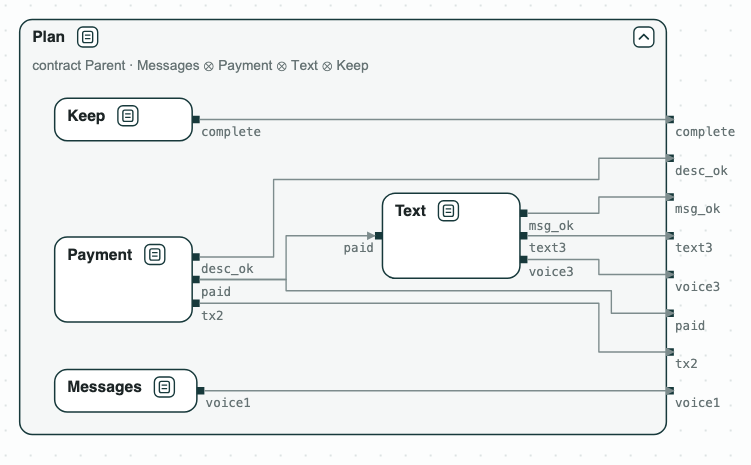
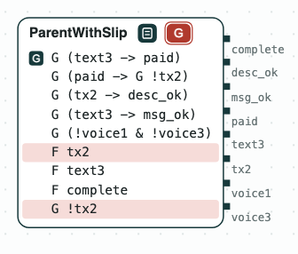

# AI agents: decomposing a task

**The question.** An AI agent splits a task among three sub-agents, each
with a contract over its tool calls. Do the contracts of the sub-agents,
together, refine the contract of the parent? If not, what is missing, and
which sub-agent must do it?

[](../assets/diagram-ai-agents-system.png)
_The plan: the sub-agents inside the contract of the parent._

The task comes from [AppWorld](https://arxiv.org/abs/2407.18901) (task
530b157_1): pay Kristin back on Venmo the amount in her text messages, with
the note "Groceries", then text her "It is done.", and send no voice
message. The rules of the user and what the user asked for are the contract
of the parent (H1 to H8), over the tool calls: `tx2` is a Venmo payment of
sub-agent 2, `text3` a text of sub-agent 3, `paid` what the Venmo tool
writes once the payment is done. _Messages_ (1) finds the amount, _Payment_
(2) pays, _Text_ (3) sends the text, and the parent keeps the completion of
the task (_Keep_).

## The steps

**Step 1. Contracts from the tools.** Each sub-agent gets the rules of the
tools it holds: _Text_ sends the text only after the payment (H1), with the
right words (H4), and no voice message. Together they do not refine the
parent: the counterexample pays and never sends the text. Sending it
(`F text3`, H7) is a goal, not a rule of a tool, so no sub-agent promises
it.

[](../assets/diagram-ai-agents-1.png)
_Step 1: the plan does not refine the parent; the parent asks for F text3, and Text does not promise it._

**Step 2. What sub-agent 3 must do.** The quotient Q3 = Parent /
(Messages ∥ Payment ∥ Keep) is the weakest contract of sub-agent 3 with
which the plan meets the parent: the rules of its tools, and `F text3`.

**Step 3. The repaired sub-agent.** _Text_ with `F text3`, which starts once
the payment is done (it assumes `F paid`), refines Q3, so the plan refines
the parent.

[](../assets/diagram-ai-agents-2.png)
_Steps 2 and 3: Q3, the hole, asks for F text3; Text refines it._

**Step 4. A clause against the rules.** If the parent also says "never pay"
(`G !tx2`), its contract is inconsistent, and the unsat core names the two
clauses in conflict: `F tx2` and `G !tx2`.

[](../assets/diagram-ai-agents-3.png)
_Step 4: the inconsistent parent, with its core on a red ground._

Once checked, the contracts of the sub-agents can be enforced on their tool
calls at run time, for instance with
[ContrAgent](https://arxiv.org/abs/2609.18128).

## Run it

```
$> git clone https://github.com/chase-cps/demos && cd demos
$> pip install chase-cps
$> chase-cps install nuxmv --accept-license
$> python3 AIAgents/agents.py
```

The script prints the result of each step and writes `out/agents.html`, the
diagrams above, to open in a browser: a click on a name opens a contract,
and a click on a red tag shows its core. The task, the plan, and the
contracts in words are in `AIAgents/requirements.txt`.
