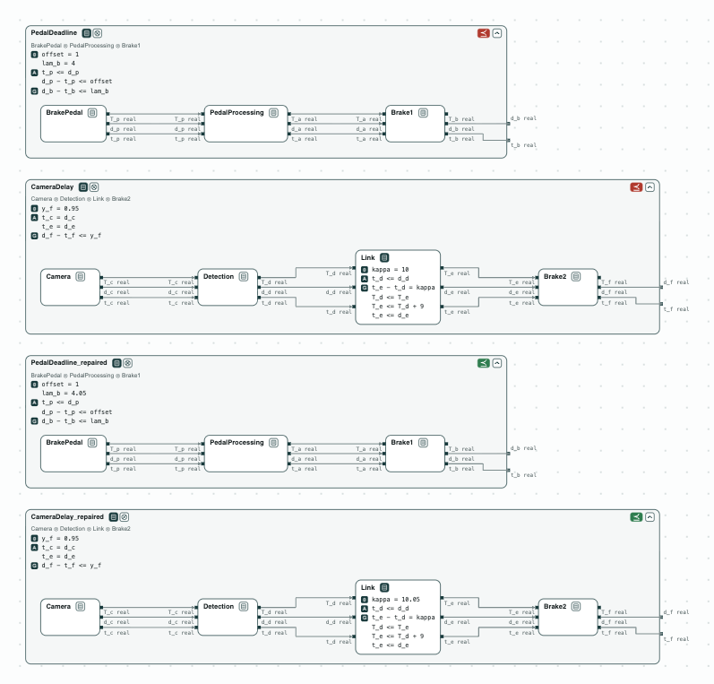
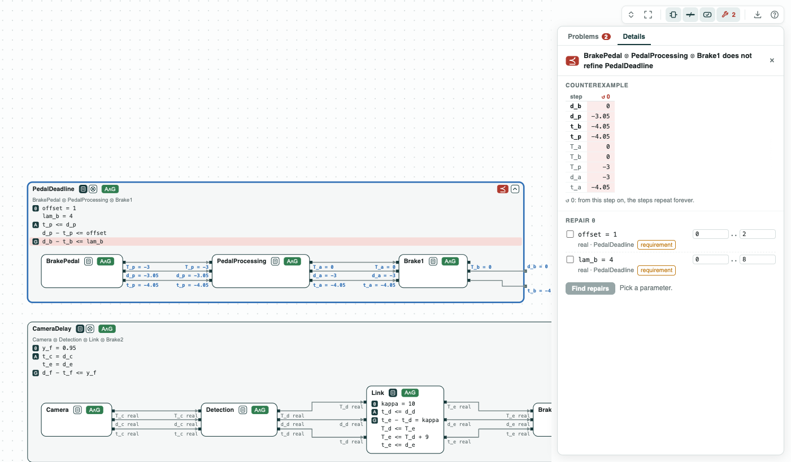
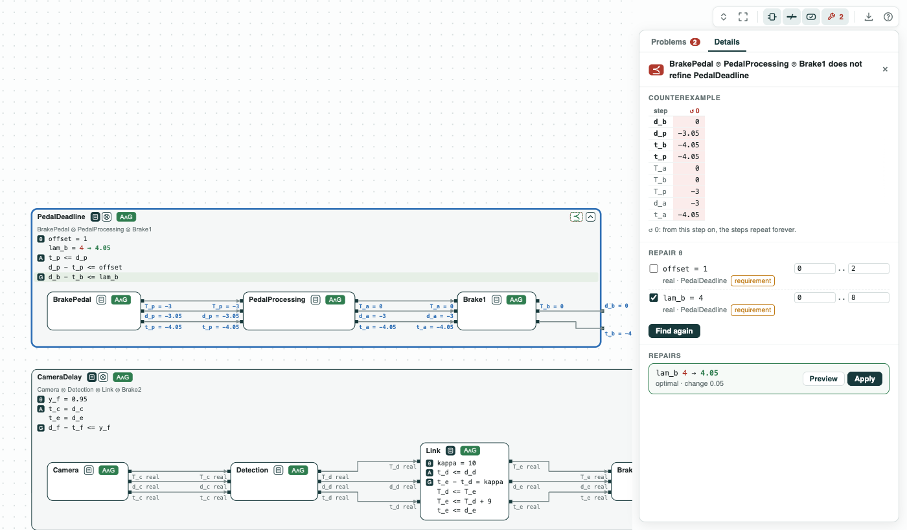
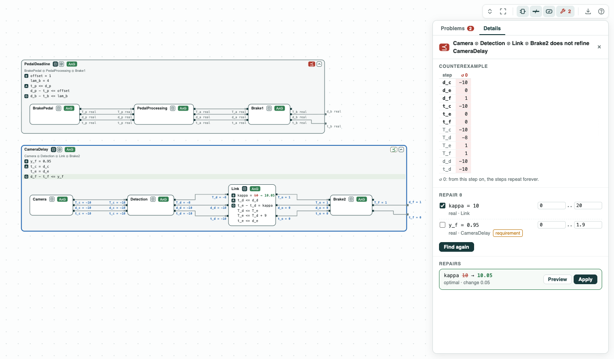

# Emergency braking: how much slack the timing needs, found by repair

**The question.** Brake 1 must start at most 4 ms after its timestamp,
but the camera path can delay it. How much must this bound grow, or the
network link change?

**The result.**

- The bound is violated: Brake 1 can start 4.05 ms after its timestamp.
- Repair of the bound: `lam_b = 4.05` ms, the least change, computed by
  z3 at once (quantifier elimination).
- Repair of the link: `kappa = 11` ms when Brake 1 may never wait, as in
  the paper; `kappa = 10.05` ms when Brake 1 uses its slack, a smaller
  change.

[](../assets/demos/braking/before-and-after-repair.png)
_The two paths before the repair (red) and after it (green)._

This is the braking system of ContrACT (Xiao, Lutz, Castillo-Effen,
Nuzzo, MEMOCODE 2026). On the camera path, the network `Link` schedules
Brake 2 `kappa` (10 ms) after the detection. Brake 1 and Brake 2 are
reactions of the same reactor: when Brake 2 waits for late data, Brake 1
waits too, up to 1 ms. The requirement _PedalDeadline_ bounds the start
of Brake 1 by `lam_b`; _CameraDelay_ bounds the wait of Brake 2 by `y_f`.
A repair is the least change of a named constant that makes a check pass.

## The steps

**Step 1. The bound is violated.** The pedal path does not refine
_PedalDeadline_. The pedal event is released 1 ms late, the pedal takes
0.05 ms and the processing 3 ms: Brake 1 starts 4.05 ms after its
timestamp.

[](../assets/demos/braking/pedal-path-counterexample.png)
_Step 1: the counterexample on the ports of the pedal path._

**Step 2. Repair the bound.** `repair` gives `lam_b = 4.05`, optimal, a
change of 0.05 ms: option A of the paper.

[](../assets/demos/braking/repair-lam-b.png)
_Step 2: lam_b 4 to 4.05, optimal._

**Step 3. Repair the link, no delay.** With `y_f = 0`, Brake 1 never
waits. The detection takes 2 ms and the link 9 ms, so the data can
arrive 1 ms after Brake 2 is scheduled. `repair` gives `kappa = 11`: option B of
the paper.

[](../assets/demos/braking/repair-kappa-no-delay.png)
_Step 3: with y_f = 0 (a copy of the file), kappa 10 to 11._

**Step 4. Repair the link, with slack.** On its own path Brake 1 starts
at most 3.05 ms late, so it can wait 0.95 ms. With `y_f = 0.95`,
`repair` gives `kappa = 10.05`, which the paper did not consider. The
script checks that 10.05 passes and 10.04 fails.

[](../assets/demos/braking/repair-kappa-absorbed.png)
_Step 4: with y_f = 0.95, kappa 10 to 10.05, optimal._

## Run it

```
pip install "chase-cps[z3]"
python braking.py --expect
chase-cps view braking.ltl --check --serve
```

The files of the demo are in the [repository](https://github.com/chase-cps/demos/tree/main/Braking); [Running the demos](running.md) says what the scripts print and how to use the diagrams.
