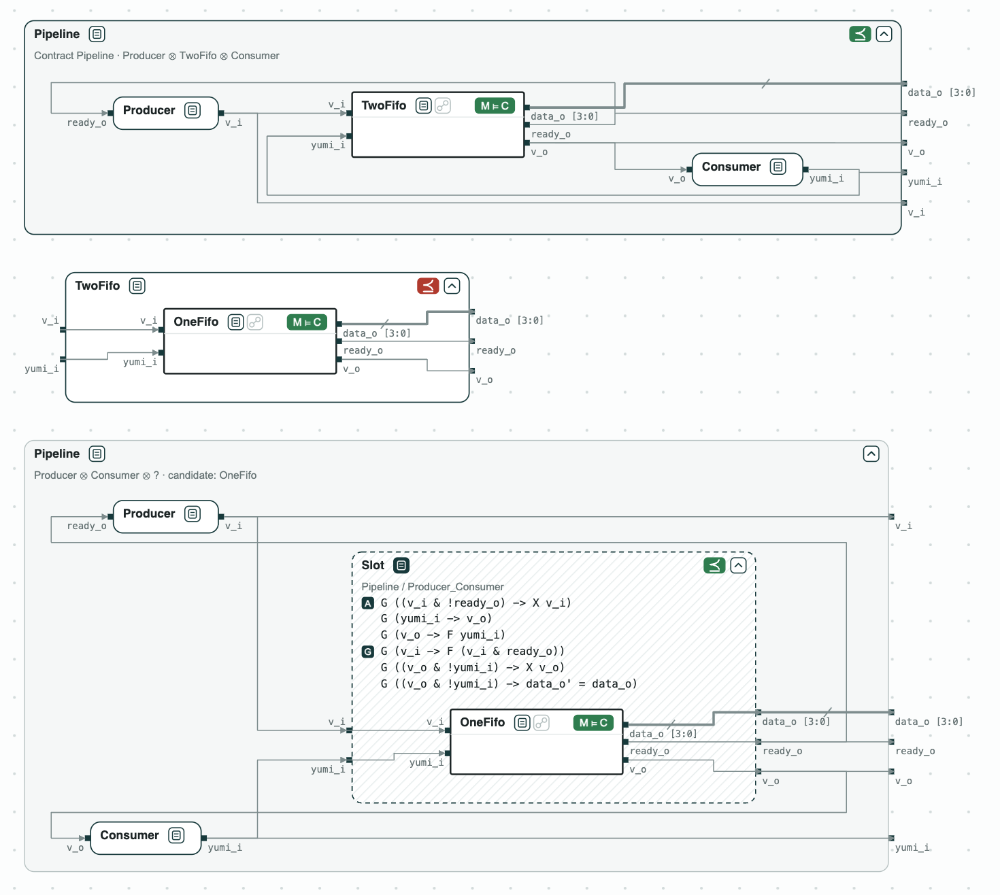
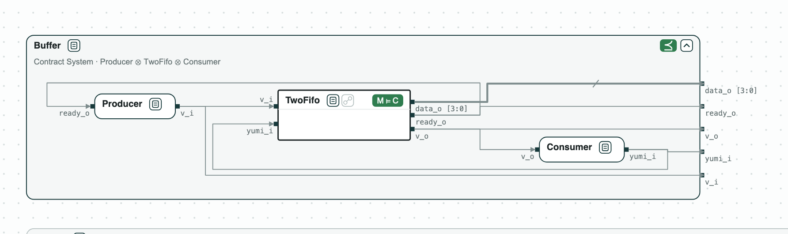
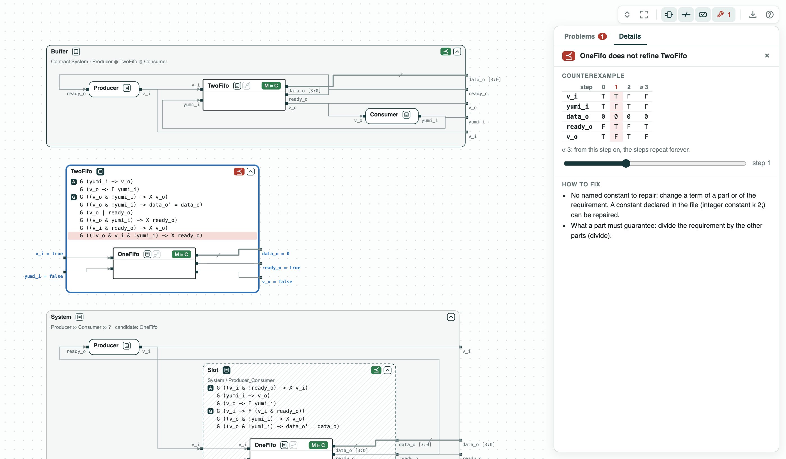
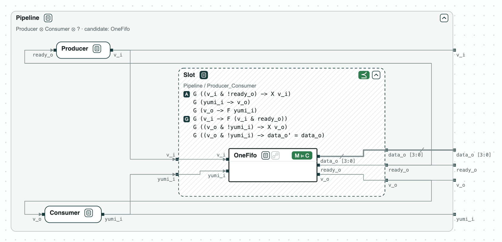
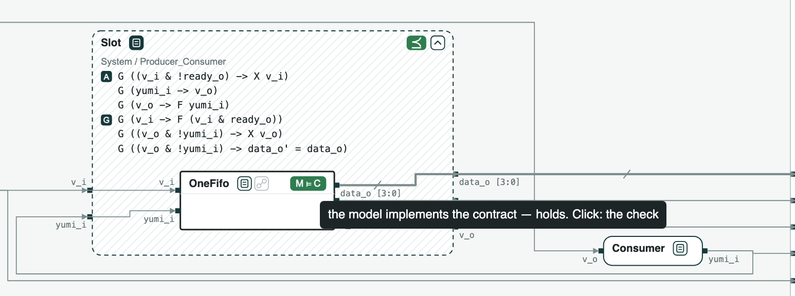

# Circuit buffer swap: the new buffer fails the old contract, but the quotient shows it fits

**The question.** A buffer of a circuit is replaced by a smaller one,
whose contract does not refine the old one. Can it take its place, and
what must any buffer in that place satisfy?

**The result.**

- Refinement: the new buffer does not refine the old one; the
  counterexample has 4 steps.
- Quotient (the weakest contract a missing part must meet): _Slot_, the
  contract of the place of the buffer, has 3 assumptions and 3
  guarantees; the new buffer refines it.
- RTL against contracts (Yosys and nuXmv): the RTL of `bsg_one_fifo`
  implements _OneFifo_ and _Slot_, not _TwoFifo_.

[{ width="839" }](../assets/demos/buffer-swap/overview-buffer-swap.png)
_The old system, OneFifo against TwoFifo, and OneFifo in Slot, the place of the buffer._

A producer sends data to a consumer through a buffer, with a ready/valid
handshake. The buffer is `bsg_two_fifo` of BaseJump STL, a FIFO of two
entries; the demo replaces it with `bsg_one_fifo`, of one entry. The
contracts are written in SystemVerilog Assertions.

## The steps

**Step 1. The old system.** _Producer_, _TwoFifo_, and _Consumer_,
composed, refine _Pipeline_, and the RTL of `bsg_two_fifo` implements
_TwoFifo_.

[{ width="834" }](../assets/demos/buffer-swap/step1-old-system.png)
_Step 1: the old system refines Pipeline; the RTL implements TwoFifo._

**Step 2. The new buffer against the old one.** _OneFifo_ does not refine
_TwoFifo_. In the counterexample of 4 steps, the empty buffer takes a
value at step 1 and is not ready at step 2, where _TwoFifo_ guarantees
that it is.

[](../assets/demos/buffer-swap/step2-onefifo-counterexample.png)
_Step 2: OneFifo does not refine TwoFifo; the guarantee it breaks in red._

**Step 3. What the place needs.** The quotient Slot = Pipeline / (Producer
⊗ Consumer), the dashed box, has 3 assumptions and 3 guarantees. _Slot_
may assume what the consumer guarantees, that an offer is taken sooner or
later, so one entry is enough: _OneFifo_ refines _Slot_, and the system
with _OneFifo_ refines _Pipeline_.

[{ width="823" }](../assets/demos/buffer-swap/step3-slot.png)
_Step 3: OneFifo refines Slot, the contract of the place._

**Step 4. On the RTL.** Yosys reads the RTL, and nuXmv checks it: the RTL
of `bsg_one_fifo` implements _OneFifo_ and _Slot_, and does not implement
_TwoFifo_. The script also writes _Slot_ as SVA (`out/slot.sv`), for
Jasper (`jasper/run.tcl`, not run by the script).

[{ width="463" }](../assets/demos/buffer-swap/step4-rtl-onefifo.png)
_Step 4: the RTL of bsg_one_fifo implements its contract (M ⊨ C)._

## Run it

```
pip install "chase-cps[rtl]"                # with Yosys
chase-cps install nuxmv --accept-license
python bufferswap.py --expect
```

The files of the demo are in the [repository](https://github.com/chase-cps/demos/tree/main/BufferSwap); [Running the demos](running.md) says what the scripts print and how to use the diagrams.
