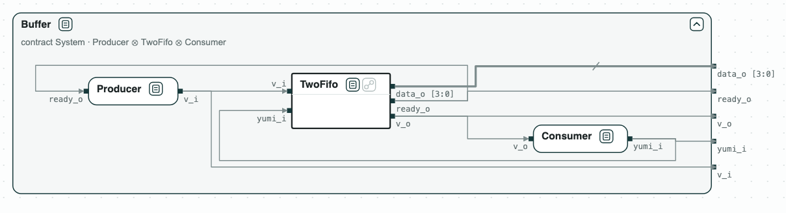
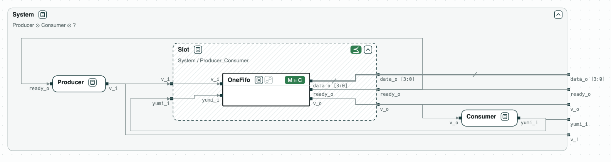
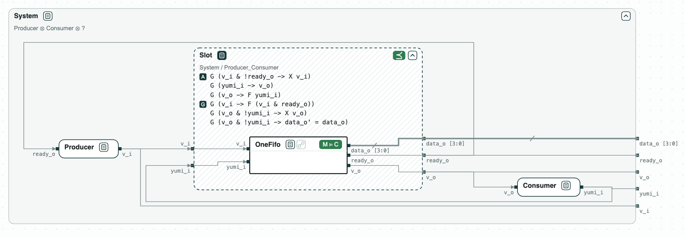

# Circuit buffer swap: a smaller buffer in its place

**The question.** A buffer of a circuit is replaced by a smaller one, whose
contract does not refine the old one. Can it take its place, and what must
any buffer in that place satisfy?

[](../assets/diagram-buffer-swap-system.png)
_The system: a producer, the buffer, and a consumer, with a ready/valid handshake._

A producer sends data to a consumer through a buffer, with a ready/valid
handshake:

- the producer offers a value (`v_i`), and the buffer takes it when it is
  ready (`ready_o`);
- the buffer offers a value (`v_o`), and the consumer takes it (`yumi_i`).

The buffer is `bsg_two_fifo` of BaseJump STL, a FIFO of two entries. The
demo replaces it with `bsg_one_fifo`, a FIFO of one entry. The contracts are
written in [SystemVerilog Assertions](../tools/systemverilog.md): every
offer is taken sooner or later, and what the buffer offers stays until it
is taken. The RTL is that of BaseJump STL.

## The steps

**Step 1. The old system.** The composition of _Producer_, _TwoFifo_, and
_Consumer_ refines _System_, and the RTL of `bsg_two_fifo` implements _TwoFifo_ (the diagram at
the top).

**Step 2. The new buffer against the old one.** _OneFifo_ does not refine
_TwoFifo_: with a value in, it takes no other. Its contract alone does not
say that it can take the place.

[](../assets/diagram-buffer-swap-2.png)
_Step 2: OneFifo does not refine TwoFifo._

**Step 3. What the place of the buffer needs.** The quotient Slot = System /
(Producer ∥ Consumer), drawn as a dashed box, is the weakest contract with which the system meets
its requirements. Any buffer that refines it can take the place, and
_OneFifo_ does: _Slot_ may assume what the consumer guarantees, that an
offer is taken sooner or later, so a buffer of one entry is enough.

[](../assets/diagram-buffer-swap-3.png)
_Step 3: OneFifo refines Slot, the contract of the place._

**Step 4. On the RTL.** The RTL of `bsg_one_fifo` implements _Slot_: Yosys
reads the RTL and nuXmv checks it. (M ⊨ C in the diagrams is the check of
each RTL against the contract of its box.)

## Run it

```
$> git clone https://github.com/chase-cps/demos && cd demos
$> pip install "chase-cps[rtl]"
$> chase-cps install nuxmv --accept-license
$> python3 BufferSwap/bufferswap.py
```

The script prints the result of each step and writes the diagrams above in
`BufferSwap/out/bufferswap.html`. It also writes _Slot_ as SVA in `BufferSwap/out/slot.sv`; with Jasper (a
commercial tool, optional here), `BufferSwap/jasper/run.tcl` proves it on
the RTL as well.
