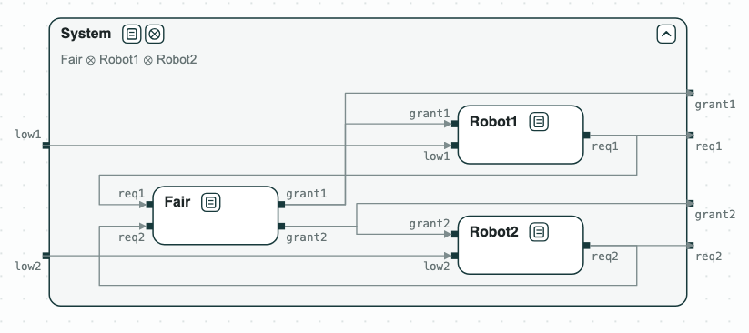
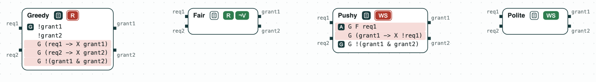
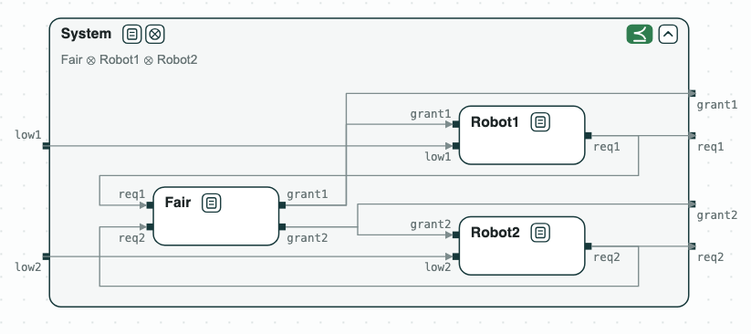
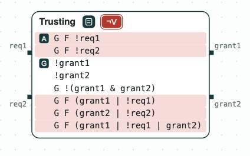

# Charging station: designing an arbiter

**The question.** Two robots share a charging station through an arbiter.
Which checks catch the problems of the first contracts of the arbiter, and
which contract works with the robots?

[](../assets/diagram-charger-system.png)
_The system: an arbiter and two robots, which feed each other with requests and grants._

A robot asks for the station (`req`) when its battery is low (`low`), and
the arbiter gives it (`grant`). The requests of the robots are the inputs of
the arbiter, and its grants are the inputs of the robots. Each candidate
arbiter guarantees that the station is never given to both robots (R5) and
is not given at the start (R4). The requirements are numbered as in
`Charger/requirements.txt`.

## The steps

**Step 1. Greedy: unrealizable.** _Greedy_ gives the station to each robot
at the next step after its request (R6.1, R6.2). When both robots ask at
once, it cannot serve both: the unrealizable core is R5, R6.1, and R6.2.

[](../assets/diagram-charger-1.png)
_Step 1: Greedy is unrealizable; the core highlighted in red._

**Step 2. Fair: realizable.** _Fair_ gives the station to each robot, or
the robot stops asking, infinitely often (R7.1, R7.2). It is realizable,
and slugs synthesizes a controller of 18 states. Its guarantee R8 is
redundant (R7.1 implies it) and is removed.

[](../assets/diagram-charger-2.png)
_Step 2: Fair is realizable._

**Step 3. Realizable for a bad reason.** _Pushy_ assumes that robot 1 asks
infinitely often (A2), and does not ask at the step after it is given the
station (A3). The arbiter can then give the station to robot 1 at every
step, even when it does not ask: by A3 robot 1 never asks again, A2 is
broken, and the contract holds because an assumption fails. The check of
well-separation finds it, with A2 and A3 as the core. _Polite_ assumes A4
instead of A3: robot 1 does not ask again only after a grant it asked for.
_Polite_ is well separated.

[](../assets/diagram-charger-3.png)
_Step 3: Pushy is not well separated (the core: A2, A3); Polite is._

**Step 4. An arbiter that never grants.** _Trusting_ assumes that each robot
does not ask infinitely often (`G F !req1`, `G F !req2`). Its guarantees
then hold without any grant: it is vacuous. The core is the two assumptions
and the three guarantees they make true. _Fair_ is not vacuous.

[](../assets/diagram-charger-4.png)
_Step 4: Trusting is vacuous; the core highlighted in red._

**Step 5. The arbiter with the robots.** _Fair_ and the robots are composed
with discharge (the guarantees of the arbiter discharge the assumptions of
the robots), and the composition refines _System_, the diagram at the top.

## Run it

```
$> git clone https://github.com/chase-cps/demos && cd demos
$> pip install chase-cps
$> chase-cps install nuxmv --accept-license
$> chase-cps install slugs
$> python3 Charger/charger.py
```

The script prints the result of each step and writes the diagrams above in
`out/charger.html`. The same steps with the console of logics_tool are in
`Charger/charger.chase`.
