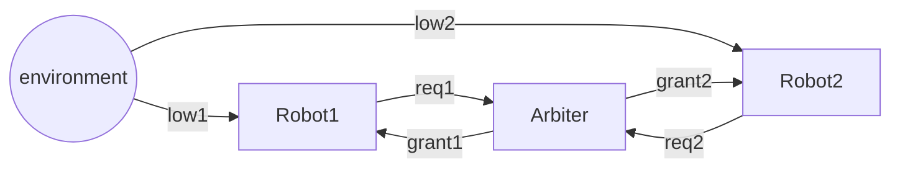
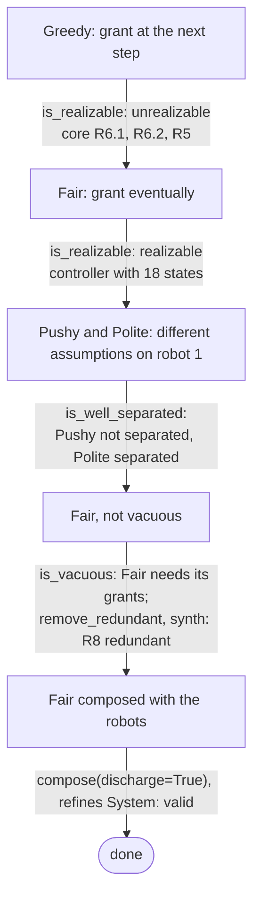
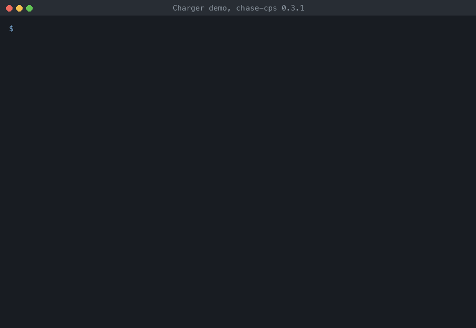

# Charger: diagnosis of an arbiter

Two robots share a charging station, and an arbiter gives the station to the
robots. The demo follows one design iteration of the arbiter: the
requirements of a first arbiter cannot be realized, a second one can be
realized but for a bad reason, and a third one is composed with the robots and
checked against the requirements of the whole system.



A robot asks for the station (`req`) when its battery is low (`low`), and
the arbiter gives it (`grant`). The robots and the arbiter feed each other:
the requests of the robots are the inputs of the arbiter, its grants are the
inputs of the robots.

## The design iteration



{ .recording }

1. **Greedy** gives the station to each robot at the next step after its
   request (R6.1, R6.2), and never to both (R5). It is unrealizable: when
   both robots ask at once, it cannot serve both. The unrealizable core
   names the three guarantees in conflict
   (GR(1) synthesis: `is_realizable(core=True)`). The composition
   of Greedy with the robots refines the system all the same
   (verification: `refines`): the refinement check does not see
   the conflict.
2. **Fair** gives the station to each robot eventually (R7.1, R7.2). It is
   realizable, and `synthesize` builds a controller with 18 states.
3. **Pushy** assumes that robot 1 asks for the station infinitely often (A2)
   and does not ask again right after it is given the station (A3). The
   arbiter can then give the station to robot 1 forever: robot 1 never asks
   again, A2 is violated, and the contract holds without serving anybody.
   `is_well_separated` finds it, with A2 and A3 as its core. **Polite**
   assumes A4 instead of A3, and is well-separated.
4. *Fair* is not vacuous: it cannot win without granting each robot. An
   arbiter that trusts the robots to stop asking on their own (G F !req1,
   G F !req2) is vacuous: it wins without granting. R8 is redundant: R7.1
   implies it. `remove_redundant` with `synth=True` removes it, and the
   contract stays realizable.
5. The arbiter and the robots are composed with discharge
   (contract algebra, with model checking): the
   assumptions of the robots (A1.1, A1.2) are discharged by the guarantees of
   the arbiter (R7.1, R7.2), no assumption is left, and the composition
   refines the system.

## Run it

```
$> git clone https://github.com/chase-cps/demos && cd demos
$> pip install chase-cps
$> chase-cps install nuxmv --accept-license && chase-cps install slugs
$> python3 Charger/charger.py
```

The directory also has the requirements (`requirements.txt`), the contracts
(`charger.ltl`, with the number of the requirement on each line), and the same
iteration with the console of logics_tool (`charger.chase`), which writes the
files for slugs and nuXmv.
