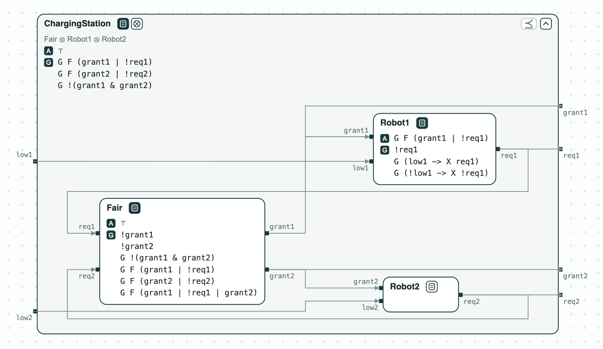
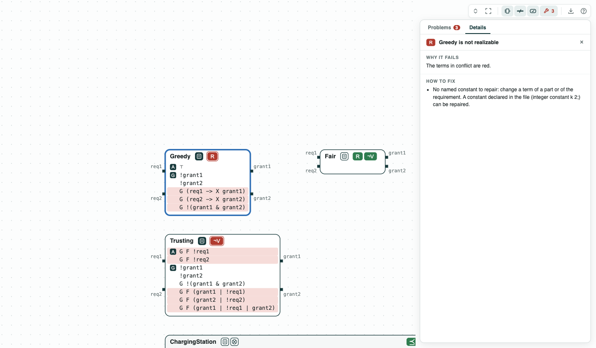
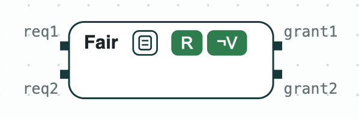
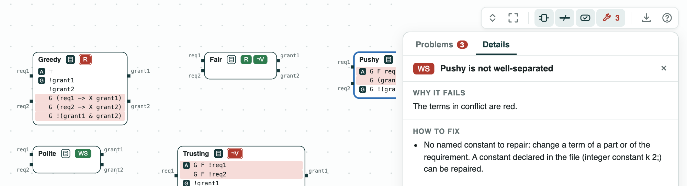
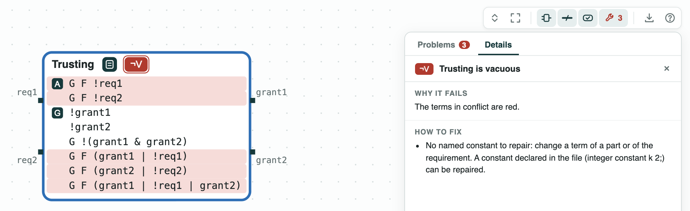
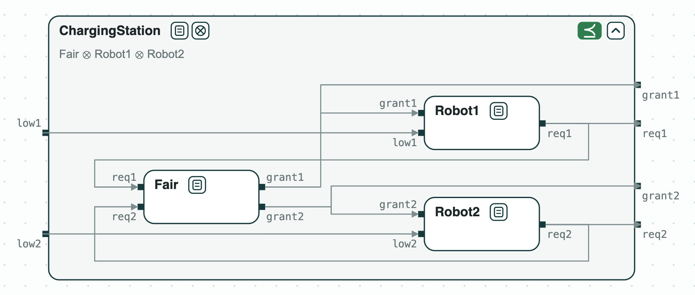

# Robot charging station: refinement does not see the conflict, realizability does

**The system.** Two robots share one charging station, and an arbiter
decides who charges. This is a teaching example, made for these pages;
its requirements are numbered in `requirements.txt`. Robot _i_ asks for
the station (`req_i`) when its battery is low (`low_i`), and assumes
that it gets it (`grant_i`), or stops asking, infinitely often. The
arbiter reads the requests and sets the grants; it must never give the
station to both robots, `G !(grant1 & grant2)`. The contracts are in
LTL over Booleans, in the GR(1) form of the synthesis tool slugs, so
CHASE can ask whether a controller can be built from a contract
(realizable) and build it. _ChargingStation_ is the contract of
the whole system.

**The question.** Five candidate arbiters are written: _Greedy_,
_Fair_, _Pushy_, _Polite_, and _Trusting_. Four of them are flawed in a
different way. Which check catches which flaw, and which arbiter works
with the robots?

[{ width="707" }](../assets/demos/charger/system.png)
_The system: an arbiter (here Fair) between the two robots, inside ChargingStation._

## The steps

**Step 1. Greedy: unrealizable, yet it refines.** _Greedy_ grants each
request at the next step, `G (req1 -> X grant1)` and the same for robot
2. When both robots ask at once it cannot serve both without breaking
`G !(grant1 & grant2)`: it is unrealizable, no arbiter can do it. The
unrealizable core, the smallest set of guarantees in conflict, is these
three formulas. Yet _Greedy_ with the robots refines _ChargingStation_:
refinement only compares formulas (every behavior allowed by the parts
is allowed by the system) and does not ask whether a part can exist.

[](../assets/demos/charger/step1-greedy-unrealizable.png)
_Step 1: the core of Greedy in red._

**Step 2. Fair: realizable.** _Fair_ gives the station to each robot, or
the robot stops asking, infinitely often, `G F (grant1 | !req1)` and the
same for robot 2. It is realizable, and slugs builds a controller of 18
states. It is not vacuous: it cannot meet its guarantees without setting
its outputs (¬V). `remove_redundant` removes its last guarantee,
`G F (grant1 | !req1 | grant2)`, implied by the first one.

[{ width="192" }](../assets/demos/charger/step2-fair-realizable.png)
_Step 2: Fair is realizable (R) and not vacuous (¬V)._

**Step 3. Realizable for a bad reason.** _Pushy_ assumes that robot 1
asks infinitely often, `G F req1`, but never right after a grant,
`G (grant1 -> X !req1)`. By granting robot 1 at every step, the arbiter
makes the robot break the first assumption, and then owes nothing. A
contract is well separated (WS) when the component cannot win this way;
_Pushy_ is not, and the core is the two assumptions. _Polite_, which
assumes `G ((req1 & grant1) -> X !req1)` instead, is well separated.

[](../assets/demos/charger/step3-pushy-not-well-separated.png)
_Step 3: Pushy is not well separated; Polite is._

**Step 4. An arbiter that never grants.** _Trusting_ is _Fair_ with two
more assumptions, `G F !req1` and `G F !req2`: each robot stops asking
infinitely often. Its guarantees then hold with no grant at all: it is
vacuous. The core is the two assumptions and the guarantees they make
true.

[](../assets/demos/charger/step4-trusting-vacuous.png)
_Step 4: Trusting is vacuous (¬V red)._

**Step 5. The arbiter with the robots.** _Fair_ and the robots feed each
other. Composed with discharge (an assumption of one part that another
part guarantees is dropped), they leave no assumption, and refine
_ChargingStation_.

[{ width="532" }](../assets/demos/charger/step5-arbiter-and-robots.png)
_Step 5: the composition refines ChargingStation._

Each check of steps 1 to 4 is one call; by hand, each flaw means
reasoning about every strategy of the robots. The checks are in [GR(1) synthesis](../tools/synthesis.md),
the tags of the pictures in
[Diagrams](../interfaces/diagrams.md#what-is-drawn).

## Run it

```
pip install chase-cps
chase-cps install nuxmv --accept-license
chase-cps install slugs
python charger.py --expect
```

The files of the demo are in the [repository](https://github.com/chase-cps/demos/tree/main/Charger); [Running the demos](running.md) says what the scripts print and how to use the diagrams.
