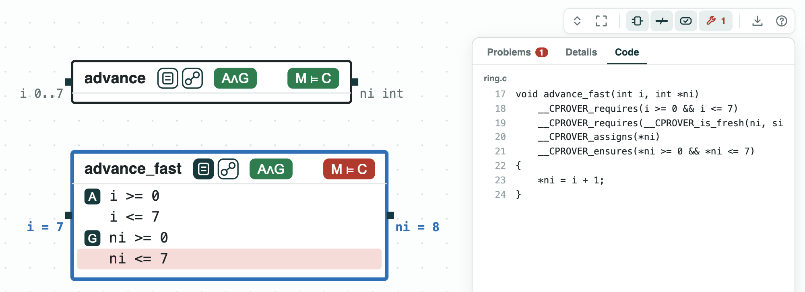
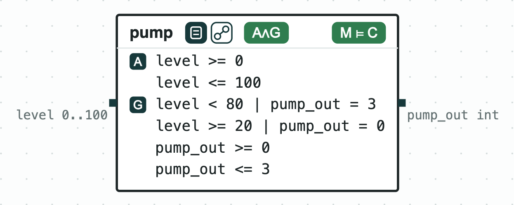
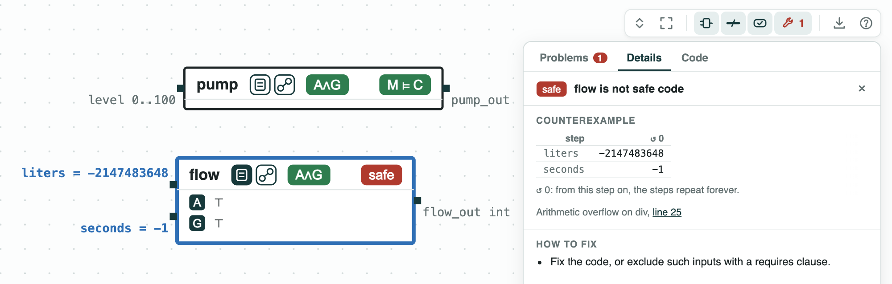
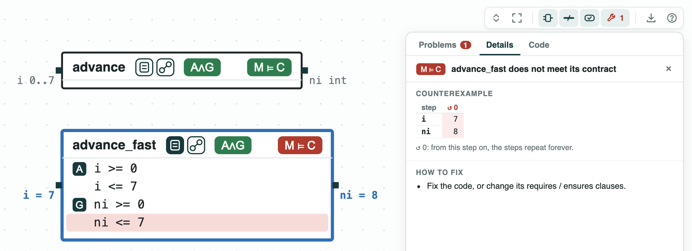

# Contracts in C: each function checked against the clauses in its file

**The question.** ESBMC, CBMC, and Frama-C read a contract written in the
C file: `requires` clauses (what a call may assume) and `ensures` clauses
(what the function must give back). Can CHASE read the same file and
check each function?

**The result.**

- `chase-cps view FILE.c` draws each function as a component; its
  contract is read from the clauses of ESBMC, CBMC, or ACSL (Frama-C).
- `pump`, `advance`, and `limit` meet their contracts, in about 0.1 s
  per function.
- A failure gives a call on the ports: for `advance_fast`, the slot
  `i = 7` gives `ni = 8`, and the term it breaks is red.
- Code with no clause is checked alone: `flow` overflows for
  `liters = -2147483648`, `seconds = -1`.

[](../assets/demos/contracts-in-c/overview-ring-c-code.png)
_ring.c drawn: each function is a component; the Code tab shows <code>advance_fast</code> with its clauses._

The requires clauses are the assumptions, the ensures clauses the
guarantees; ESBMC (or CBMC) checks the function. The clauses CHASE reads
are on the page https://chase-cps.github.io/tools/c-programs/.

## The steps

**Step 1. The pump meets its contract.** `pump` (clauses of ESBMC), the
pump of a water tank for one call, runs at full speed from a level of 80
and is off below 20. It meets its contract.

[](../assets/demos/contracts-in-c/step1-pump-meets-contract.png)
_Step 1: <code>pump</code> meets the contract read from its clauses._

**Step 2. Code with no clause.** `flow` is checked for overflow, division
by zero, and failed asserts (the tag `safe`). `liters / seconds`
overflows for `liters = -2147483648`, `seconds = -1`; the panel gives the
line.

[](../assets/demos/contracts-in-c/step2-flow-unsafe.png)
_Step 2: <code>flow</code> is not safe code._

**Step 3. The ring buffer, with and without the wrap.** `advance`
(clauses of CBMC) gives the next slot of a ring buffer of 8 slots, and
meets its contract. `advance_fast` does not wrap at the end: the slot
`i = 7` gives `ni = 8`, and the term `ni <= 7` is red.

[](../assets/demos/contracts-in-c/step3-advance-fast-fails.png)
_Step 3: <code>advance</code> meets its contract, <code>advance_fast</code> does not._

**Step 4. A contract in ACSL.** `climb.c` limits the climb rate of the
drone of DroneAltitude to 3, with its contract in a `/*@ ... */` comment.
`limit` meets it (ESBMC checks it; Frama-C is not run). `limit_loose`
tests the top with `v > 4`, so `v = 4` gives 4.

[](../assets/demos/contracts-in-c/step6-limit-loose-fails.png)
_Step 4: <code>limit</code> meets its ACSL contract, <code>limit_loose</code> does not._

## Run it

```
pip install "chase-cps[z3]"      # and ESBMC or CBMC
python contractsinc.py --expect
```

The files of the demo are in the [repository](https://github.com/chase-cps/demos/tree/main/ContractsInC); [Running the demos](running.md) says what the scripts print and how to use the diagrams.
