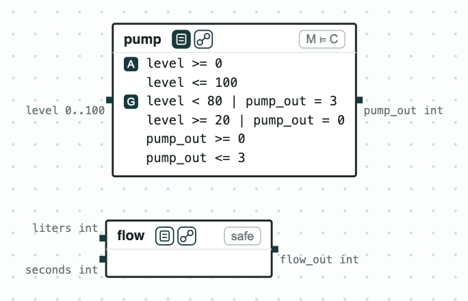

# Contracts in C: each function checked against the clauses in its file

**The system.** Small C functions of controllers: the pump of a water
tank (`tank.c`), a ring buffer (`ring.c`), and a limit on the climb rate
of a drone (`climb.c`). Their contracts are written in the C file itself,
as the C checkers ESBMC, CBMC, and Frama-C read them: `requires` clauses
say what a call may assume (the assumptions of the contract), `ensures`
clauses what the function must give back (its guarantees). CHASE reads
these clauses, in any of the three syntaxes, and draws each function as
a component whose inputs are its parameters and whose output is its
return value. ESBMC (or CBMC) checks one call of the function against
its contract. The clauses CHASE reads are listed on the page
[C programs](../tools/c-programs.md).

**The question.** Does each function meet the contract written next to
it, and what does a failure look like? Code with no contract at all:
can it at least be checked for overflow? The same file then serves the
C checker and the contracts of a whole system.

[{ width="338" }](../assets/demos/contracts-in-c/system.png)
_The system of <code>tank.c</code>: <code>pump</code>, with the terms read from its clauses, and <code>flow</code>, with none._

## The steps

**Step 1. The pump meets its contract.** `pump` (clauses of ESBMC) runs
at full speed (3) from a level of 80 and is off below 20. ESBMC proves
that every call within the assumed levels, 0 to 100, gives back what the
contract asks, in about 0.1 s (the tag M ⊨ C).

[{ width="322" }](../assets/demos/contracts-in-c/step1-pump-meets-contract.png)
_Step 1: <code>pump</code> meets the contract read from its clauses._

**Step 2. Code with no clause.** `flow` divides the liters by the
seconds. With no contract, it is checked for overflow, division by zero,
and failed asserts (the tag `safe`). `liters / seconds` overflows for
`liters = -2147483648`, `seconds = -1`; the panel gives the line.

[](../assets/demos/contracts-in-c/step2-flow-unsafe.png)
_Step 2: <code>flow</code> is not safe code._

**Step 3. The ring buffer, with and without the wrap.** `advance`
(clauses of CBMC) gives the next slot of a ring buffer of 8 slots, and
meets its contract. `advance_fast` does not wrap at the end: the slot
`i = 7` gives `ni = 8`, and the term `ni <= 7` is red. The failing call
is on the ports, ready to replay.

[](../assets/demos/contracts-in-c/step3-advance-fast-fails.png)
_Step 3: <code>advance</code> meets its contract, <code>advance_fast</code> does not._

**Step 4. A contract in ACSL.** `climb.c` limits the climb rate of the
drone of the page [Drone climb](drone-altitude.md) to 3,
with its contract in an ACSL comment, `/*@ ... */`, the language of
Frama-C. `limit` meets it (ESBMC checks it; Frama-C is not run).
`limit_loose` tests the top with `v > 4`, so `v = 4` gives 4.

[](../assets/demos/contracts-in-c/step6-limit-loose-fails.png)
_Step 4: <code>limit</code> meets its ACSL contract, <code>limit_loose</code> does not._

Once read, a function is a contract like any other: it can be composed
with the others and checked against the contract of a system, as in
[Fire-suppression drones in C](drone-grid.md). The tags of
the pictures are explained on the page
[Diagrams](../interfaces/diagrams.md#what-is-drawn).

## Run it

```
pip install "chase-cps[z3]"      # and ESBMC or CBMC
python contractsinc.py --expect
```

The files of the demo are in the [repository](https://github.com/chase-cps/demos/tree/main/ContractsInC); [Running the demos](running.md) says what the scripts print and how to use the diagrams.
