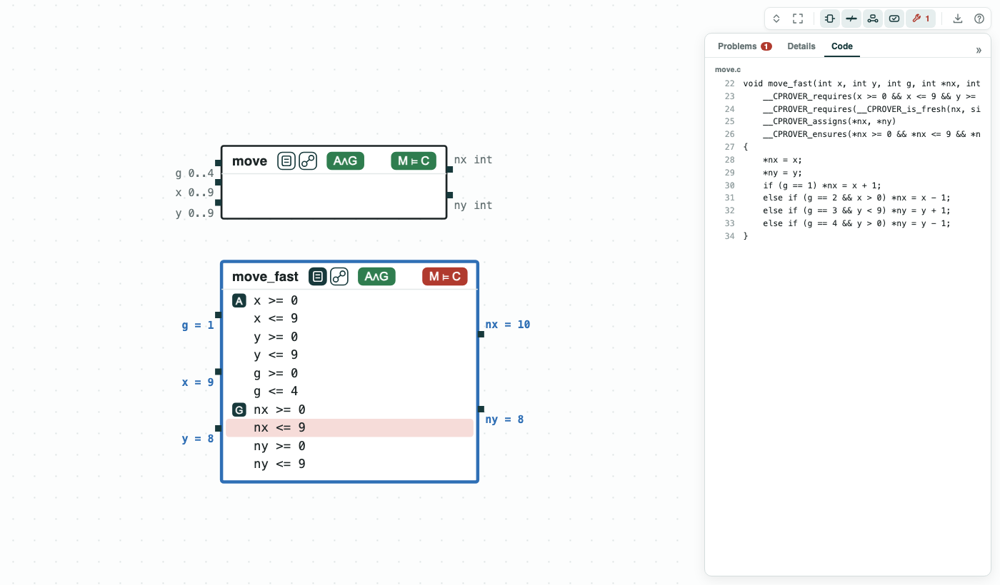
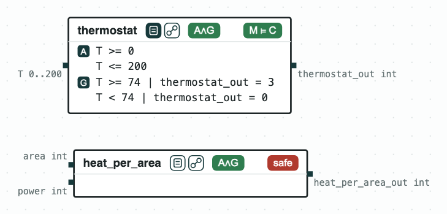
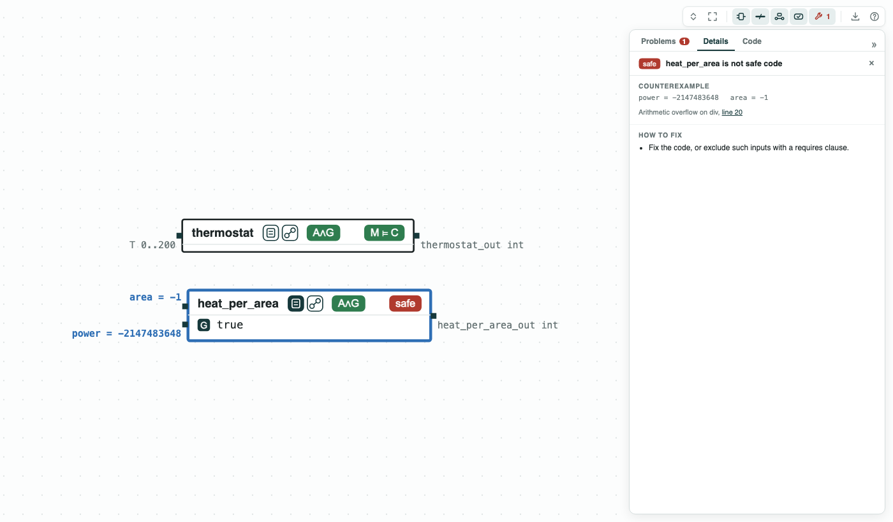
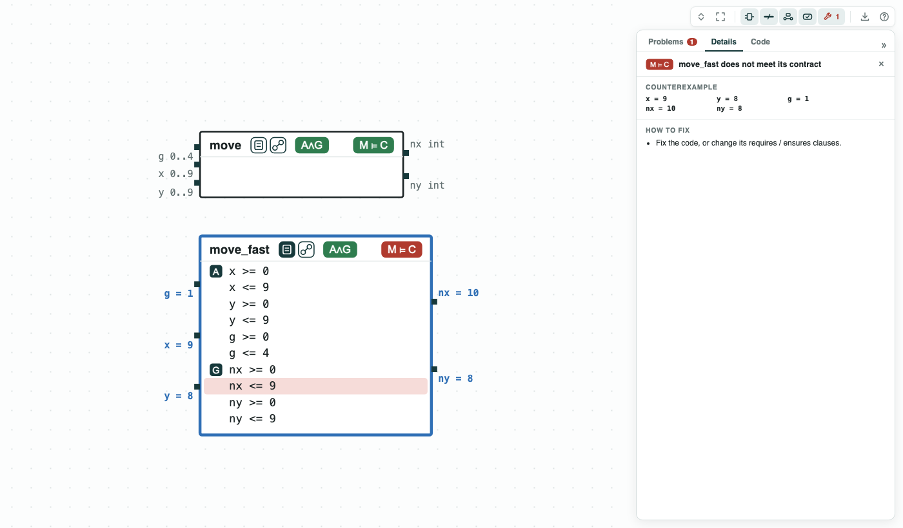
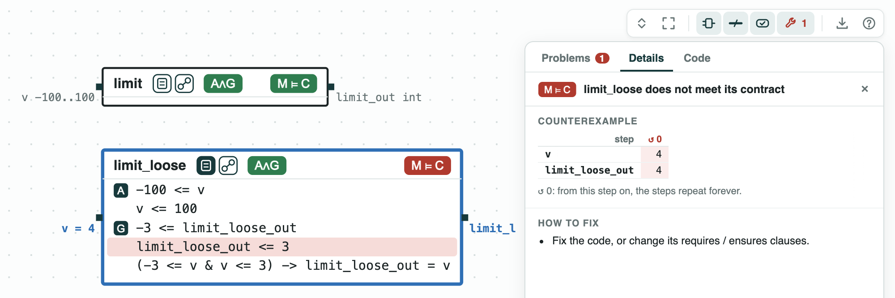

# Contracts in C: each function checked against the clauses in its file

**The question.** ESBMC, CBMC, and Frama-C read a contract written in the
C file: `requires` clauses (what a call may assume) and `ensures` clauses
(what the function must give back). Can CHASE read the same file and
check each function?

**The result.**

- `chase-cps view FILE.c` draws each function as a component; its
  contract is read from the clauses of ESBMC, CBMC, or ACSL (Frama-C).
- `thermostat`, `move`, and `limit` meet their contracts, in about 0.1 s
  per function.
- A failure gives a call on the ports: for `move_fast`, `x = 9` and the
  move `g = 1` give `nx = 10`, and the term it breaks is red.
- Code with no clause is checked alone: `heat_per_area` overflows for
  `power = -2147483648`, `area = -1`.

[](../assets/demos/contracts-in-c/overview-move-c-code.png)
_move.c drawn: each function is a component; the Code tab shows <code>move_fast</code> with its clauses._

The requires clauses are the assumptions, the ensures clauses the
guarantees; ESBMC (or CBMC) checks the function. The clauses CHASE reads
are on the page https://chase-cps.github.io/tools/c-programs/.

## The steps

**Step 1. The thermostat meets its contract.** `thermostat` (clauses of
ESBMC), the thermostat of Heater for one call, heats while `T < 74`. It
meets its contract.

[](../assets/demos/contracts-in-c/step1-thermostat-meets-contract.png)
_Step 1: <code>thermostat</code> meets the contract read from its clauses._

**Step 2. Code with no clause.** `heat_per_area` is checked for overflow,
division by zero, and failed asserts (the tag `safe`). `power / area`
overflows for `power = -2147483648`, `area = -1`; the panel gives the
line.

[](../assets/demos/contracts-in-c/step2-heat-per-area-unsafe.png)
_Step 2: <code>heat_per_area</code> is not safe code._

**Step 3. The move, with and without the test at the edge.** `move`
(clauses of CBMC), the move of a drone of DroneGrid on a 10 x 10 grid,
meets its contract. `move_fast` has no test at the edge: from `x = 9`,
the move `g = 1` gives `nx = 10`, and the term `nx <= 9` is red.

[](../assets/demos/contracts-in-c/step4-move-fast-fails.png)
_Step 3: <code>move</code> meets its contract, <code>move_fast</code> does not._

**Step 4. A contract in ACSL.** `climb.c` limits the climb rate of the
drone of DroneAltitude to 3, with its contract in a `/*@ ... */` comment.
`limit` meets it (ESBMC checks it; Frama-C is not run). `limit_loose`
tests the top with `v > 4`, so `v = 4` gives 4.

[](../assets/demos/contracts-in-c/step6-limit-loose-fails.png)
_Step 4: <code>limit</code> meets its ACSL contract, <code>limit_loose</code> does not._

## Run it

```
pip install "chase-cps[z3]"      # and ESBMC or CBMC
python contractsinc.py --expect
```

The files of the demo are in the [repository](https://github.com/chase-cps/demos/tree/main/ContractsInC); [Running the demos](running.md) says what the scripts print and how to use the diagrams.
