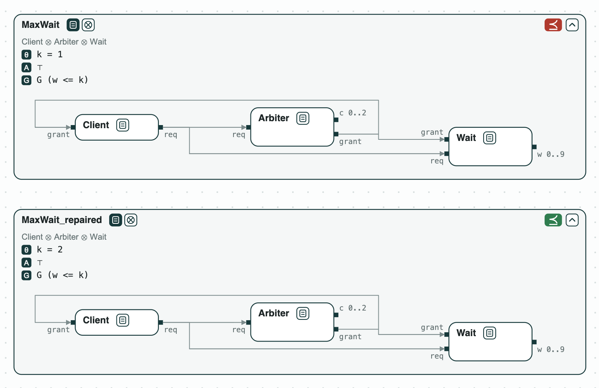
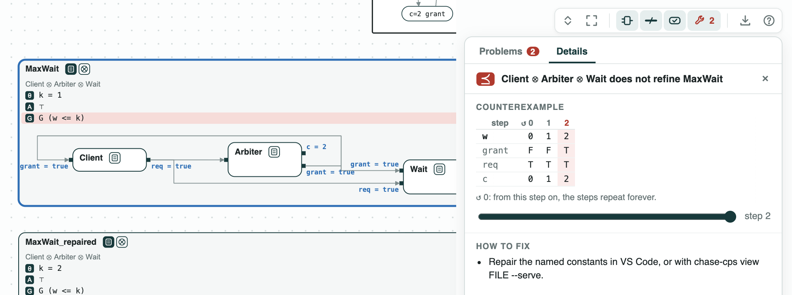
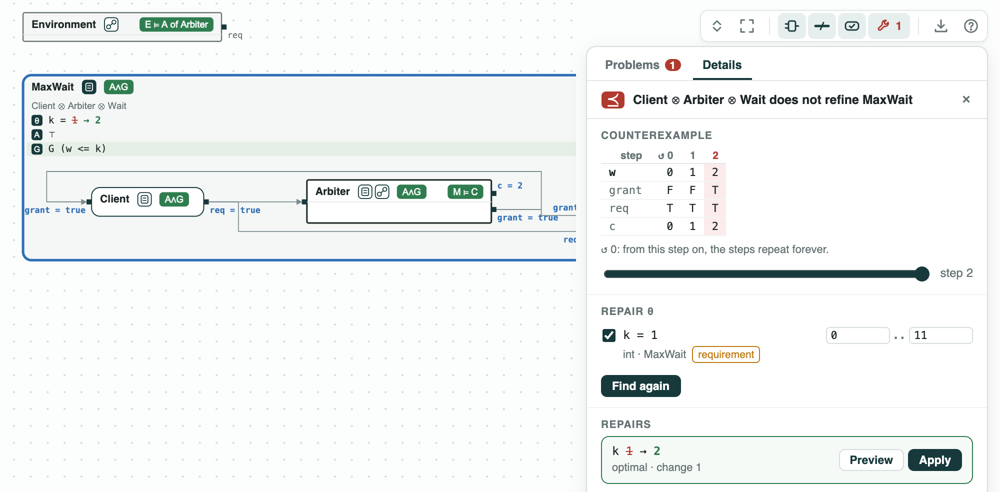
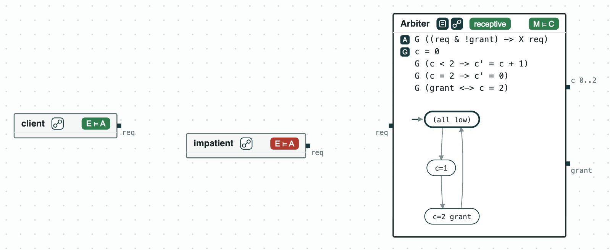

# Resource arbiter: the least bound on a waiting time

**The question.** A client waits for a resource that an arbiter grants
every third step. What is the least bound `k` such that no request waits
more than `k` steps?

**The result.**

- Counterexample over an infinite run (LTL, nuXmv): with `k = 1`, a
  request waits 2 steps, and the run loops.
- Repair by counterexamples: `k = 2`, the least value, in 2 rounds, each
  candidate checked by nuXmv.
- The same answer by brute force, checking each `k` from 0 to 9.
- The arbiter written as a state machine in SMV implements its contract
  and takes every request (receptive); a client in SMV is checked as its
  environment.

[](../assets/demos/deadline/before-and-after-repair.png)
_Before the repair (k = 1, ⪯ red) and after it (k = 2, green)._

The contracts are in `deadline.ltl`. _Client_ keeps asking (`req`) until
it is granted. _Arbiter_ counts `c` = 0, 1, 2, 0, ... and grants when
`c = 2`. _Wait_ counts in `w` the steps a request has waited. _MaxWait_ is
the requirement `G (w <= k)`, with the named constant `k` at 1. The
formulas are LTL over an infinite run, so nuXmv checks them.

## The steps

**Step 1. The bound is too small.** _Client_, _Arbiter_, and _Wait_
composed do not refine _MaxWait_. In the counterexample, a request at
`c = 0` is granted at `c = 2`: it waits 2 steps (`w = 2`), and the run
goes back to step 0.

[](../assets/demos/deadline/wait-counterexample.png)
_Step 1: w reaches 2 at step 2, when the grant comes._

**Step 2. Repair the bound.** `repair` finds `k = 2`. Each round
optimizes `k` under the condition that the counterexamples found so far
are no longer counterexamples (one with `w = 2` gives `k >= 2`), then
checks the refinement with nuXmv. Two rounds: `k = 1` fails, `k = 2`
passes. Each condition only removes values that cannot work, so the
value that passes is optimal. Checking `k = 0, 1, ..., 9` one by one
with nuXmv gives the same answer.

[](../assets/demos/deadline/repair-k.png)
_Step 2: Find repairs, k picked: 1 to 2, optimal._

**Step 3. The arbiter and the client as state machines.** _Arbiter_
assumes that a request is held until it is granted. `arbiter.smv` writes
the arbiter in SMV, with `req` as an input (`IVAR`): it implements
_Arbiter_ (M ⊨ C) and is receptive: it takes every request the
assumption allows. `refusing.smv` adds `TRANS c = 0 -> !req`: it still
implements _Arbiter_, but only because it refuses a request after
`c = 2`, and the receptiveness check says so. On the other side,
`client.smv` is an environment of _Arbiter_ (E ⊨ A); `impatient.smv`,
which may stop asking before the grant, is not: its counterexample asks
at step 0 and stops at step 1.

[](../assets/demos/deadline/step3-arbiter-and-clients.png)
_Step 3: the arbiter as a state machine, and the two clients._

## Run it

```
pip install "chase-cps[z3]"
chase-cps install nuxmv --accept-license
python deadline.py --expect
chase-cps view deadline.ltl --check --serve
chase-cps check deadline.ltl --recep refusing.smv Arbiter --env impatient.smv Arbiter
```

The files of the demo are in the [repository](https://github.com/chase-cps/demos/tree/main/Deadline); [Running the demos](running.md) says what the scripts print and how to use the diagrams.
