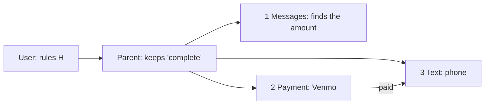

# Delegation: a task split among AI agents

**The question.** A parent agent splits a task among three sub-agents and
gives each one a contract over its tool calls. Do the sub-agents, together,
keep every rule of the user and deliver what the user asked for? If not,
what is missing, and who should do it?

This is the decomposition of a system contract into the contracts of its
components, with the components being AI agents and the behaviors being
their tool calls. The task is 530b157_1 of
[AppWorld](https://arxiv.org/abs/2407.18901) (Trivedi et al., ACL 2024):
pay a friend back on Venmo, with the note "Groceries", then text her "It
is done.". The plan and the contracts are those of a run of ACORN, whose
contracts are those of [ContrAgent](https://arxiv.org/abs/2609.18128):
temporal formulas over the tool calls of an agent. Each tool call of a
sub-agent is a Boolean variable (a call does not say who makes it, so each
sub-agent has its own), and `paid` is the fact that the Venmo tool writes.



## The contracts

| Contract | Guarantees |
|---|---|
| _Parent_ (H) | H1 `G (text3 -> paid)`, H2 `G (paid -> G !tx2)`, H3 `G (tx2 -> desc_ok)`, H4 `G (text3 -> msg_ok)`, H5 `G (!voice1 & !voice3)`, H6 `F tx2`, H7 `F text3`, H8 `F complete` |
| _Messages_ (1) | `G !voice1`: the rule of the voice tool it holds |
| _Payment_ (2) | H2, H3, H6, and how the Venmo tool writes `paid` |
| _Text_ (3), from its tools | H1, H4, `G !voice3` |
| _Text_ (3), as written in the run | the same, and `F text3`, assuming `F paid` (it starts when the payment is done) |
| _Keep_ (the parent) | H8 |

## The steps

| Step | Operation | Result |
|---|---|---|
| 1. The plan from the tools | `refines(Messages ∥ Payment ∥ Text ∥ Keep, Parent)`, with the contract of _Text_ from its tools | invalid: the payment is made and the text is never sent |
| 2. What sub-agent 3 must do | Q3 = Parent / (Messages ∥ Payment ∥ Keep), with discharge | H1, H4, `G (!voice1 & !voice3)`, `F text3` |
| 3. The plan as run | `refines(Text, Q3)`, `refines(Messages ∥ Payment ∥ Text ∥ Keep, Parent)` | valid |
| 4. A slip of the parent | `is_consistent(Parent with G !tx2, core=True)` | unsat, with the core `F tx2` and `G !tx2` |

The rules of the user follow the tools: each one goes to the sub-agents
that hold its tools, and the payment to the only one that holds Venmo. That
is not enough (step 1): two sub-agents hold the tools to send the text, so
no rule says which one must. The quotient answers the question (step 2): it
is the weakest contract of sub-agent 3 with which the plan meets the
contract of the parent, and it asks for the text. The contract of the run
refines it (step 3). A clause that contradicts the rules of the user is
found by consistency, and the unsat core points to it (step 4).

The formulas are read on infinite traces, as CHASE reads them; ContrAgent
also exports its contracts to CHASE with an encoding of finite traces.

## Run it

```
$> git clone https://github.com/chase-cps/demos && cd demos
$> pip install chase-cps
$> chase-cps install nuxmv --accept-license
$> python3 Delegation/delegation.py
```

The directory also has the task, the plan, and the contracts in words
(`requirements.txt`).
