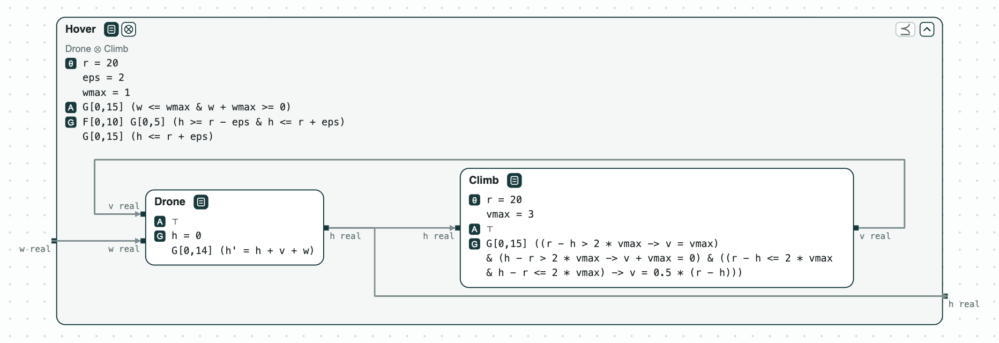
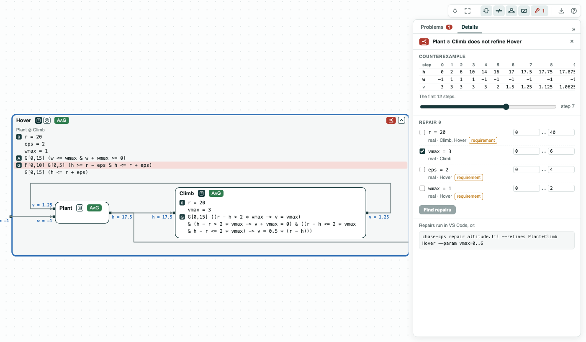
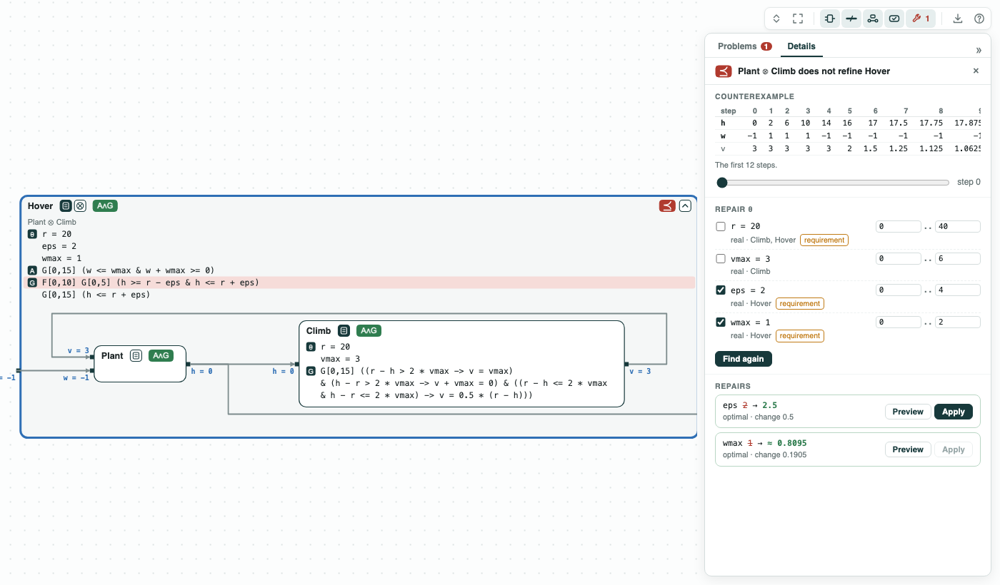

# Drone climb: no controller beats the wind

**The system.** A drone of a fire-suppression mission climbs to the
altitude where it drops its water, `r` = 20 m. The fire makes a vertical
wind `w` (up or down, at most `wmax` per step) that pushes the drone. The
drone comes from the mission of ContrACT (Xiao, Lutz, Castillo-Effen,
Nuzzo, MEMOCODE 2026). _Drone_ starts on the ground at height `h` = 0
and moves by `v + w` each step. _Climb_, the controller, sets the climb
rate `v` to half the error to `r`, at most `vmax` (3 m per step). The
requirement _Hover_: while the wind stays within `wmax`, the drone is
within `eps` (2 m) of `r` for 5 steps, starting at one of the first 10,
and is never above `r + eps`. The contracts are in signal temporal logic
in discrete time, checked by z3.

**The question.** Does the drone get there in time and stay long enough?
If not, should the controller change, or the requirement? A faster
controller costs a stronger motor; a looser requirement costs water
dropped from farther away.

[{ width="870" }](../assets/demos/drone-altitude/system.png)
_The system: the drone and its controller inside the requirement Hover._

## The steps

**Step 1. The wind decides.** _Drone_ and _Climb_ composed refine
_Hover_ (every behavior of the two meets it) in a wind of 0.5 m per
step, not of 1. The robustness of _Hover_, the margin by which it holds
in the worst case, is 0.75 m in a wind of 0.5. In a wind of 1 it is
-0.5 m: in the counterexample the wind always pushes down, and the drone
is at 17.5 m at step 10, the last step where the 5 steps can start,
0.5 m below the band of 18 to 22 m.

[](../assets/demos/drone-altitude/hover-counterexample.png)
_Step 1: a counterexample in a wind of 1, step 7 on the ports._

**Step 2. The controller cannot fix it.** `repair` looks for values of
named constants that make the check pass at the least change. For
`vmax` it finds none, and proves it: near the target, with the wind
down, the error goes as `e' = e/2 + 1`, so it stays above 2 m however
fast the drone climbs.

[![Find repairs with vmax picked: no value in [0, 9] works](../assets/demos/drone-altitude/repair-vmax-impossible.png)](../assets/demos/drone-altitude/repair-vmax-impossible.png)
_Step 2: vmax picked, its range widened to [0, 9]: no value works._

**Step 3. The requirement.** The least tolerance is `eps = 2.5` m (2.49
fails): the 0.5 m of step 1. Or, keeping `eps = 2`, the strongest wind
is `wmax = 17/21`, about 0.81 m per step (0.82 fails).

[](../assets/demos/drone-altitude/repair-eps-or-wmax.png)
_Step 3: eps 2 to 2.5, or wmax 1 to about 0.8095 (17/21)._

**Step 4. Both at once.** With two constants free, a cost says which
change is worse: `(eps - 2) + w (1 - wmax)`, a change of the wind
counting `w` times a change of the tolerance. With `w = 2` the repair
lowers the wind to 17/21 (cost 8/21); with `w = 3` it widens the
tolerance to 2.5 (cost 1/2). Each answer is the least cost over every
mix of the two changes, which is hard to find by trying values.

```
r = repair("refines", drone, hover, parameters={"eps": (2, 10), "wmax": (0, 1)},
           minimize="(eps - 2) + 3 * (1 - wmax)")
```

The tags of the pictures are explained on the page
[Diagrams](../interfaces/diagrams.md#what-is-drawn).

## Run it

```
pip install "chase-cps[z3]"
python altitude.py --expect
chase-cps view altitude.ltl --check --serve
```

The files of the demo are in the [repository](https://github.com/chase-cps/demos/tree/main/DroneAltitude); [Running the demos](running.md) says what the scripts print and how to use the diagrams.
