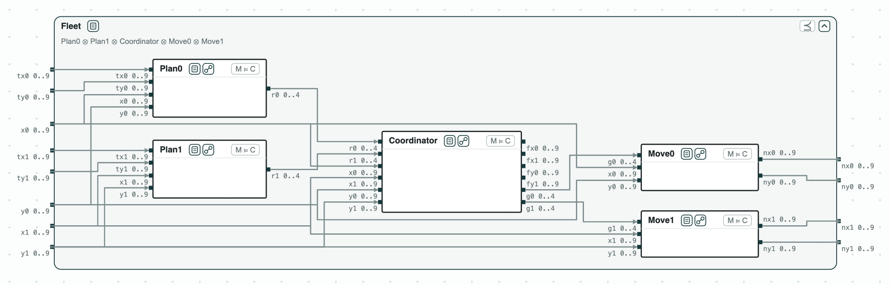
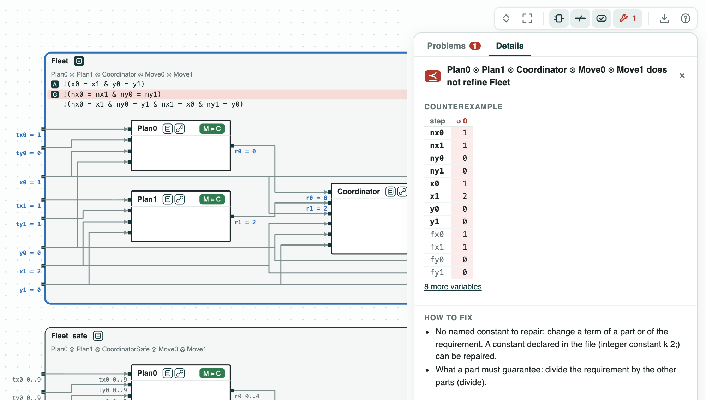
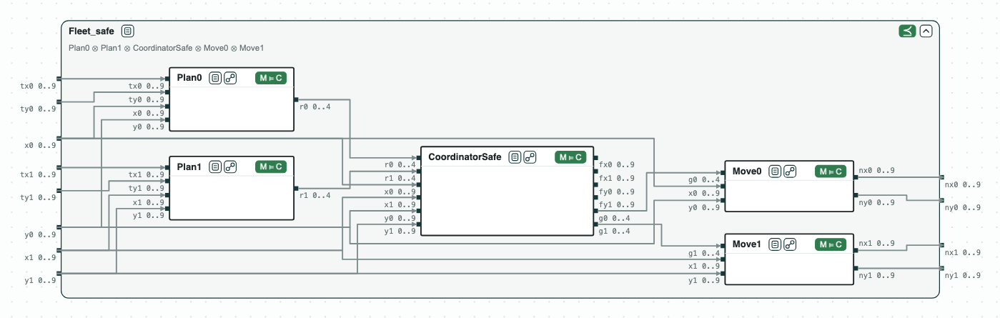
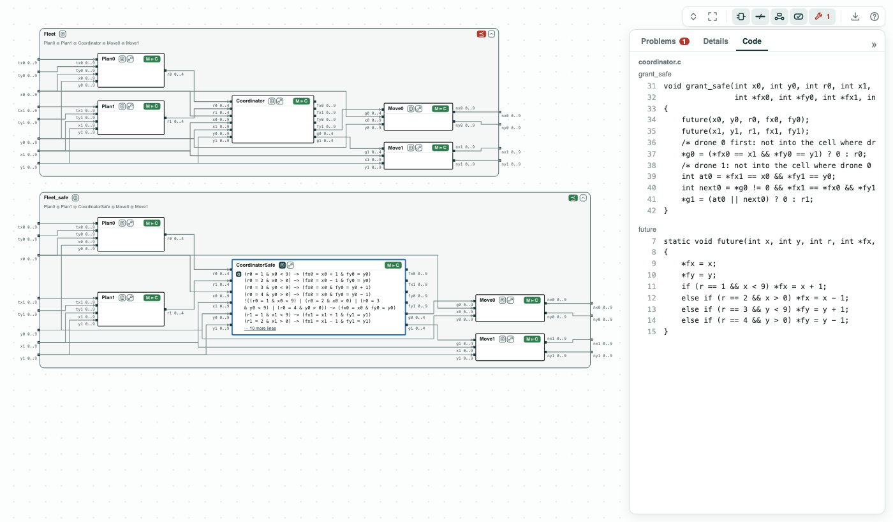

# Fire-suppression drones in C: a collision found and fixed on the contracts, then checked one function at a time

**The system.** Two drones of a fire-suppression mission move on a
10 x 10 grid, one cell per step. They come from the multi-drone fire
suppression of ContrACT (Xiao et al., MEMOCODE 2026), whose software is
written as reactions, pieces of code run at each step. Each step has five
parts, each with a contract and a C function:

- _Plan0_ and _Plan1_ (`plan.c`): each drone at `(x, y)` asks for a move
  `r` toward its target `(tx, ty)`: 0 stay, 1 right, 2 left, 3 down, 4 up;
- _Coordinator_ (`coordinator.c`, function `grant`): grants the moves
  `g`, refusing two moves into the same cell or a swap;
- _Move0_ and _Move1_ (`move.c`): each drone moves as granted, to
  `(nx, ny)`.

The requirement _Fleet_: two drones in different cells are, after the
step, in different cells, and do not cross. The contracts are on
integers, checked by z3; the C functions by ESBMC.

**The question.** Can two drones end in the same cell? And can each C
function be checked alone, without checking the whole program? A whole
program check grows with every function; one function at a time does not.

[{ width="870" }](../assets/demos/drone-grid/system.png)
_The system: one step of the two drones inside the requirement Fleet; each part has its C function._

## The steps

**Step 1. The contracts do not refine the requirement.** The five parts
composed do not refine _Fleet_ (some behavior of the parts breaks it).
In the counterexample, drone 0 is at its target (1, 0) and stays, and
drone 1 at (2, 0) moves left into its cell: the coordinator compares
only drones that both move. The script finds the same failure for a swap.

[](../assets/demos/drone-grid/step1-fleet-does-not-refine.png)
_Step 1: the parts with <code>Coordinator</code> do not refine <code>Fleet</code>._

**Step 2. The fix.** No number can be tuned: the rule must change.
CHASE computes the quotient of _Fleet_ by the other four parts: the
weakest contract the coordinator must meet so that the step meets
_Fleet_ (see [the contract algebra](../contracts/algebra.md)).
_Coordinator_ does not refine it. _CoordinatorSafe_, which grants a move
only into a cell that is free after the step, does, and the parts with
it refine _Fleet_.

[{ width="870" }](../assets/demos/drone-grid/step3-coordinator-safe-refines.png)
_Step 2: the parts with <code>CoordinatorSafe</code> refine <code>Fleet</code>._

**Step 3. The code.** ESBMC checks each function against its contract
(the tag M ⊨ C), in about 0.1 s each. The five functions of the step
(`plan0`, `plan1`, `grant`, `move0`, `move1`) implement theirs. `grant`
does not implement _CoordinatorSafe_; `grant_safe` does. With steps 2
and 3, the C code with `grant_safe` keeps the drones apart, and the
whole program is never checked at once.

[](../assets/demos/drone-grid/step4-grant-safe-code.png)
_Step 3: <code>grant_safe</code> implements <code>CoordinatorSafe</code>._

The tags of the pictures are explained on the page
[Diagrams](../interfaces/diagrams.md#what-is-drawn).

## Run it

```
pip install "chase-cps[z3]"      # and ESBMC or CBMC
python dronegrid.py --expect
```

The files of the demo are in the [repository](https://github.com/chase-cps/demos/tree/main/DroneGrid); [Running the demos](running.md) says what the scripts print and how to use the diagrams.
