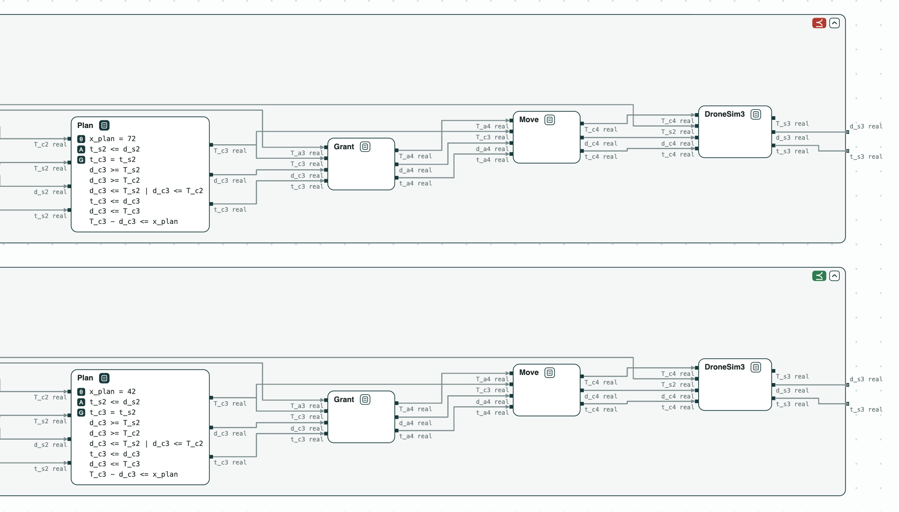
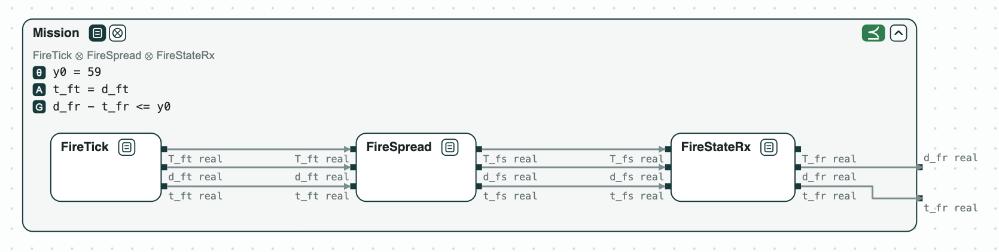
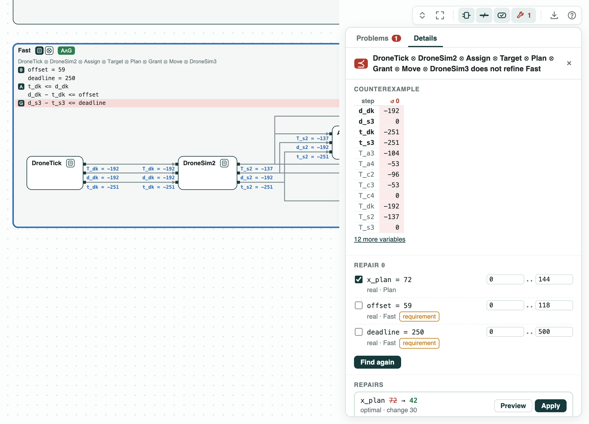
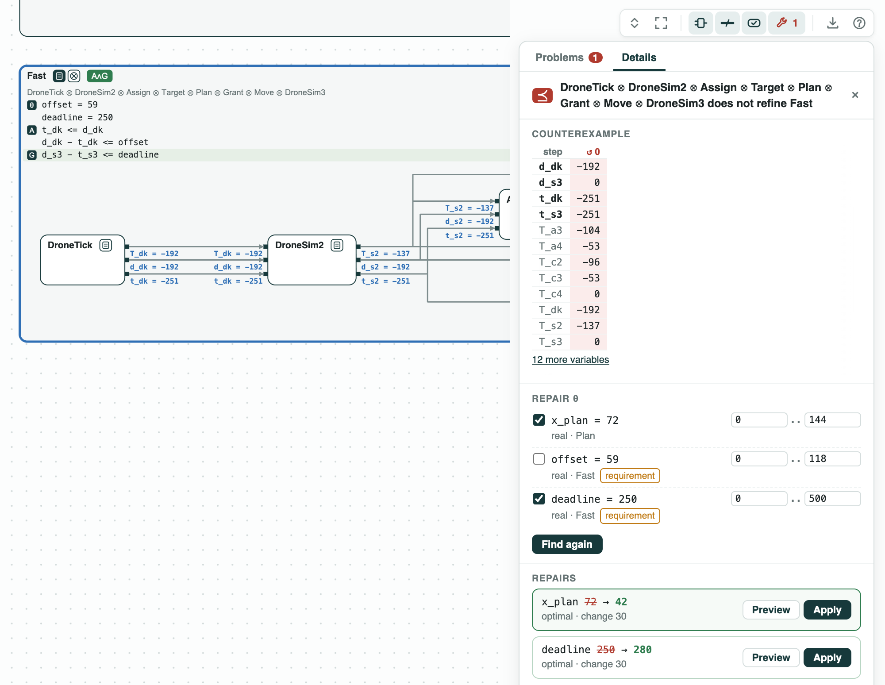

# Fire-suppression drone timing: the bound, a faster timer, and its repair

**The question.** Three drones put out fires; each must move within
400 ms of its timer. Is the bound met? With a faster timer of 250 ms,
what fails, and what is the least change that fixes it?

**The result.**

- The bound of 400 ms holds. The worst case of a drone, found by one
  optimization, is 280 ms.
- A timer of 250 ms fails: the counterexample is a drone that moves
  251 ms after its timestamp.
- Repair: the least bound that holds is `deadline = 280` ms; or, keeping
  250 ms, the planner must take at most `x_plan = 42` ms instead of 72.
  Both changes are optimal.
- The margins under 400 ms: the planner may take up to 192 ms, and the
  mission may delay the drones by up to 179 ms.

[{ width="870" }](../assets/demos/drone-timing/before-and-after-repair.png)
_The end of the pipeline of a drone inside Fast (250 ms): with <code>x_plan = 72</code> (⪯ red), and with the faster planner, <code>x_plan = 42</code> (⪯ green)._

This is the multi-drone fire suppression of ContrACT (Xiao, Lutz,
Castillo-Effen, Nuzzo, MEMOCODE 2026). `dronetiming.ltl` has the timing
contracts of each reaction, linear constraints over the reals: z3 checks
and optimizes them, in place of the Gurobi MILP of the paper. _Mission_
bounds the delay that the fire simulation causes to the drone timer.
_Available_: given that delay (`offset`), the drone moves at most `lam`
after its timestamp. _Fast_ is the same with `deadline = 250`. The three
drones run the same pipeline and do not wait for each other, so one
pipeline gives the bound of each.

## The steps

**Step 1. The mission.** The mission subgraph (the timer, the fire
spreading, the coordinator reading the fire) refines _Mission_. Its worst
case is 59 ms: the offset of the drones.

[{ width="786" }](../assets/demos/drone-timing/mission-refines-mission.png)
_Step 1: the mission subgraph inside Mission (y0 = 59): ⪯ green._

**Step 2. The bound holds.** The pipeline of a drone refines _Available_
with `lam = 400`. One optimization over its behaviors gives the worst
case, 280 ms: 59 ms of offset, 55 ms for the drone to report its cell,
33 ms for the coordinator to assign a target and 8 ms for the controller
to take it, 72 ms to plan, and 53 ms to send the move.

**Step 3. A faster timer fails.** The pipeline does not refine _Fast_.
The counterexample gives each event a time; on the ports, the drone
timer is released 59 ms late and the move starts 251 ms after its
timestamp.

[](../assets/demos/drone-timing/fast-counterexample.png)
_Step 3: the counterexample of Fast._

**Step 4. Repair.** `repair` changes one named constant as little as
possible. On the requirement: `deadline = 280`, a change of 30 ms. On
the planner: `x_plan = 42`, also 30 ms less, since planning is on the
longest path. The script checks that the pipeline with `x_plan = 42`
refines _Fast_.

[](../assets/demos/drone-timing/repair-deadline-or-plan.png)
_Step 4: deadline 250 to 280, or x_plan 72 to 42, both optimal._

**Step 5. The margins.** Under the bound of 400 ms, repair as
optimization gives the slowest planner, `x_plan = 192` ms, and the
largest delay of the mission, `offset = 179` ms: both 120 ms more than
now, the slack of step 2.

## Run it

```
pip install "chase-cps[z3]"
python dronetiming.py --expect
chase-cps view dronetiming.ltl --check --serve
```

The files of the demo are in the [repository](https://github.com/chase-cps/demos/tree/main/DroneTiming); [Running the demos](running.md) says what the scripts print and how to use the diagrams.
