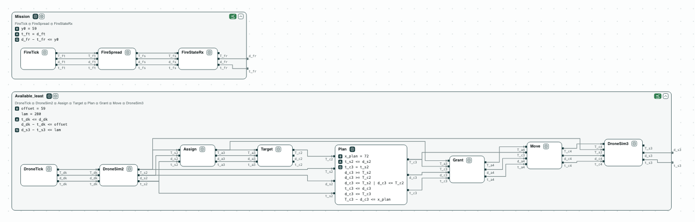
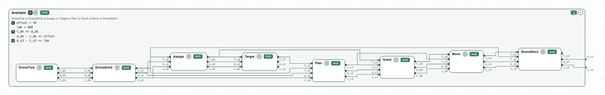
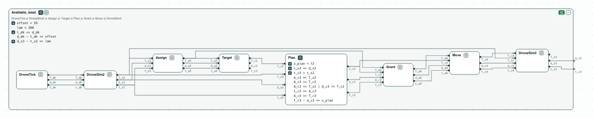

# Fire-suppression drone timing: the margins, as a linear program

**The question.** Three drones put out fires; each must move within
400 ms of its timer. Is the bound met, by how much, and how much slower
may a reaction be, or the rest of the mission, before it is not?

**The result.**

- The bound holds. The worst case of a drone, found by one optimization,
  is 280 ms: the least bound that holds.
- Repair as optimization: the planner may take up to `x_plan = 192` ms,
  and the mission may delay the drones by up to `offset = 179` ms. Each
  is optimal, and checked by the refinement.
- z3 checks and optimizes these linear constraints over the reals, in
  place of the Gurobi MILP (mixed-integer linear program) of the paper.

[](../assets/demos/drone-timing/mission-and-drone.png)
_The mission inside Mission, and a drone inside Available at its least bound._

This is the multi-drone fire suppression of ContrACT (Xiao, Lutz,
Castillo-Effen, Nuzzo, MEMOCODE 2026). `dronetiming.ltl` has the timing
contracts of each reaction. _Mission_ bounds the delay that the fire
simulation causes to the drone timer. _Available_: given that delay (`offset`), the drone
moves at most `lam` after its timestamp. The three drones run the same
pipeline and do not wait for each other, so one pipeline gives the bound
of each.

## The steps

**Step 1. The mission.** The mission subgraph (the timer, the fire
spreading, the coordinator reading the fire) refines _Mission_. Its worst
case is 59 ms: the offset of the drones.

[](../assets/demos/drone-timing/mission-refines-mission.png)
_Step 1: the mission subgraph inside Mission (y0 = 59): ⪯ green._

**Step 2. The bound holds.** The pipeline of a drone refines _Available_
with `lam = 400`. One optimization over its behaviors gives the worst
case, 280 ms: 59 ms of offset, 55 ms for the drone to report its cell,
33 ms for the coordinator to assign a target and 8 ms for the controller
to take it (the planner waits for it), 72 ms to plan, and 53 ms to send
the move.

[](../assets/demos/drone-timing/drone-refines-available.png)
_Step 2: the pipeline of a drone inside Available (lam = 400): ⪯ green._

**Step 3. The margins, by repair.** Repair is here an optimization over
one named constant. The least bound that holds is `lam = 280`. The
planner may take up to `x_plan = 192` ms, and the mission may delay the
drones by up to `offset = 179` ms: both 120 ms more than now, the slack
of step 2.

[](../assets/demos/drone-timing/drone-least-bound.png)
_Step 3: at lam = 280 the refinement still holds; Plan open._

## Run it

```
pip install "chase-cps[z3]"
python dronetiming.py --expect
chase-cps view dronetiming.ltl --check --serve
```

The files of the demo are in the [repository](https://github.com/chase-cps/demos/tree/main/DroneTiming); [Running the demos](running.md) says what the scripts print and how to use the diagrams.
