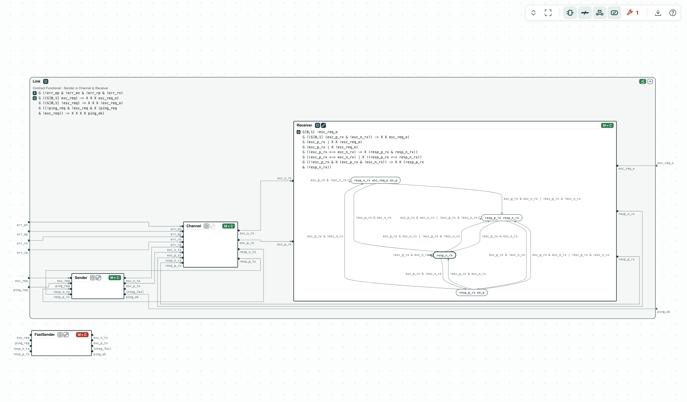
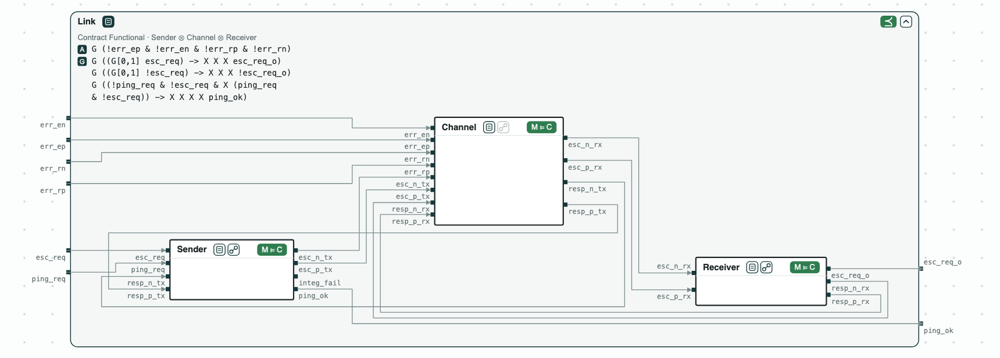
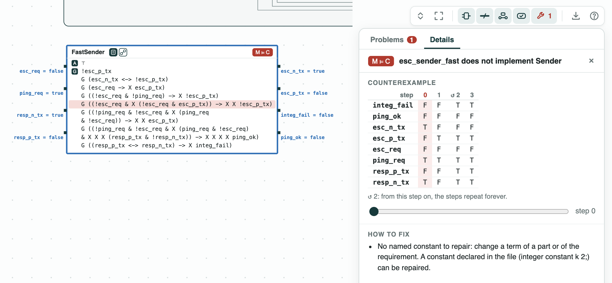

# OpenTitan security chip: the escalation link proven module by module from its RTL

**The question.** The escalation link of a security chip is made of a
sender, the wires, and a receiver. Does it meet its requirements, and can
we show it by checking each module on its own?

**The result.**

- RTL against contracts (Yosys and nuXmv): the Verilog of each module
  implements its contract, written in SystemVerilog Assertions.
- Composition: the three contracts together refine both requirements,
  _Functional_ and _Integrity_, with no check on the whole design.
- A counterexample on the RTL: a faster sender breaks its contract in 4
  steps; in the whole link, a ping makes the receiver escalate.

[](../assets/demos/escalation/overview-link.png)
_The link inside Functional (⪯), each module with its RTL (M ⊨ C), and the fast sender, which fails._

The link is a small version of the escalation link of OpenTitan. To
escalate (order the receiver to react to an attack), the sender raises a
differential pair: two wires that carry opposite values, so a single wrong
wire makes them equal, which both ends detect. To ping (test that the
receiver is alive), it sends one-cycle pulses; a pulse of two cycles means
an escalation. The requirements follow the assertions of OpenTitan
(`prim_esc_rxtx_assert_fpv`).

## The steps

**Step 1. Each module.** The RTL of the sender, of the channel, and of
the receiver implements its contract. The receiver is drawn open: its
contract and its state machine of 4 states, read from the RTL.

[](../assets/demos/escalation/step1-modules.png)
_Step 1: each RTL implements its contract (M ⊨ C); the receiver with its four states._

**Step 2. The composition.** _Sender_ ⊗ _Channel_ ⊗ _Receiver_ refines
_Functional_ and _Integrity_. The whole RTL, checked directly, meets both
too. The quotient SenderSlot = Functional / (Channel ⊗ Receiver), the
weakest contract any sender must meet in this link, is refined by
_Sender_.

[](../assets/demos/escalation/step2-composition.png)
_Step 2: the composition of the three modules refines Functional (⪯)._

**Step 3. A faster sender.** A sender that pings at every cycle of a ping
request does not implement _Sender_. In the counterexample of 4 steps, the
ping request stays high and so does the pair, which only an escalation
may do. In the whole link, a ping makes the receiver escalate.

[](../assets/demos/escalation/step5-fast-sender.png)
_Step 3: the fast sender does not implement Sender; the guarantee it breaks in red._

## Run it

```
pip install "chase-cps[rtl]"                # with Yosys
chase-cps install nuxmv --accept-license
python escalation.py --expect
```

The files of the demo are in the [repository](https://github.com/chase-cps/demos/tree/main/Escalation); [Running the demos](running.md) says what the scripts print and how to use the diagrams.
