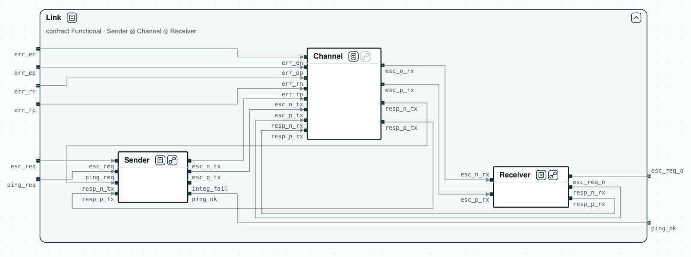
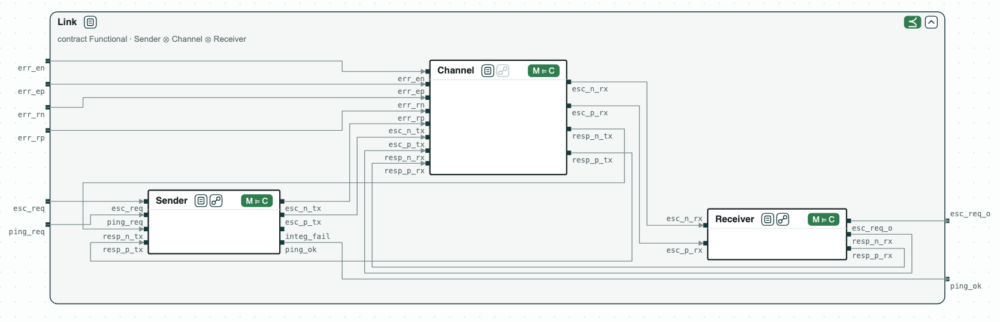

# Security chip: checked module by module

**The question.** The escalation link of a security chip is made of a
sender, the wires, and a receiver. Does it meet its requirements, and can we
show it by checking each module on its own?

[](../assets/diagram-escalation-system.png)
_The link: the sender, the channel, and the receiver, each with its RTL, inside the requirements._

The link is a toy version of the escalation link of OpenTitan. The sender
raises a differential pair to make the receiver escalate, and pings the
receiver with one-cycle pulses; the receiver answers on a response pair. A
pulse that lasts two cycles means an escalation. The error inputs of the
channel (`err_*`) flip a wire, as a fault would; the two wires of the pair
are then equal, which the receiver and the sender detect. The requirements
follow the end-to-end assertions of OpenTitan: _Functional_ (escalation and
ping, without wire errors) and _Integrity_ (a single wrong wire is
detected). The contracts are written in
[SystemVerilog Assertions](../tools/systemverilog.md), and each module has
its RTL in Verilog.

## The steps

**Step 1. Each module.** The RTL of the sender, of the channel, and of the
receiver implements its contract.

**Step 2. The composition.** _Sender_ ∥ _Channel_ ∥ _Receiver_ refines
_Functional_ and _Integrity_. So the three modules together meet the
requirements, with no check on the whole design.

[](../assets/diagram-escalation-1.png)
_Steps 1 and 2: each RTL implements its contract, and the composition refines Functional; the receiver with its four states._

**Step 3. A cross-check.** The whole RTL, checked directly, meets
_Functional_ and _Integrity_ too.

**Step 4. What any sender must do.** The quotient SenderSlot = Functional
/ (Channel ∥ Receiver) is the contract that any sender must meet in this
link; the contract of the sender refines it.

**Step 5. A faster sender.** A sender that pings at every cycle of a ping
request does not implement the contract of the sender: its ping pulses last
two cycles, which the receiver reads as an escalation.

## Run it

```
$> git clone https://github.com/chase-cps/demos && cd demos
$> pip install "chase-cps[rtl]"
$> chase-cps install nuxmv --accept-license
$> python3 Escalation/escalation.py
```

The script prints the result of each step and writes the diagram above in
`out/escalation.html`. The contracts are in `Escalation/sva/`, and the RTL
in `Escalation/rtl/`.
