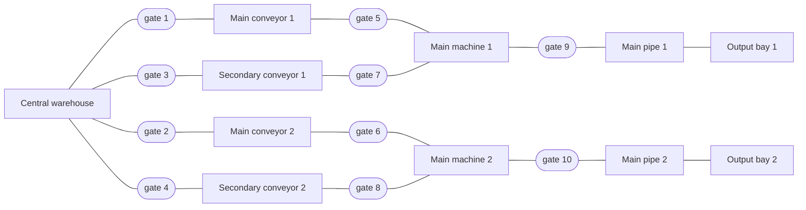
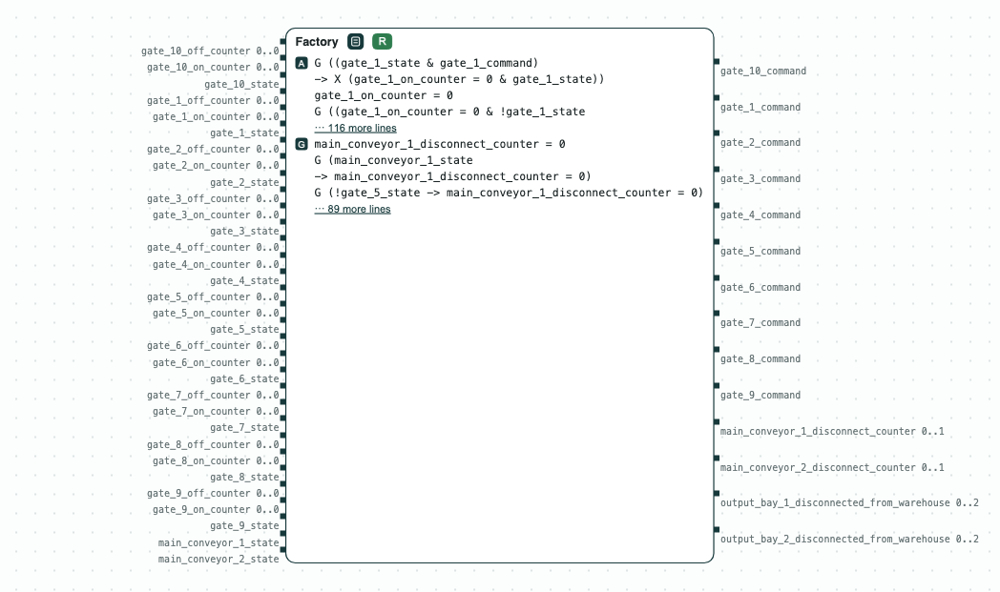

# Factory gate controller: the bays keep their supply when the main conveyors fail

**The question.** Can the gates of a factory be switched so that the
output bays keep their supply when the main conveyors fail?

**The result.**

- The patterns become one GR(1) contract for the gate controller (32
  inputs, 14 outputs, 60 assumptions, 18 guarantees), realizable for slugs
  and gr1c.
- Without the secondary conveyors it is unrealizable; the unrealizable
  core (the smallest set of guarantees in conflict) is the 3 terms that
  bound the time a bay is cut off.



_The factory: the controller switches the gates._

The factory is that of the FDL 2024 paper. `dsl_factory_realizable.txt`
gives its components, their connections, and patterns such as
`never-disconnect(output bay 1, warehouse, 30, MS)`. Only the main
conveyors may fail.

## The steps

**Step 1. The requirements are realizable.** No two conveyors are
connected, a failed main conveyor is cut off within 20 ms, and a bay is
never without supply for more than 30 ms. The contract is realizable; gr1c
agrees (`dsl_tool -b gr1c`).

[](../assets/demos/factory-gates/step1-controller-realizable.png)
_Step 1: the contract of the controller of the gates is realizable (R)._

**Step 2. Without the secondary conveyors.** The script leaves out the
lines of gates 3, 4, 7, and 8. The contract is then unrealizable; its
core is the 3 terms of the counter of bay 2: when main conveyor 2 fails,
nothing else feeds its machine (the core takes about 4 minutes).

The same language describes a [power system](aircraft-power.md).

## Run it

```
pip install chase-cps
chase-cps install slugs
python factory.py --expect
```

The files of the demo are in the [repository](https://github.com/chase-cps/demos/tree/main/FDL2024); [Running the demos](running.md) says what the scripts print and how to use the diagrams.
