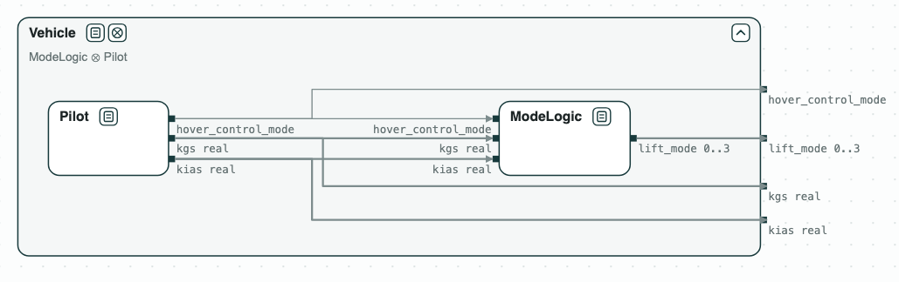
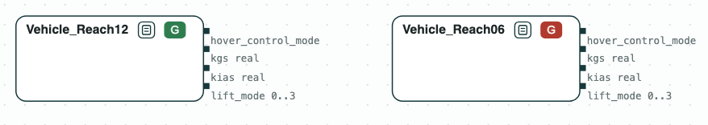
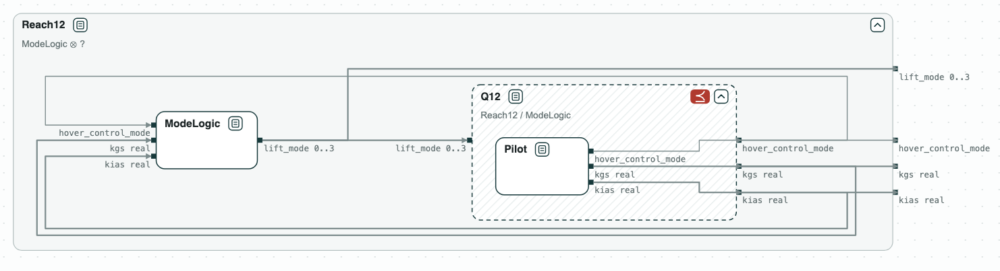
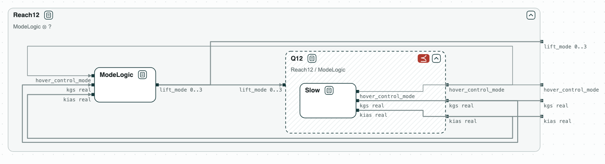
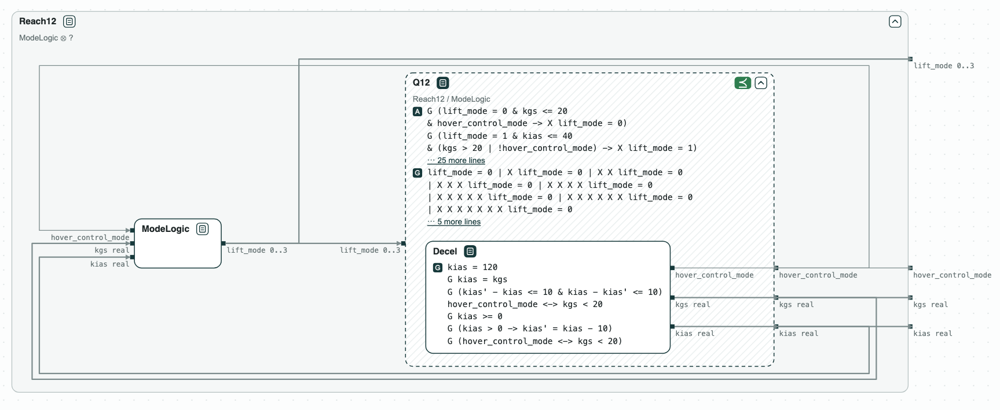
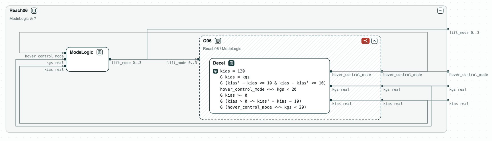

# Aircraft: what makes it hover in time

**The question.** The requirements of an aircraft are consistent with a
hover within 12 steps. What must the pilot do so that every flight hovers
within 12 steps?

[](../assets/diagram-lift-plus-cruise-system.png)
_The vehicle: the mode logic and the pilot._

Lift-Plus-Cruise is an aircraft studied at NASA, with lift rotors for the
hover and a wing for the cruise. The requirements are those of the LPC_mini
project of [FRET](https://github.com/NASA-SW-VnV/fret) (Pressburger et al.,
REFSQ 2023): the mode logic gives the lift mode (from wing borne to thrust
borne, i.e. hover) from the airspeed `kias` and the ground speed `kgs`, both
real numbers; the pilot sets the speeds. The airspeed is 120 at the start
and changes by at most 10 at each step.

## The steps

**Step 1. Two deadlines.** The requirements with a hover within 12 steps
(_Reach12_) are consistent; with a hover within 6 steps (_Reach06_) they are
not. The unsat core names the requirements in conflict: the vehicle stays
wing borne while `kias` is above 90, then semi wing borne while it is above
30, and `kias` cannot reach 30 by step 6.

[](../assets/diagram-lift-plus-cruise-1.png)
_Step 1: consistent with 12 steps, not with 6; the core on a red ground._

**Step 2. The split.** The vehicle is split into the mode logic and the
pilot, as in the diagram at the top, and _ModeLogic_ ∥ _Pilot_ refines
_Vehicle_.

**Step 3. What the pilot must do.** Consistency says that some flight hovers
within 12 steps, not that every one does. The quotient Q12 = Reach12 /
ModeLogic is the weakest contract of the pilot with which every flight
does. The requirements of the pilot do not refine it: they let `kias` stay
at 120.

[](../assets/diagram-lift-plus-cruise-3.png)
_Step 3: Q12, what the pilot must do; Pilot does not refine it._

**Step 4. A pilot that slows down.** _Slow_ lowers `kias` by 10 at each
step. It does not refine Q12: the hover control mode never turns on, and
the vehicle never hovers.

[](../assets/diagram-lift-plus-cruise-4.png)
_Step 4: Slow does not refine Q12._

**Step 5. A pilot that slows down and turns on the hover control.**
_Decel_ also turns the hover control mode on below a ground speed of 20. It
refines Q12, so every flight hovers within 12 steps. No pilot meets the 6
steps: _Decel_ does not refine Q06.

[](../assets/diagram-lift-plus-cruise-5.png)
_Step 5: Decel refines Q12._

[](../assets/diagram-lift-plus-cruise-6.png)
_Step 5: Decel does not refine Q06._

All the checks are on real variables, with the SMT engine of nuXmv.

## Run it

```
$> git clone https://github.com/chase-cps/demos && cd demos
$> pip install chase-cps
$> chase-cps install nuxmv --accept-license
$> python3 LiftPlusCruise/lpc.py
```

The script prints the result of each step, with the counterexamples, and
writes `out/lpc.html`, the diagrams above, to open in a browser: a click on
a name opens a contract, and a click on a red tag shows its core. The
requirements in FRETish are in `LiftPlusCruise/requirements.txt`.
