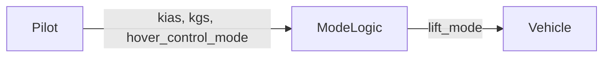

# Aircraft: what makes it hover in time

**The question.** The requirements of an aircraft are consistent with a
hover within 12 steps. What must the pilot do so that every flight hovers
within 12 steps?

Lift-Plus-Cruise is an aircraft studied at NASA: lift rotors for the vertical
take-off, the landing, and the hover, and a wing with a pusher propeller for
the cruise. The requirements are those of the LPC_mini project of the
Lift-Plus-Cruise case study of [FRET](https://github.com/NASA-SW-VnV/fret)
(Pressburger, Katis, Dutle, Mavridou, REFSQ 2023). They give the lift mode of
the aircraft (wing borne, semi wing borne, semi thrust borne, or thrust borne,
i.e. hover) from its airspeed `kias` and its ground speed `kgs`, both real
numbers.

The airspeed is 120 at the start (LPC_INIT_KIAS), and changes by at most 10
at each step (LPC_KIAS_DERIVATIVE). Two requirements ask the vehicle to hover
within 12 steps (LPC_REACH_HOVER_12) or within 6 steps (LPC_REACH_HOVER_06).
FRET finds the requirements realizable with the first one and unrealizable
with the second one. All the variables are outputs of the vehicle, so the
requirements are realizable when they are consistent.



## The contracts

<div class="tbl-pairs" markdown>

| Contract | Guarantees |
|---|---|
| _Vehicle_ | all the requirements but the two LPC_REACH_HOVER ones |
| _Reach12_, _Reach06_ | LPC_REACH_HOVER_12, LPC_REACH_HOVER_06 |
| _ModeLogic_ | the requirements of the lift mode: LPC_*_TO_*, LPC_*_STAY_ON_NEXT, LPC_INIT_LIFT_MODE, LPC_LIFT_MODE |
| _Pilot_ | the requirements of the speeds: LPC_INIT_KIAS, LPC_KIAS_KGS, LPC_KIAS_DERIVATIVE, LPC_KIAS_0, LPC_INIT_HOVER_MODE |
| _Slow_ | _Pilot_, and `G(kias > 0 -> kias' = kias - 10)` |
| _Decel_ | _Slow_, and `G(hover_control_mode <-> kgs < 20)` |

</div>

## The steps

<div class="tbl-steps" markdown>

| Step | Operation | Result |
|---|---|---|
| 1. Hover within 12 steps | `is_consistent(Vehicle with Reach12)` | sat, with a behavior that hovers at step 11 |
| 2. Hover within 6 steps | `is_consistent(Vehicle with Reach06, core=True)` | unsat, with the requirements in conflict |
| 3. The split | `refines(ModeLogic || Pilot, Vehicle)` | valid |
| 4. What the pilot must do | Q12 = Reach12 / ModeLogic, with discharge; `refines(Pilot, Q12)` | invalid: `kias` may stay at 120 |
| 5. A pilot that slows down | `refines(Slow, Q12)` | invalid: the hover control mode stays off |
| 6. A pilot that slows down and turns on the hover control | `refines(Decel, Q12)`, `refines(ModeLogic || Decel, Reach12)` | valid |

</div>

{ .recording }

Steps 1 and 2 are the checks of FRET. In step 2, `unsat_core` names the
requirements in conflict: the vehicle stays wing borne while `kias` is above
90 (LPC_WB_STAY_ON_NEXT), that is for 3 steps; then it is semi wing borne
while `kias` is above 30 (LPC_SWB_STAY_ON_NEXT), and `kias` cannot reach 30
by step 6.

Consistency says that some behavior hovers within 12 steps, not that every
one does. The quotient of step 4 answers the question: it is the weakest
contract of the pilot with which the mode logic hovers within 12 steps. The
requirements of the pilot do not meet it, since they let the airspeed stay
at 120. A pilot that slows down does not either (step 5): the
counterexample never turns the hover control mode on, since
LPC_INIT_HOVER_MODE ties it to `kgs` only at the start, and the vehicle
stays semi thrust borne. With the hover control mode on below 20, every
behavior hovers at step 12 (step 6). All the checks are on real variables,
with the SMT engine of nuXmv (`reals: smt`).

## Run it

```
$> pip install chase-cps
$> chase-cps install nuxmv --accept-license
$> python3 LiftPlusCruise/lpc.py
```

The directory also has the requirements in FRETish (`requirements.txt`), the
contracts (`lpc.ltl`), and steps 1 and 2 with the console of logics_tool
(`lpc.chase`).
