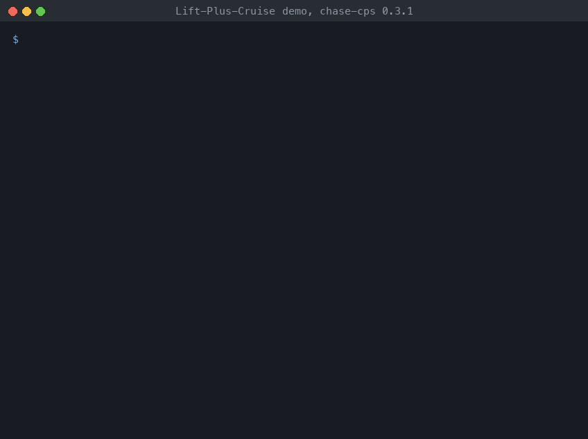

# Lift-Plus-Cruise: requirements with real variables

Lift-Plus-Cruise is an aircraft studied at NASA: lift rotors for the vertical
take-off, the landing, and the hover, and a wing with a pusher propeller for
the cruise. The requirements are those of the LPC_mini project of the
Lift-Plus-Cruise case study of [FRET](https://github.com/NASA-SW-VnV/fret)
(Pressburger, Katis, Dutle, Mavridou, REFSQ 2023). They give the lift mode of
the aircraft (wing borne, semi wing borne, semi thrust borne, or thrust borne,
i.e. hover) from its airspeed `kias` and its ground speed `kgs`, both real
numbers.

The airspeed is 120 at the start (LPC_INIT_KIAS), and changes by at most 10
at each step (LPC_KIAS_DERIVATIVE). Two requirements ask the vehicle to hover
within 12 steps (LPC_REACH_HOVER_12) or within 6 steps (LPC_REACH_HOVER_06).
FRET finds the requirements realizable with the first one and unrealizable
with the second one. All the variables are outputs of the vehicle, so the
requirements are realizable when they are consistent: CHASE checks their
consistency.

{ .recording }

1. With LPC_REACH_HOVER_12 the requirements are consistent, and nuXmv gives a
   behavior: `kias` goes down from 120 by 10 at each step, the vehicle leaves
   the wing borne mode when `kias` is 90, and it hovers at step 11. The real
   variables are checked with the SMT engine of nuXmv (`reals: smt`).
2. With LPC_REACH_HOVER_06 they are not, and `unsat_core` names the
   requirements in conflict. The vehicle stays wing borne while `kias` is
   above 90 (LPC_WB_STAY_ON_NEXT), that is for 3 steps; then it is semi wing
   borne while `kias` is above 30 (LPC_SWB_STAY_ON_NEXT), and `kias` cannot
   reach 30 by step 6.

## Run it

```
$> pip install chase-cps
$> chase-cps install nuxmv --accept-license
$> python3 LiftPlusCruise/lpc.py
```

The directory also has the requirements in FRETish (`requirements.txt`), the
contracts (`lpc.ltl`), and the same checks with the console of logics_tool
(`lpc.chase`).
