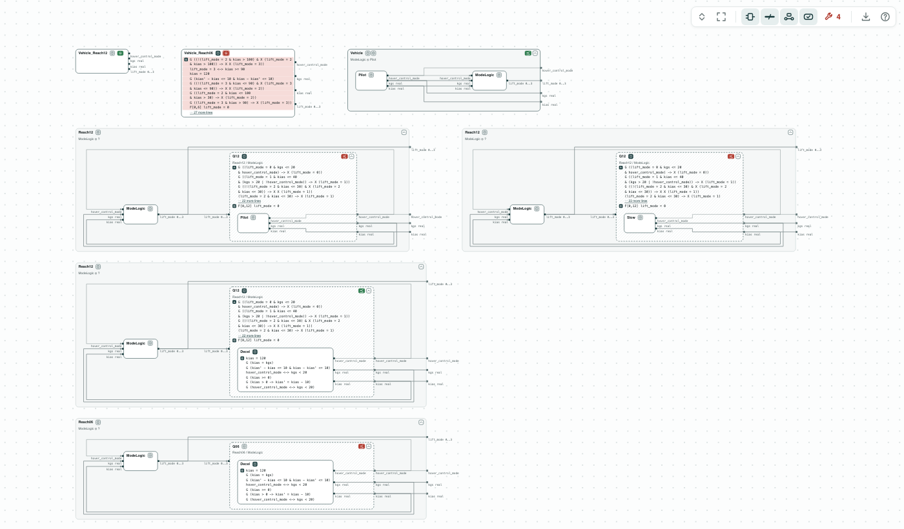
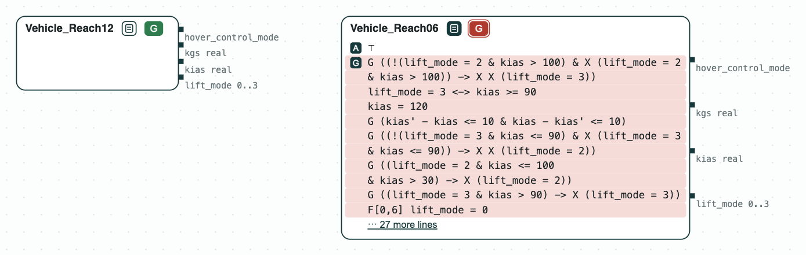
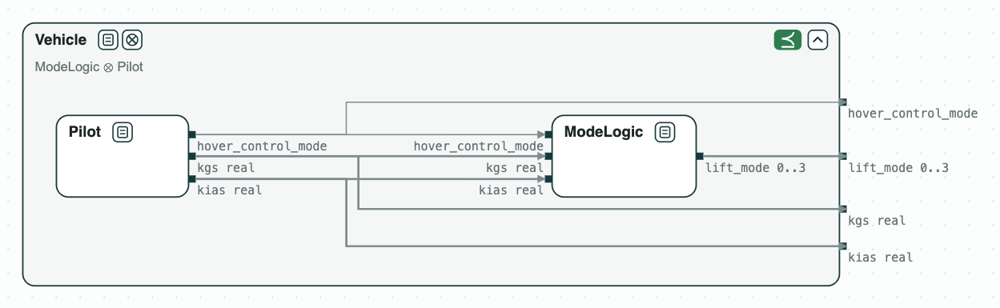
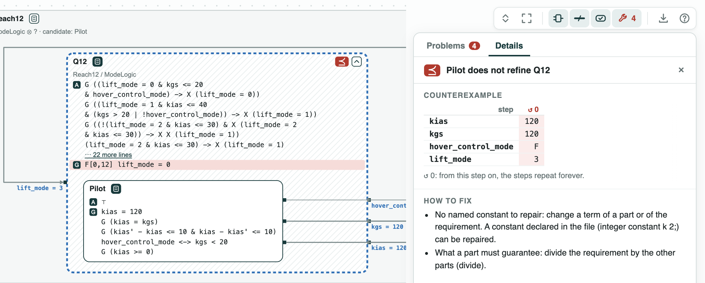
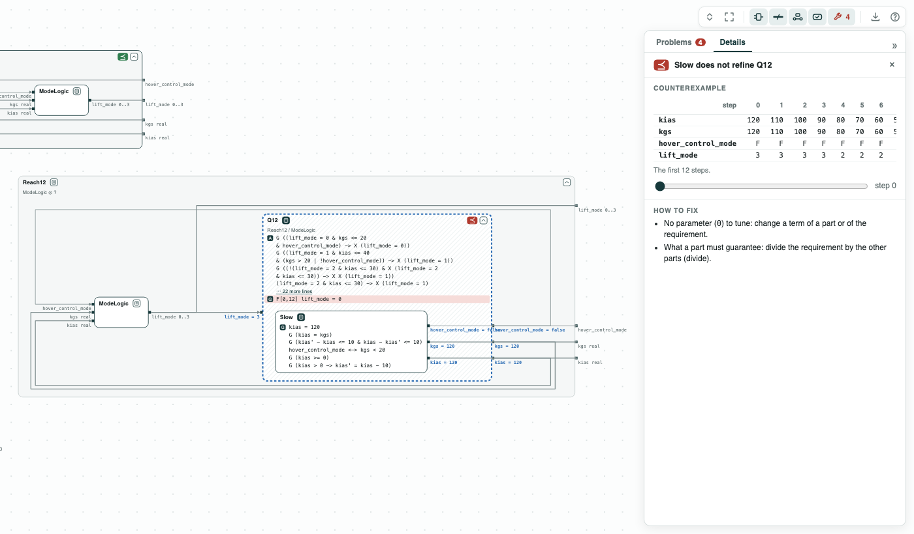
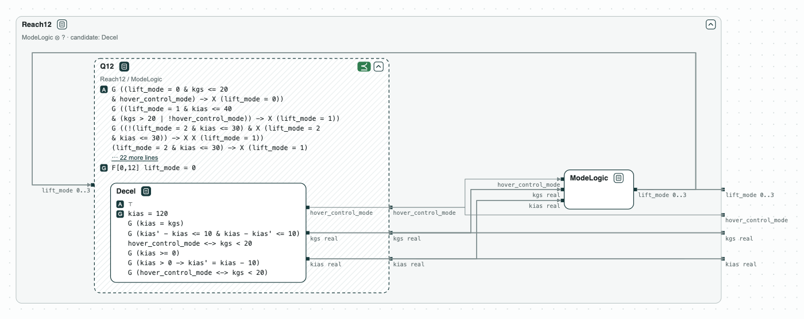
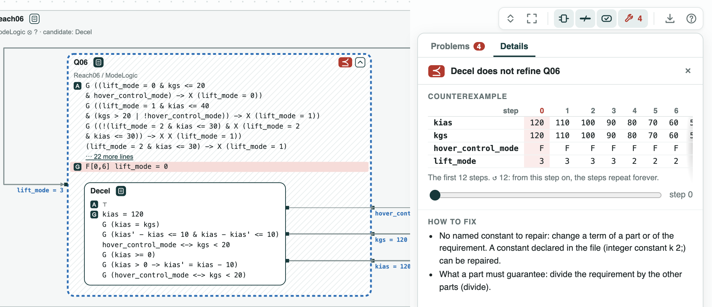

# NASA Lift-Plus-Cruise aircraft: what the pilot must do to hover in time

**The question.** Some flights meet the requirements and hover within 12
steps. What must the pilot do so that every flight does?

**The result.**

- Within 12 steps the requirements are consistent; within 6 they are not:
  the unsat core (the smallest set of requirements in conflict) is 8.
- The quotient Q12, the weakest contract the pilot must meet, is refined
  neither by a pilot with the requirements alone nor by one that only
  slows down.
- _Decel_, which also turns on the hover control, refines Q12.

[{ width="870" }](../assets/demos/lift-plus-cruise/overview-requirements-and-pilots.png)
_The split of the vehicle: ModeLogic, and the quotient Q12, what the pilot must do, with a candidate pilot in it._

Lift-Plus-Cruise is a NASA aircraft that hovers on lift rotors and
cruises on a wing. The requirements come from the LPC_mini project of
[FRET](https://github.com/NASA-SW-VnV/fret) (Pressburger et al., REFSQ
2023), on real variables (the SMT engine of nuXmv). The mode logic sets the
lift mode from the airspeed `kias`, the ground speed `kgs`, and the hover
control, set by the pilot.

## The steps

**Step 1. Two deadlines.** Within 12 steps the requirements are
consistent; within 6 they are not. The core, 8 requirements, says why:
`kias` starts at 120 and changes by at most 10 per step, and the vehicle
stays wing borne above 90, then semi wing borne above 30: it cannot hover
by step 6.

[{ width="733" }](../assets/demos/lift-plus-cruise/step1-reach06-inconsistent-core.png)
_Step 1: consistent with 12 steps, not with 6; the core in red._

**Step 2. The split.** _ModeLogic_ ⊗ _Pilot_ refines _Vehicle_, the
requirements without a deadline.

[{ width="661" }](../assets/demos/lift-plus-cruise/step2-mode-logic-and-pilot.png)
_Step 2: the split refines the vehicle._

**Step 3. What the pilot must do.** Q12 = Reach12 / ModeLogic, the dashed
box, is the weakest contract of the pilot with which every flight hovers
in time. _Pilot_ does not refine it: `kias` may stay at 120.

[](../assets/demos/lift-plus-cruise/step3-pilot-does-not-refine-q12.png)
_Step 3: Pilot does not refine Q12: <code>kias</code> stays at 120._

**Step 4. A pilot that slows down.** _Slow_ lowers `kias` by 10 per step, but
never turns the hover control on: it does not refine Q12.

[](../assets/demos/lift-plus-cruise/step4-slow-does-not-refine-q12.png)
_Step 4: Slow slows down, but never turns the hover control on._

**Step 5. A pilot that turns on the hover control.** _Decel_ also turns
the hover control on when `kgs` is below 20, and refines Q12. It does not
refine Q06 = Reach06 / ModeLogic: at step 6 the vehicle is still semi wing
borne.

[{ width="598" }](../assets/demos/lift-plus-cruise/step5-decel-refines-q12.png)
_Step 5: Decel refines Q12._

[](../assets/demos/lift-plus-cruise/step6-decel-does-not-refine-q06.png)
_Step 5: Decel does not refine Q06._

## Run it

```
pip install chase-cps
chase-cps install nuxmv --accept-license
python lpc.py --expect
```

The files of the demo are in the [repository](https://github.com/chase-cps/demos/tree/main/LiftPlusCruise); [Running the demos](running.md) says what the scripts print and how to use the diagrams.
