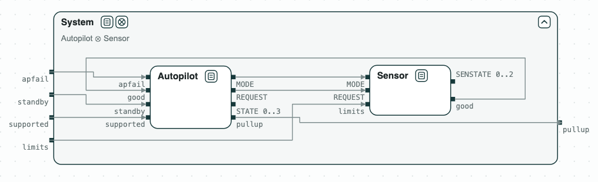

# Autopilot: conflicting requirements

**The question.** Which requirements of a state machine, as first written,
contradict each other? Once they are corrected, does the system command
the pullup when its requirement says?

[](../assets/diagram-lm-fsm-system.png)
_The system: the autopilot and the sensor, which feed each other._

An autopilot commands a safety maneuver (pullup) when a sensor reports a
hazard. The requirements are those of the finite state machine of the Ten
Lockheed Martin Cyber-Physical Challenges (Mavridou et al., RE 2020), as in
the FRET case study, which gives a first version of each requirement and
the corrected one (FSM-001 to FSM-011). Each requirement is a transition
of the autopilot (`STATE` 0 to 3: TRANSITION, NOMINAL, MANEUVER, STANDBY) or
of the sensor (NOMINAL, TRANSITION, FAULT).

## The steps

**Step 1. The first requirements.** _AutopilotFirst_ and _SensorFirst_ are
unrealizable. Each unrealizable core is two requirements that send the
machine to two different states for the same inputs, with the initial
state; for instance, in TRANSITION with the pilot in control (`standby`),
the system supported (`supported`), and good sensor data (`good`), FSM-002
says STANDBY and FSM-003 says NOMINAL. (A primed input is its value at the
next step: the autopilot reads the inputs of the step it moves to.) The script replaces the requirement by
its corrected version and checks again: four conflicts in the autopilot,
one in the sensor, the same fixes as FRET.

[](../assets/diagram-lm-fsm-1.png)
_Step 1: the first requirements are unrealizable; the cores highlighted in red._

**Step 2. The system.** The corrected _Autopilot_ and _Sensor_ are
realizable, but together they do not refine _System_ (FSM-001): the
counterexample gives the pullup one step after the limits are exceeded.

[](../assets/diagram-lm-fsm-2.png)
_Step 2: Autopilot ∥ Sensor does not refine System._

**Step 3. The system, with time.** The sensor and the autopilot each take a
step to react, and the autopilot must first reach NOMINAL from the start.
_SystemTimed_ (FSM-001t) gives the pullup that time: with the limits not exceeded for three steps and then
exceeded, the pilot not in control and no failure, the pullup comes at the
fifth step. The composition refines it.

[](../assets/diagram-lm-fsm-3.png)
_Step 3: Autopilot ∥ Sensor refines SystemTimed._

## Run it

```
$> git clone https://github.com/chase-cps/demos && cd demos
$> pip install chase-cps
$> chase-cps install nuxmv --accept-license
$> chase-cps install slugs
$> python3 LMFSM/fsm.py
```

The script prints the result of each step, with the five conflicts and
their fixes, and writes the diagrams above in `LMFSM/out/fsm.html`. The
requirements are in `LMFSM/requirements.txt`, and the contracts in
`LMFSM/fsm.ltl`.
