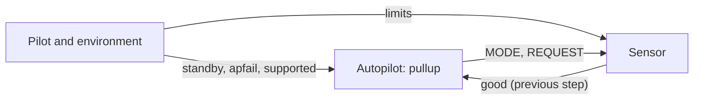

# LMFSM: conflicting requirements

An autopilot commands a safety maneuver (pullup) when a sensor reports a
hazard. The requirements are those of the finite state machine of the Ten
Lockheed Martin Cyber-Physical Challenges (A. Mavridou et al., "The Ten
Lockheed Martin Cyber-Physical Challenges: Formalized, Analyzed, and
Explained", RE 2020), as in the FRET case study LMCPS. The demo finds the
requirements in conflict, checks that the corrected ones can be realized,
and checks the requirement of the whole system on the composition of the
autopilot and the sensor.



## The contracts

The autopilot has four states (TRANSITION, NOMINAL, MANEUVER, STANDBY), and
the sensor three (NOMINAL, TRANSITION, FAULT). Each requirement is a
transition, written one step early: "from S to S' when c" is
`G((STATE = S & c) -> STATE' = S')`, where the inputs of the new step are
primed. The autopilot reads the sensor of the previous step, and the sensor
reads the autopilot of the same step.

- _AutopilotFirst_ and _SensorFirst_ have the requirements as first written.
- _Autopilot_ and _Sensor_ have the corrected ones (v2), and what the
  Simulink model of the challenge does in the other cases: the machine
  stays in its state, and the outputs are given by the state.
- _System_ (FSM-001): a pullup when the limits are exceeded, the pilot is
  not in control, and the system is supported without failures.
  _SystemTimed_ (FSM-001t) gives the pullup the steps it takes.

## The steps

| Step | Operation | Result |
|---|---|---|
| 1. The first requirements | `is_realizable` with the unrealizable core | Four conflicts in the autopilot, fixed one at a time (FSM-003, FSM-004, FSM-008, FSM-007), one in the sensor (FSM-011) |
| 2. The corrected requirements | `is_realizable` | _Autopilot_ and _Sensor_ are realizable |
| 3. The system | `compose` with discharge, `refines` | The composition does not refine FSM-001: the counterexample shows the pullup one step late |
| 4. The system, with time | `refines` | The composition refines FSM-001t |

In step 1, the core of _AutopilotFirst_ is FSM-002 and FSM-003 (with the
initial state): both apply in TRANSITION when the pilot is in control and
the sensor data is good, and lead to two states. The script replaces
FSM-003 by FSM-003v2, which adds "when the pilot is not in control", and
checks again; the next core is the next conflict.

In step 4, the limits not exceeded for three steps and then exceeded, with
the pilot not in control and no failure from the second step to the fifth,
give a pullup at the fifth step. This is FSM-001v3 of FRET with the limits
not exceeded for one step less. The limits not exceeded at the start are
needed: when the sensor is in FAULT while the autopilot is in TRANSITION and
the limits stay exceeded, each one waits for the other, and there is never a
pullup.

## Run it

```
$> git clone https://github.com/chase-cps/demos && cd demos
$> pip install chase-cps
$> chase-cps install nuxmv --accept-license && chase-cps install slugs
$> python3 LMFSM/fsm.py
```

The directory also has the requirements (`requirements.txt`) and the
contracts (`fsm.ltl`, with the number of the requirement on each line).
