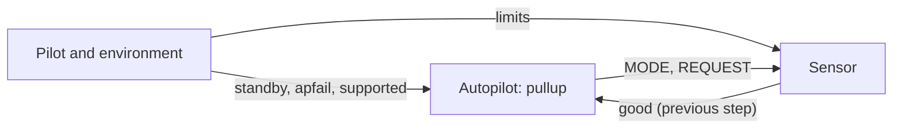
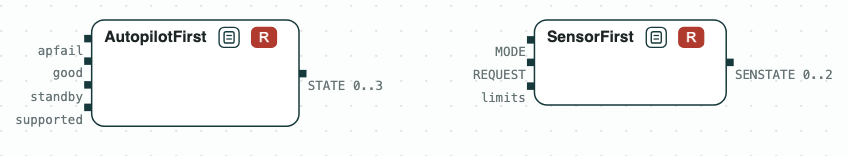
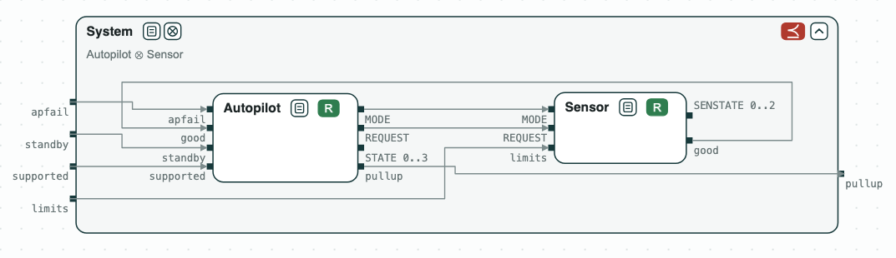
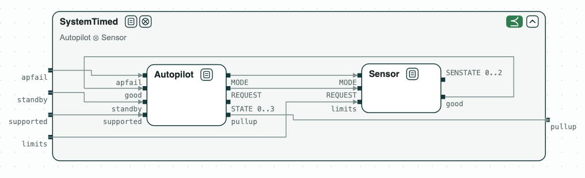

# Autopilot: conflicting requirements

**The question.** Which requirements of a state machine, as first written,
contradict each other, and does the pullup of the corrected system come
when the requirement of the system says?

An autopilot commands a safety maneuver (pullup) when a sensor reports a
hazard. The requirements are those of the finite state machine of the Ten
Lockheed Martin Cyber-Physical Challenges (A. Mavridou et al., "The Ten
Lockheed Martin Cyber-Physical Challenges: Formalized, Analyzed, and
Explained", RE 2020), as in the FRET case study LMCPS, which gives a first
version of each requirement and the corrected one (v2).



## The contracts

The autopilot has four states (TRANSITION, NOMINAL, MANEUVER, STANDBY), and
the sensor three (NOMINAL, TRANSITION, FAULT). Each requirement is a
transition, written one step early: "from S to S' when c" is
`G((STATE = S & c) -> STATE' = S')`, where the inputs of the new step are
primed. The autopilot reads the sensor of the previous step, and the sensor
reads the autopilot of the same step.

- _AutopilotFirst_ and _SensorFirst_ have the requirements as first written.
- _Autopilot_ and _Sensor_ have the corrected ones (v2), and what the
  Simulink model of the challenge does in the other cases: the machine
  stays in its state, and the outputs are given by the state.
- _System_ (FSM-001): a pullup when the limits are exceeded, the pilot is
  not in control, and the system is supported without failures.
  _SystemTimed_ (FSM-001t) gives the pullup the steps it takes.

## The steps

<div class="tbl-steps" markdown>

| Step | Operation | Result |
|---|---|---|
| 1. The first requirements | `is_realizable` with the unrealizable core | Four conflicts in the autopilot, fixed one at a time (FSM-003, FSM-004, FSM-008, FSM-007), one in the sensor (FSM-011) |
| 2. The corrected requirements | `is_realizable` | _Autopilot_ and _Sensor_ are realizable |
| 3. The system | Autopilot ∥ Sensor, with discharge; `refines(..., System)` | The composition does not refine FSM-001: the counterexample shows the pullup one step late |
| 4. The system, with time | `refines(Autopilot || Sensor, SystemTimed)` | The composition refines FSM-001t |

</div>

Step 1 answers the first part of the question. Each unrealizable core is a
pair of requirements that send the machine from one state to two different
states for the same inputs (with the initial state, and the requirements
that lead to that state). The script replaces the first one by its
corrected version and checks again, until the contract is realizable:

<div class="tbl-three" markdown>

| Core | The conflict | Fix |
|---|---|---|
| FSM-002, FSM-003 | in TRANSITION, the pilot in control and good sensor data: STANDBY or NOMINAL | FSM-003v2: only when the pilot is not in control |
| FSM-003v2, FSM-004, FSM-005 | in NOMINAL, the pilot in control and bad sensor data: MANEUVER or STANDBY | FSM-004v2: only when the pilot is not in control |
| FSM-002, FSM-008, FSM-009 | in STANDBY, the pilot not in control and a failure: TRANSITION or MANEUVER | FSM-008v2: only without a failure |
| FSM-002, FSM-006, FSM-007, FSM-009 | in MANEUVER, the pilot in control, supported, good data: STANDBY or TRANSITION | FSM-007v2: only when the pilot is not in control |
| FSM-010, FSM-011 (sensor) | in NOMINAL, the limits exceeded and no request: FAULT or TRANSITION | FSM-011v2: only when the limits are not exceeded |

</div>

The fixes are the corrected versions of FRET: CHASE finds each conflict
from the formulas alone, in the order in which a designer would meet them.

In step 4, the limits not exceeded for three steps and then exceeded, with
the pilot not in control and no failure from the second step to the fifth,
give a pullup at the fifth step. This is FSM-001v3 of FRET with the limits
not exceeded for one step less. The limits not exceeded at the start are
needed: when the sensor is in FAULT while the autopilot is in TRANSITION and
the limits stay exceeded, each one waits for the other, and there is never a
pullup.

## Diagram

`fsm.py` writes `out/fsm.html`, the diagram of the demo, which opens in a browser: a click on a name shows the contract, and a click on a red tag marks its core.

[](../assets/diagram-lm-fsm-1.png)
_The contracts as first written are unrealizable; a click on R marks the requirements in conflict._

[](../assets/diagram-lm-fsm-2.png)
_Autopilot ∥ Sensor does not refine System (FSM-001): the pullup does not come at once._

[](../assets/diagram-lm-fsm-3.png)
_Autopilot ∥ Sensor refines SystemTimed (FSM-001t)._

## Run it

```
$> git clone https://github.com/chase-cps/demos && cd demos
$> pip install chase-cps
$> chase-cps install nuxmv --accept-license && chase-cps install slugs
$> python3 LMFSM/fsm.py
```

The directory also has the requirements (`requirements.txt`) and the
contracts (`fsm.ltl`, with the number of the requirement on each line).
