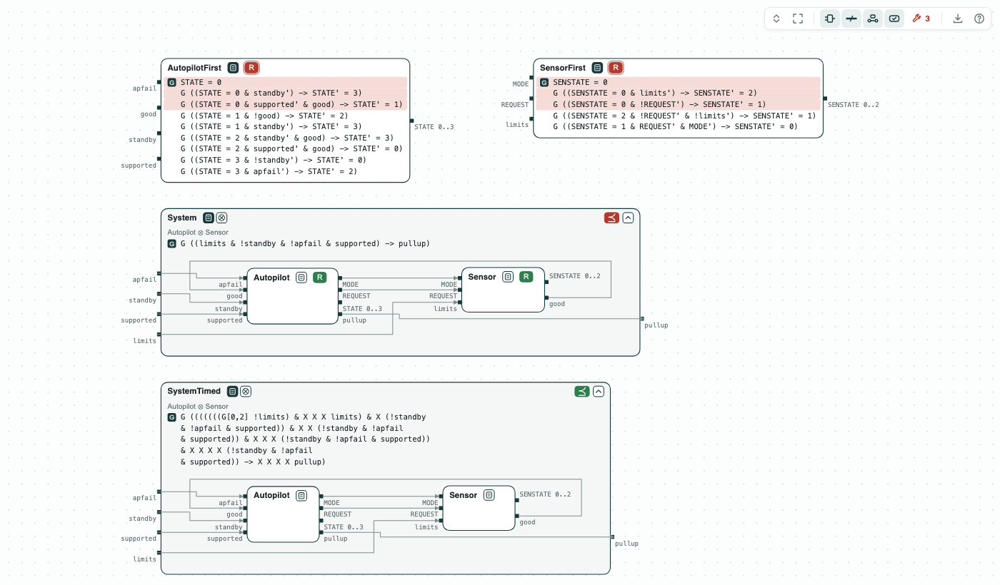
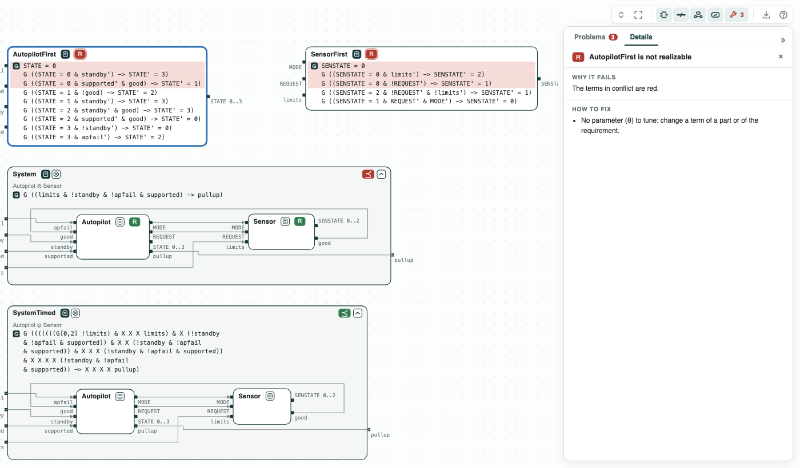
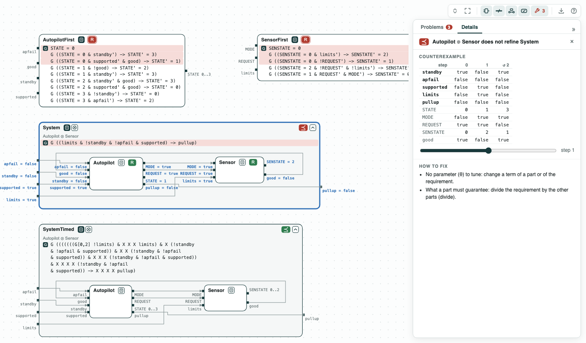

# Lockheed Martin autopilot: the requirements in conflict, and the time the pullup takes

**The question.** An autopilot commands a safety maneuver (pullup) when a
sensor reports a hazard. Which of its first requirements conflict? Once
corrected, does the pullup come when its requirement says?

**The result.**

- The first requirements are unrealizable. Fixing one requirement per
  unrealizable core (the smallest set of requirements in conflict), the
  script finds four conflicts in the autopilot and one in the sensor, like
  FRET.
- The corrected autopilot and sensor do not refine FSM-001, the
  system requirement: the counterexample has three steps.
- They refine FSM-001t, its timed version.

[](../assets/demos/lm-fsm/overview-all-checks.png)
_The first requirements (R red), and the corrected ones inside System (⪯ red) and SystemTimed (⪯ green)._

The requirements come from the Ten Lockheed Martin Cyber-Physical
Challenges (Mavridou et al., RE 2020), first and corrected, as in the FRET
case study. Each is a transition of the autopilot (TRANSITION, NOMINAL,
MANEUVER, STANDBY) or of the sensor; `x'` is the value of `x` at the next
step.

## The steps

**Step 1. The first requirements.** Each core of _AutopilotFirst_ and
_SensorFirst_ is the initial state and the requirements that send the
machine to two states for the same inputs. In TRANSITION, for instance,
with the pilot in control (`standby`), the system supported and good sensor
data, FSM-002 says STANDBY and FSM-003 says NOMINAL. The script replaces
one requirement per core by its corrected version until the contract is
realizable: four conflicts in the autopilot, one in the sensor.

[](../assets/demos/lm-fsm/step1-first-requirements-unrealizable.png)
_Step 1: the first requirements; the cores in red._

**Step 2. The system.** The corrected _Autopilot_ and _Sensor_ are
realizable; composed with discharge, they leave no assumption. They do not
refine _System_ (FSM-001: a pullup when the limits are exceeded, with the
pilot not in control, the system supported, and no failure). At step 1 of
the counterexample the limits are exceeded, but the autopilot is still in
NOMINAL: no pullup.

[](../assets/demos/lm-fsm/step2-does-not-refine-system.png)
_Step 2: the composition does not refine System; the values at step 1._

**Step 3. The system, with time.** The sensor and the autopilot each take a
step to react, and the autopilot must first reach NOMINAL. _SystemTimed_
(FSM-001t) gives the pullup that time: after three steps within the limits
and one beyond, with the pilot not in control and no failure, the pullup
comes at the fifth step. The composition refines it.

[](../assets/demos/lm-fsm/step3-refines-systemtimed.png)
_Step 3: the composition refines SystemTimed._

## Run it

```
pip install chase-cps
chase-cps install nuxmv --accept-license
chase-cps install slugs
python fsm.py --expect
```

The files of the demo are in the [repository](https://github.com/chase-cps/demos/tree/main/LMFSM); [Running the demos](running.md) says what the scripts print and how to use the diagrams.
