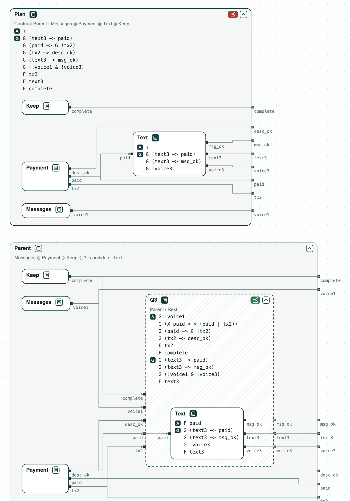
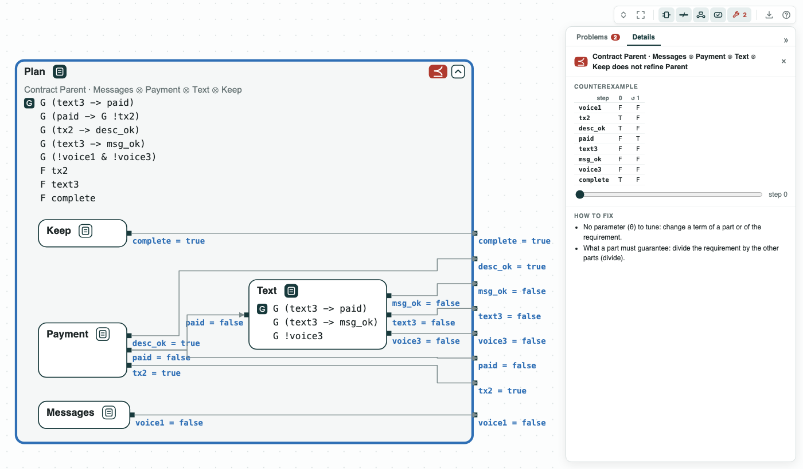
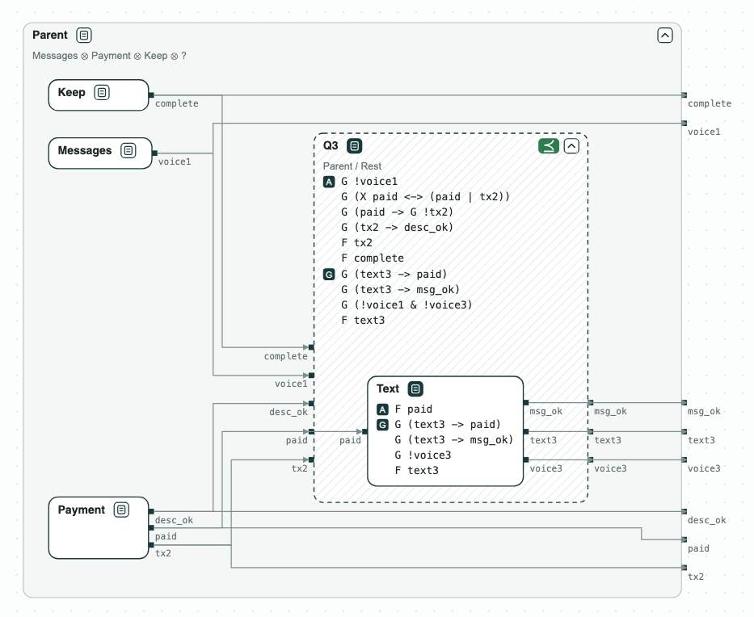
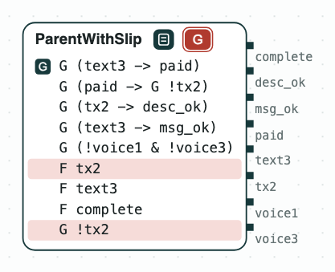

# Payment assistant agent: the plan of an AI agent checked before it runs

**The question.** An AI agent splits a task among sub-agents, each with a
contract over its tool calls. Do the contracts of the sub-agents, together,
refine the contract of the parent? If not, which sub-agent must do what?

**The result.**

- Refinement (LTL, nuXmv): the plan as given does not refine the parent;
  the counterexample pays and never sends the text.
- Quotient (the weakest contract a missing part must meet): Q3, what
  sub-agent 3 must do, asks for `F text3`; _Text_ with it refines Q3, and
  the plan refines the parent.
- Unsat core (the smallest set of requirements in conflict): a parent that
  also says "never pay" is inconsistent; the core is two clauses.

[{ width="657" }](../assets/demos/payment-assistant/overview-plan-and-quotient.png)
_The plan of the sub-agents (⪯ red), and the parent with the quotient Q3, Text inside it (⪯ green)._

The task is 530b157_1 of [AppWorld](https://arxiv.org/abs/2407.18901): pay
Kristin back on Venmo the amount in her text messages, with the note
"Groceries", then text her "It is done.", and send no voice message. These
rules are the contract of the parent, over the tool calls (`tx2` pays,
`text3` texts). The parent gives the task to _Messages_ (1, finds
the amount), _Payment_ (2, pays), and _Text_ (3, sends the text); _Keep_ is
what it keeps itself: marking the task complete.

## The steps

**Step 1. Contracts from the tools.** Each sub-agent gets the rules of the
tools it holds; the payment goes to the only one that holds Venmo.
Together they do not refine the parent: no sub-agent promises `F text3`
(the text is sent, sooner or later).

[](../assets/demos/payment-assistant/step1-plan-does-not-refine-parent.png)
_Step 1: the plan does not refine the parent; in the counterexample <code>text3</code> stays false._

**Step 2. What sub-agent 3 must do.** Only sub-agent 3 sends the text, so
the quotient Q3 = Parent / (Messages ⊗ Payment ⊗ Keep), the dashed box,
asks for the rules of its tools and `F text3`. _Text_ with `F text3`
refines Q3, so the plan refines the parent.

[{ width="664" }](../assets/demos/payment-assistant/step3-text-refines-q3.png)
_Step 2: Text, with <code>F text3</code> and the assumption <code>F paid</code>, refines Q3._

**Step 3. A clause against the request.** If the parent also says "never
pay" (`G !tx2`, _ParentWithSlip_), its contract is inconsistent, and the
unsat core is the two clauses in conflict: `F tx2` and `G !tx2`.

[{ width="223" }](../assets/demos/payment-assistant/step4-parent-inconsistent-core.png)
_Step 3: the inconsistent parent, with the core in red._

## Run it

```
pip install chase-cps
chase-cps install nuxmv --accept-license
python assistant.py --expect
```

The files of the demo are in the [repository](https://github.com/chase-cps/demos/tree/main/PaymentAssistant); [Running the demos](running.md) says what the scripts print and how to use the diagrams.
