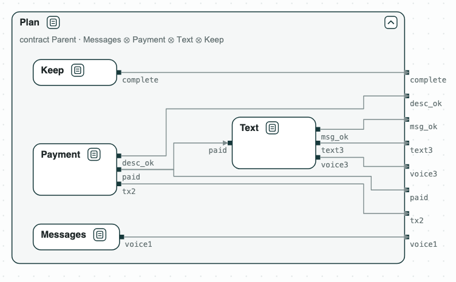

# Payment assistant agent: decomposing a task

**The question.** An assistant agent splits a task among sub-agents, each
with a contract over its tool calls. Do the contracts of the sub-agents,
together, refine the contract of the parent agent? If not, what is missing,
and which sub-agent must do it?

[](../assets/demos/payment-assistant/plan-of-sub-agents.png)
_The plan: the sub-agents inside the contract of the parent._

The task comes from [AppWorld](https://arxiv.org/abs/2407.18901) (task
530b157_1): pay Kristin back on Venmo the amount in her text messages, with
the note "Groceries", then text her "It is done.", and send no voice
message. The parent gives the task to three sub-agents, and marks the task
complete itself (_Keep_):

- _Messages_ (1) finds the amount;
- _Payment_ (2) pays;
- _Text_ (3) sends the text.

The variables are the tool calls and their arguments:

- `voice1`, `voice3`: a voice message of sub-agent 1 or 3;
- `tx2`: a Venmo payment;
- `desc_ok`: the note of the payment is right;
- `paid`: written by the Venmo tool once the payment is done;
- `text3`: a text;
- `msg_ok`: the words of the text are right;
- `complete`: the task is marked complete.

The contract of the parent guarantees:

- H1: the text is sent after the payment;
- H2: one payment;
- H3 and H4: the right note and the right words;
- H5: no voice message;
- H6 to H8: `F tx2`, `F text3`, and `F complete`.

## The steps

**Step 1. Contracts from the tools.** Each sub-agent gets the rules of the
tools it holds. _Text_ sends the text only after the payment, with the
right words, and no voice message. Together the sub-agents do not refine
the parent: the counterexample pays and never sends the text. No sub-agent
promises `F text3`.

[](../assets/demos/payment-assistant/plan-does-not-refine-parent.png)
_Step 1: the plan does not refine the parent; Text does not promise F text3._

**Step 2. What sub-agent 3 must do.** Only sub-agent 3 can send the text
(`text3`), so the quotient by the others, Q3 = Parent / (Messages ∥ Payment
∥ Keep), drawn as a dashed box, says what it must do: the weakest contract
with which the plan refines the parent. It asks for the rules of its tools
and `F text3`.

**Step 3. The repaired sub-agent.** _Text_ with `F text3` refines Q3, so
the plan refines the parent. It may assume that the payment is done sooner
or later (`F paid`): Q3 assumes it from what the other sub-agents
guarantee.

[](../assets/demos/payment-assistant/quotient-q3-text-refines.png)
_Steps 2 and 3: Q3 asks for F text3; Text refines it._

**Step 4. A clause against the request.** If the parent also says "never
pay" (`G !tx2`, _ParentWithSlip_ in the picture), its contract is
inconsistent, and the unsat core is the two
clauses in conflict: `F tx2` and `G !tx2`.

[](../assets/demos/payment-assistant/parent-inconsistent-core.png)
_Step 4: the inconsistent parent, with the core highlighted in red._

## Run it

```
$> git clone https://github.com/chase-cps/demos && cd demos
$> pip install chase-cps
$> chase-cps install nuxmv --accept-license
$> python3 PaymentAssistant/assistant.py
```

The script prints the result of each step and writes the diagrams above in
`PaymentAssistant/out/assistant.html`. The task and the contracts in words are in
`PaymentAssistant/requirements.txt`.
