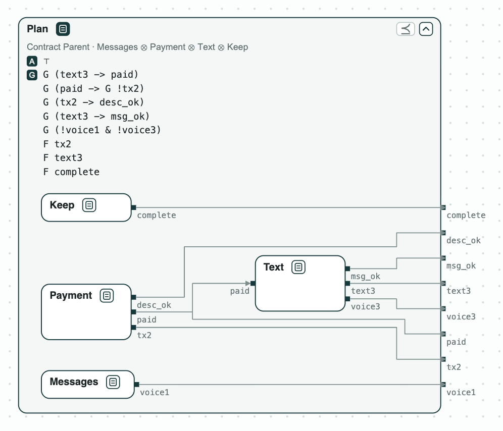

# Payment assistant agent: the plan of an AI agent checked before it runs

**The system.** An AI agent gets a task from a user and splits it among
sub-agents, each holding some of the tools. The task comes from
[AppWorld](https://arxiv.org/abs/2407.18901), a benchmark of agents that
use phone apps: pay Kristin back on Venmo the amount in her text messages,
with the note "Groceries", then text her "It is done.", and send no voice
message. Each variable is a tool call or what it writes: `tx2` (a payment
made by sub-agent 2), `paid` (the payment is done), `text3` (a text sent by
sub-agent 3), `desc_ok` and `msg_ok` (the note and the text are the ones
asked for), `voice1`, `voice3` (voice messages), `complete` (the task
marked done). The contract of the parent, _Parent_, is the request and
the rules of the user, written in LTL; it assumes nothing. The sub-agents
are _Messages_ (finds the amount), _Payment_ (pays), _Text_ (sends the
text), and _Keep_, what the parent keeps for itself (marking the task
complete). Each sub-agent gets a contract from the tools it holds. nuXmv
checks the contracts.

**The question.** Do the contracts of the sub-agents, together, give the
contract of the parent? If not, what must a sub-agent promise? The answer
is known before any tool is called, so a plan with a gap is fixed before
it pays anyone.

[{ width="492" }](../assets/demos/payment-assistant/system-plan.png)
_The plan: the four sub-agents inside the contract of the parent._

## The steps

The tags on the boxes give the results of the checks: green holds, red
fails; [Diagrams](../interfaces/diagrams.md) says
how to read them.

**Step 1. The plan does not refine the parent.** The plan
[refines](../contracts/checks.md#verification-tasks) the parent (⪯) when
every behavior of the sub-agents together meets the
contract of the parent. It does not: no sub-agent promises `F text3` (the
text is sent, sooner or later). nuXmv gives a run that pays and never
sends the text.

[](../assets/demos/payment-assistant/step1-plan-does-not-refine-parent.png)
_Step 1: the plan does not refine the parent; in the counterexample <code>text3</code> stays false._

**Step 2. What sub-agent 3 must do.** CHASE computes the
[quotient](../contracts/algebra.md#example-the-contract-of-a-missing-component) Q3 = Parent / (Messages ⊗ Payment ⊗ Keep): the weakest contract that the
missing sub-agent must meet so that the plan refines the parent. It is
derived from the contracts, not written by hand. Q3 asks for the rules of
the tools of sub-agent 3 and `F text3`. _Text_, with `F text3` added,
refines Q3 (it is drawn in Q3, the dashed box), so the plan refines the
parent.

[{ width="664" }](../assets/demos/payment-assistant/step3-text-refines-q3.png)
_Step 2: Text, with <code>F text3</code> and the assumption <code>F paid</code>, refines Q3._

**Step 3. A rule against the request.** If the parent also says "never
pay" (`G !tx2`, in _ParentWithSlip_), no behavior meets its contract: it
is inconsistent. CHASE finds the [unsat core](../contracts/checks.md#cores-why-a-check-fails), the smallest set of
guarantees in conflict: `F tx2` and `G !tx2`, two of nine.

[{ width="223" }](../assets/demos/payment-assistant/step4-parent-inconsistent-core.png)
_Step 3: the inconsistent parent, with the core in red._

## Run it

```
pip install chase-cps
chase-cps install nuxmv --accept-license
python assistant.py --expect
```

The files of the demo are in the [repository](https://github.com/chase-cps/demos/tree/main/PaymentAssistant); [Running the demos](running.md) says what the scripts print and how to use the diagrams.
