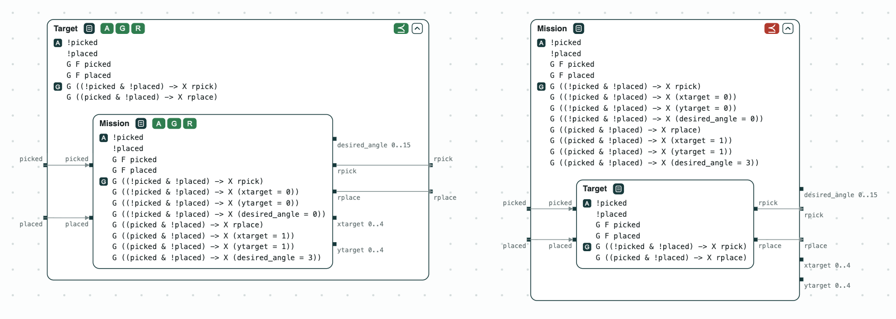
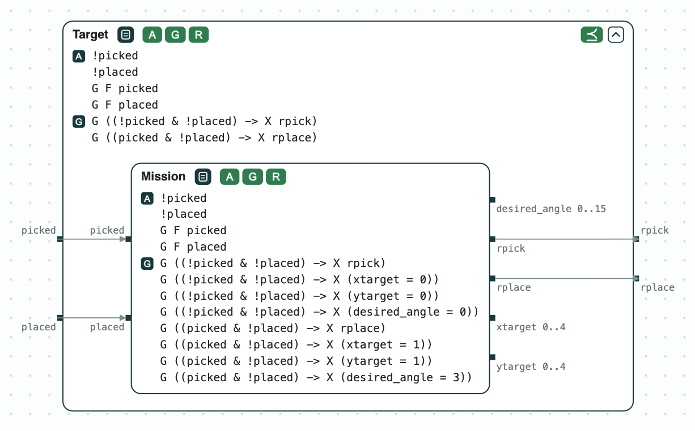
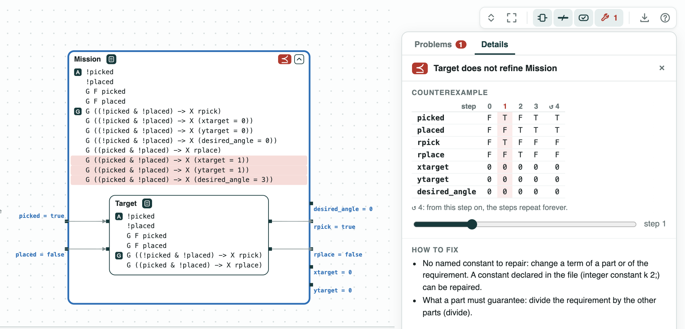
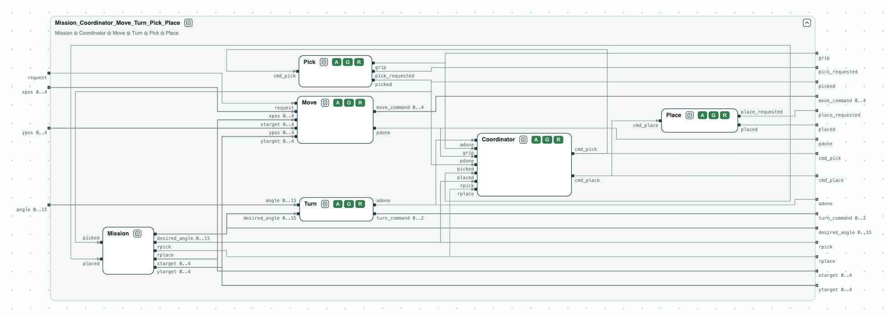

# Pick-and-place arm: the mission refines the target, and the coordinator is synthesized

**The question.** A robotic arm picks a piece, turns, and places it. Does
the mission meet the requirements, do the seven contracts fit together, and
can the coordinator be synthesized?

**The result.**

- _Mission_ refines _Target_; _Target_ does not refine _Mission_, and the
  counterexample shows a pick with no target position set.
- The seven contracts, composed, are compatible and consistent: their
  assumptions, their guarantees, and both together can hold.
- The coordinator is realizable, and slugs synthesizes a controller of 128
  states.

[](../assets/demos/pick-and-place/overview-all-checks.png)
_The two refinements: Mission refines Target (⪯ green), Target does not refine Mission (⪯ red)._

The arm is the second part of a tutorial at the DATE 2021 University Booth;
the first part is the [aircraft power system](aircraft-power.md). In `specs/robotic_arm.ltl`,
_Target_ requests a pick (`rpick`), then a place (`rplace`); _Mission_ also
sets the target position (`xtarget`, `ytarget`) and the angle
(`desired_angle`). _Coordinator_ commands the pick and the place; _Move_,
_Turn_, _Pick_, and _Place_ are the four actions.

## The steps

**Step 1. The mission refines the target.** The console of `logics_tool`
runs the commands of `solution.script` and writes the checks for nuXmv:

```
$> logics_tool -i specs/robotic_arm.ltl -o /tmp/ -c solution.script
$> nuXmv /tmp/MT.smv
```

Both formulas are true: _Mission_ refines _Target_ (it assumes no more
and guarantees at least as much).

[](../assets/demos/pick-and-place/step3-mission-refines-target.png)
_Step 1: Mission refines Target (⪯ green)._

**Step 2. The target does not refine the mission.** In `/tmp/TM.smv` the
formula of the guarantees is false. In the counterexample, the piece is
picked at step 1, and at step 2 `xtarget`, `ytarget`, and `desired_angle`
are still 0: _Target_ says nothing about them.

[](../assets/demos/pick-and-place/step3-target-does-not-refine-mission.png)
_Step 2: Target does not refine Mission; the counterexample at step 2._

**Step 3. The whole system.** `compose` builds the system of the seven
contracts, and `verify` writes the negation of its assumptions, of its
guarantees, and of both. `nuXmv -bmc /tmp/system.smv` finds a run for
each: the system is compatible and consistent.

[](../assets/demos/pick-and-place/step4-whole-system.png)
_Step 3: the whole system; the coordinator and the four actions are compatible (A), consistent (G), and realizable (R)._

**Step 4. The coordinator.** `synthesize Coordinator coordinator slugs`
writes the coordinator for slugs, which finds it realizable and
synthesizes a controller of 128 states.

## Run it

```
pip install chase-cps
chase-cps install nuxmv --accept-license
chase-cps install slugs
sh diagram.sh
```

The files of the demo are in the [repository](https://github.com/chase-cps/demos/tree/main/DATE21); [Running the demos](running.md) says what the scripts print and how to use the diagrams.
