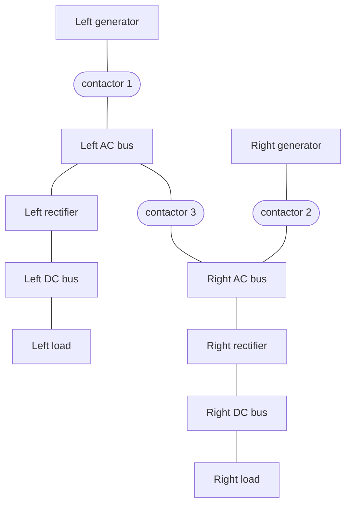

# Power systems and factories

**The question.** The requirements of the power system of an aircraft are
written as patterns over its architecture. Can the contactors be controlled
so that the requirements hold, and if not, which requirements must be
relaxed?



_The architecture of the power system: the contactors are what the controller switches._

These demos write the requirements in the domain-specific language of CHASE
instead of contracts: the components of an architecture, their types, how
they are connected, and patterns of requirements and assumptions. CHASE
turns them into one contract in GR(1), which `load_dsl` reads. The
requirements are those of the DATE 2018 paper: a DC bus is powered by the
generator on its side if possible, a failed generator is disconnected within
15 ms, two generators are never connected in parallel, and a DC bus is never
unpowered for more than 15 ms. The contactors open and close within 10 ms,
and at most one generator fails.

## The steps

**Step 1. The requirements as written.** They are unrealizable: no
controller of the contactors meets them.

**Step 2. Relaxed requirements.** With 20 ms to disconnect a failed
generator and 30 ms without power for a DC bus, the requirements are
realizable, and slugs synthesizes the controller of the contactors.

**Step 3. A small factory.** The same language describes a factory (FDL
2024): a warehouse, conveyors, machines that turn iron into coins, pipes,
output bays, and gates. Its requirements are realizable.

## Run it

```
$> git clone https://github.com/chase-cps/demos && cd demos
$> pip install chase-cps
$> chase-cps install slugs
$> python3
>>> from chase_cps import load_dsl, is_realizable
>>> is_realizable(load_dsl("DATE18/template_0_unrealizable.txt")).status
'unrealizable'
>>> is_realizable(load_dsl("DATE18/template_0_realizable.txt")).status
'realizable'
>>> is_realizable(load_dsl("FDL2024/dsl_factory_realizable.txt")).status
'realizable'
```

The DATE 2021 University Booth demo goes through the same steps with the
console tools of CHASE (`dsl_tool` and slugs), and through the robotic arm
in the logics language; its walkthrough is in `DATE21/DATE21.md`.
