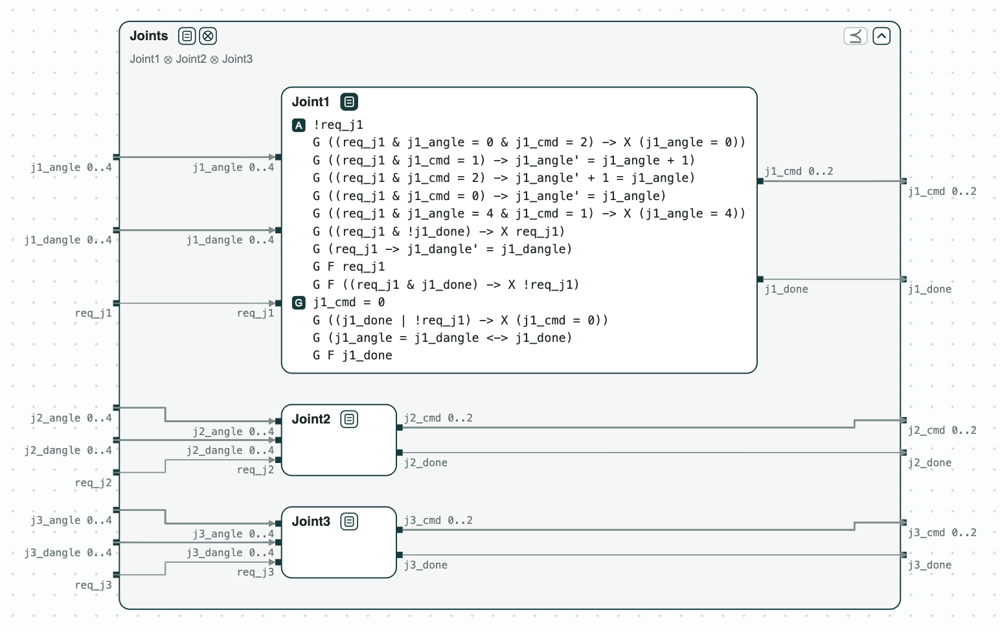
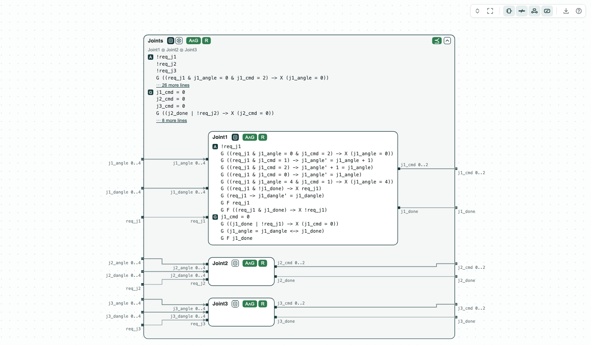

# Robotic arm joints: checked and synthesized one joint at a time

**The system.** A robotic arm with three joints moves each joint to the
angle it is asked for. The example was shown at CPS-IoT Week 2022
([CPSWeek22](https://github.com/chase-cps/demos/blob/main/CPSWeek22/CPSWeek22.md) has the original files). Joint
_i_ reads a request `req_ji`, the angle asked for `ji_dangle`, and its
present angle `ji_angle` (0 to 4); it writes a command `ji_cmd` (0 stay,
1 up, 2 down) and `ji_done`. Its contract assumes that a request is held
until the joint is done and that the angle follows the command; it
guarantees that the joint is done exactly at the angle asked for, and
done infinitely often (`G F ji_done`). _Joints_, the contract of the
arm, has the assumptions and the guarantees of the three joints. The
contracts are LTL over bounded integers, checked by nuXmv; the
controllers are built by slugs.

**The question.** Do the three joint contracts, composed, meet the
contract of the arm? Can a controller be built for each joint alone,
rather than one for the arm? And how does the check grow with the number
of joints? An arm maker wants to add joints without redoing the proof.

[{ width="762" }](../assets/demos/robotic-joints/system.png)
_The system: the three joints inside the contract of the arm; Joint1 open (the others are the same with 2 and 3)._

## The steps

**Step 1. The joints refine the arm.** The composition of the three
joints refines _Joints_: it assumes no more and guarantees at least as
much, for every behavior. `verification.chase` writes this check for
nuXmv in `refinement.smv`, and nuXmv proves both formulas. `diagram.sh`
draws the same check: every tag is green, the composition refines
(⪯), and each joint's assumptions and guarantees can hold together
(A∧G) and it is realizable (R).

[{ width="518" }](../assets/demos/robotic-joints/step1-joints-refine-arm.png)
_Step 1: Joint1 and Joints open: what one joint and the arm assume and guarantee._

**Step 2. One controller per joint, not one for the arm.**
`synthesis.chase` writes one file for slugs per joint, and slugs builds
a controller of 72 states for each. `singlemodel.chase` writes _Joints_
alone: it is realizable too, but its controller has at least 375,000
states, about 72 x 72 x 72, and slugs does not finish writing it. With
step 1, the three small controllers are enough: their composition meets
the contract of the arm.

**Step 3. Scaling.** `scaling.py` builds the same contracts for N joints
and checks the refinement: about 1 s for 3 joints and 5 s for 8 (Apple
M4 Pro, nuXmv 2.2.0). With `--broken`, Joint1 does not guarantee
`G F j1_done`, and nuXmv finds a counterexample of 3 or 4 steps for
every N.

The tags of the pictures are explained on the page
[Diagrams](../interfaces/diagrams.md#what-is-drawn).

## Run it

```
pip install chase-cps
chase-cps install nuxmv --accept-license
chase-cps install slugs
python scaling.py --joints 1 2 3 4 5 6 7 8 --broken --expect
```

`compositional_demo.sh` and `singlemodel_demo.sh` run steps 1 and 2 with the console.

The files of the demo are in the [repository](https://github.com/chase-cps/demos/tree/main/RoboticJoints); [Running the demos](running.md) says what the scripts print and how to use the diagrams.
