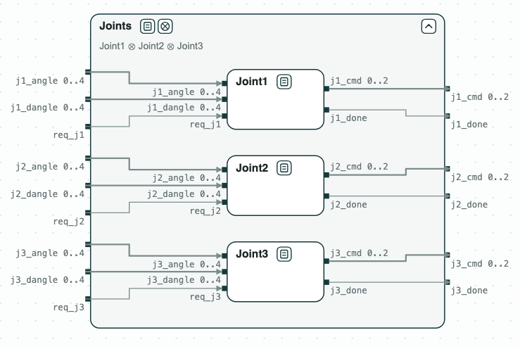
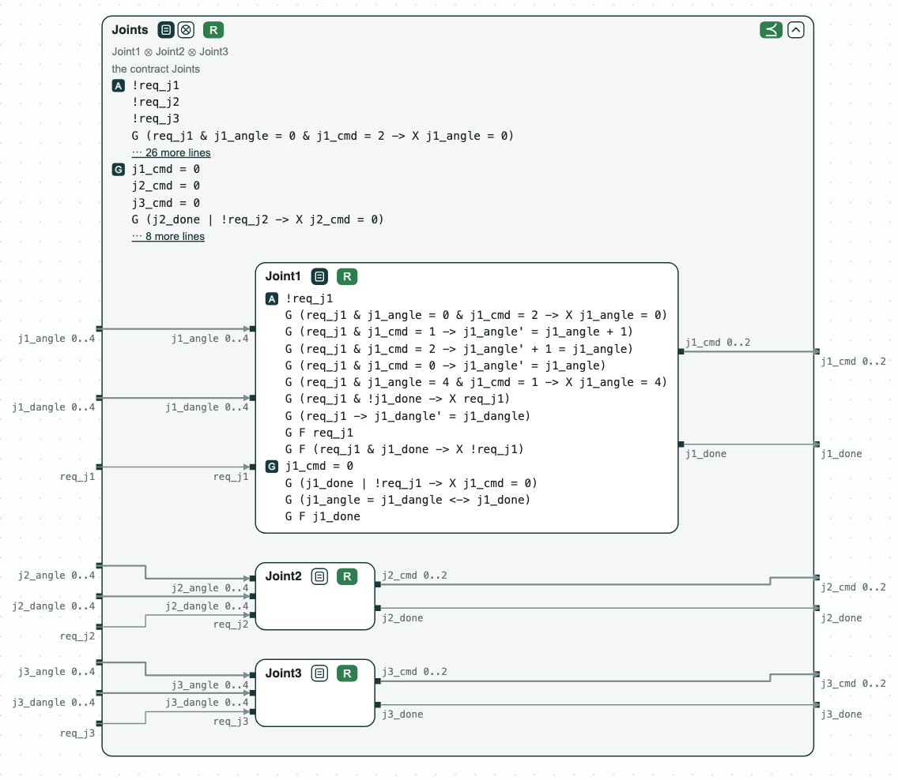
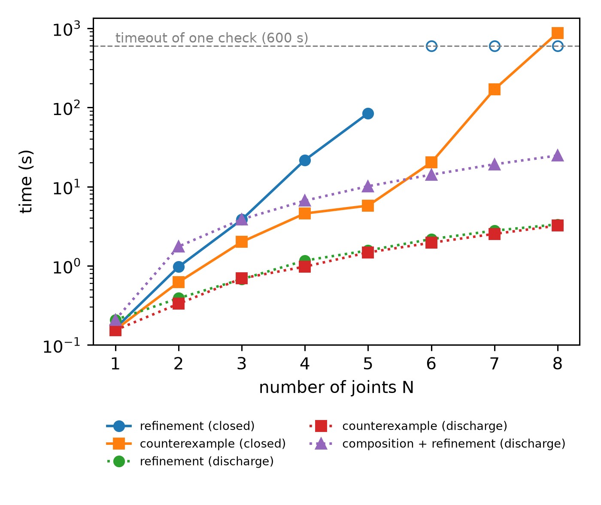

# Robotic joints: composition and scaling

**The question.** A robotic arm is built from three joints, each with its
own contract. Does the arm meet its contract, can each joint be
synthesized, and how does the check grow with the number of joints?

[](../assets/diagram-robotic-joints-system.png)
_The arm: three joints inside the contract of the arm._

The demo was first presented at CPS-IoT Week 2022. The arm asks Joint1 to
move (`req_j1`) to an angle (`j1_dangle`); the joint commands its motor
(`j1_cmd`: stop, up, or down), reads the angle (`j1_angle`), and says when
it is there (`j1_done`). Joint2 and Joint3 are alike. Each joint stops the
motor when it is done or not asked, is done exactly at the requested angle,
and is done infinitely often, under assumptions on the motor and on the
requests.

## The steps

**Step 1. The composition.** Joint1 ∥ Joint2 ∥ Joint3 refines _Joints_, the
contract of the arm.

**Step 2. The joints.** Each joint is realizable, and slugs synthesizes its
controller.

[](../assets/diagram-robotic-joints-1.png)
_Steps 1 and 2: the joints refine the arm, and each one is realizable (R); the terms of Joint1 and of the arm._

**Step 3. More joints.** `scaling.py` builds the same contracts for N joints
and checks the refinement, for a correct arm and for a broken one (a joint
that may never be done). The plain composition gives one large formula
(closed in the plot): the refinement of the correct arm is proved up to 5
joints (84 s), and the counterexample of the broken arm is found up to 8
joints. The refinement is two checks, each stopped after 600 s (the empty
circles); the counterexample at 8 joints takes 872 s in all. The
composition with discharge keeps the terms of the joints and removes the
redundant ones (the joints share no variable, so nothing is discharged
here): with 8 joints, the composition takes 21 s and the refinement 3.3 s.
The two series were measured with chase-cps 0.1.0 and 0.3.2.

[{ width="440" }](../assets/robotic-joints-scaling.png)
_Step 3: refinement time against the number of joints._

## Run it

```
$> git clone https://github.com/chase-cps/demos && cd demos
$> pip install chase-cps
$> chase-cps install nuxmv --accept-license
$> chase-cps install slugs
$> sh RoboticJoints/diagram.sh
$> python3 RoboticJoints/scaling.py --joints 1 2 3 4 5 6 7 8 --broken --discharge
```

`diagram.sh` checks steps 1 and 2 and writes the diagram above in
`RoboticJoints/out/specs.html`; `scaling.py` prints the times of step 3
(without `--discharge`, those of the plain composition). The same steps with the console of
logics_tool are in `RoboticJoints/verification.chase` and
`RoboticJoints/synthesis.chase`; the data of the plot are in
`RoboticJoints/results`.
