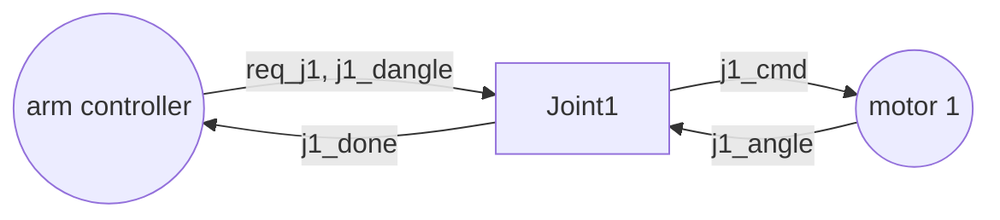

# Robotic joints

The joints of a robotic arm, first presented at CPS-IoT Week 2022. Each
joint has a contract (Joint1, Joint2, Joint3), and the arm has one too
(Joints).

The arm asks Joint1 to move (`req_j1`) to an angle (`j1_dangle`); the joint
commands its motor (`j1_cmd`: stop, up, or down), reads the angle
(`j1_angle`), and says when it is there (`j1_done`). Joint2 and Joint3 are
alike. Each joint guarantees that it stops the motor when it is done or not
asked, that `done` holds exactly at the requested angle, and that it is done
infinitely often, under assumptions on the motor and on the requests.

- `verification.chase` composes the three joints and checks that the
  composition refines the contract of the arm (logics_tool writes the
  refinement for nuXmv).
- `synthesis.chase` writes the GR(1) specification of each joint for slugs,
  which synthesizes the joint controllers.
- `single_model.ltl` is the same arm as one contract, for comparison with the
  compositional model.

## Run it

{ .recording }

The composition of the three joints refines the contract of the arm, and
Joint1 is realizable. `scaling.py` repeats the refinement for N joints, and
for a broken arm (Joint1 without `G F j1_done`), whose counterexample has
length 3.

## Scaling

`scaling.py` builds the same contracts for N joints with the Python package,
composes them, and checks the refinement, for a correct arm and for a broken
one (a joint that may never be done):

{ width="520" }

With the closed-form composition the correct version is checked up to 5 joints
(84 s); from 6 joints the check of the guarantees does not finish in 600 s.
The counterexample of the broken version is found up to 8 joints. Composed
with discharge, the composite keeps the terms of the joint contracts, and the
refinement is proved up to 8 joints in 3.3 s. The data and the machine are in
`RoboticJoints/results`.
