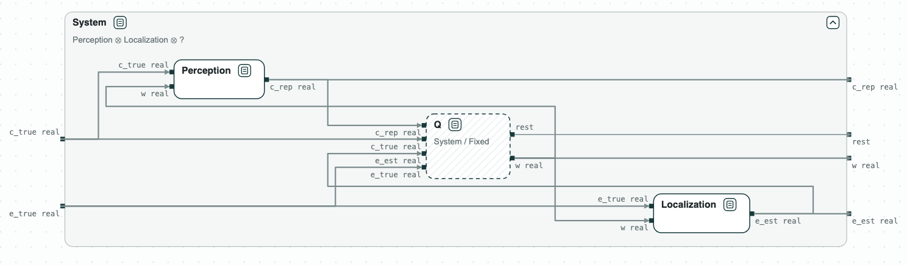
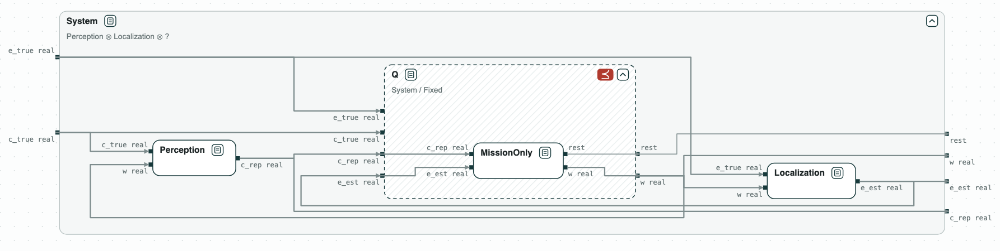
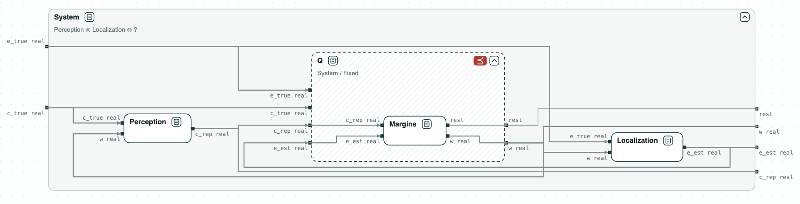
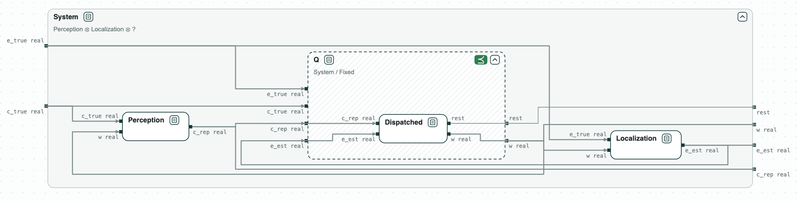

# Warehouse robot: a controller to delegate

**The question.** The local controller of a warehouse robot is given to a
designer, a person or a language model, while perception and localization
stay as they are. What must the controller satisfy for the robot to meet
the requirements of the system?

[](../assets/diagram-warehouse-robot-system.png)
_The place of the controller: the hole Q next to perception and localization._

The example is simplified from Damera, Matheu, and Baras, "Contract-Based
Agentic Systems Engineering: Delegation as Quotient for Assured System
Design" (arXiv 2610.33349, 2026). The robot keeps 0.40 m from a worker and
rests at a dock. The controller commands the yaw rate `w`; it sees the
clearance to the worker and the distance to the dock only as perception and
localization report them, with their errors. Perception works only if the
robot turns slowly, `|w| <= 0.8`. The variables are real numbers.

## The steps

**Step 1. The contract of the controller.** The quotient Q = System /
(Perception ∥ Localization) is the weakest contract of the controller with
which the robot meets the requirements, so it is the one to hand to the
designer. It guarantees the requirements of the system, and what perception
assumes of the controller: `|w| <= 0.8`.

**Step 2. The requirements of the mission.** _MissionOnly_, the
requirements written on what the controller sees, does not refine Q: in the
counterexample the reported clearance is 0.40 while the true one is 0.10.

[](../assets/diagram-warehouse-robot-1.png)
_Step 2: MissionOnly does not refine Q._

**Step 3. With margins for the errors.** _Margins_ adds the errors of
perception and localization to the bounds, and does not refine Q either: it
turns faster than perception allows (`w` = -1.20), and the robot reaches the
worker.

[](../assets/diagram-warehouse-robot-2.png)
_Step 3: Margins does not refine Q._

**Step 4. With the yaw rate.** _Dispatched_, _Margins_ with `|w| <= 0.8`,
refines Q, so the robot with it meets the requirements of the system.

[](../assets/diagram-warehouse-robot-3.png)
_Step 4: Dispatched refines Q._

The paper finds the same two failures on the robot in simulation; here they
are checked on all the behaviors, with a counterexample when they fail.

## Run it

```
$> git clone https://github.com/chase-cps/demos && cd demos
$> pip install chase-cps
$> chase-cps install nuxmv --accept-license
$> python3 WarehouseRobot/warehouse.py
```

The script prints the result of each step, with the counterexamples, and
writes `out/warehouse.html`, the diagrams above, to open in a browser: a
click on a name opens a contract. The contracts in words are in
`WarehouseRobot/requirements.txt`.
