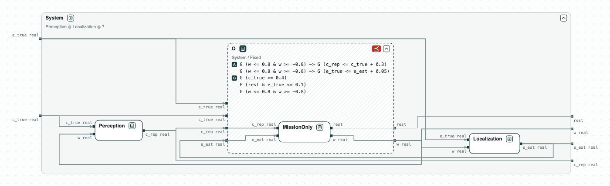
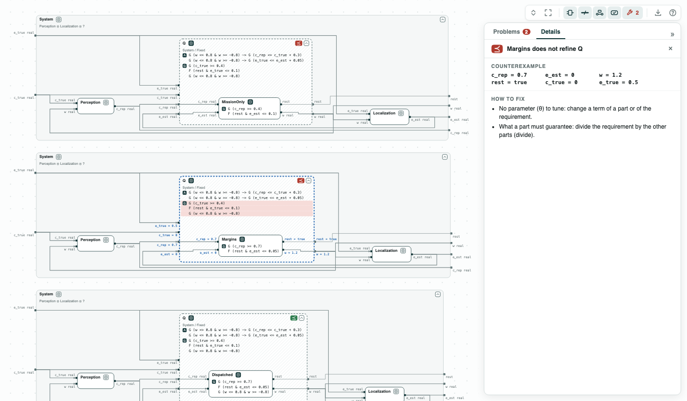

# Warehouse robot: the contract of a controller to delegate

**The question.** The local controller of a warehouse robot is given to a
designer while perception and localization stay as they are. What must the
controller satisfy for the robot to meet the requirements of the system?

**What it shows.**

- Quotient on reals: Q = System / (Perception ⊗ Localization), the weakest
  contract of the controller, the one to give to the designer; it asks for
  `|w| <= 0.8`, what perception assumes.
- Refinement on reals (nuXmv, SMT): the requirements written for the
  mission alone do not refine Q, nor do they with margins for the errors;
  each counterexample turns faster than perception allows (0.0 s each).
- Refinement: the contract given to the designer refines Q (0.0 s), and
  the robot with it refines the system (0.2 s).
- Diagrams: the quotient drawn as a dashed box between perception and
  localization, with each candidate inside it.

[](../assets/demos/warehouse-robot/overview-three-candidates.png)
_The three candidate contracts of the controller, each in the place of the controller: two fail, one holds._

The example is simplified from Damera, Matheu, and Baras, "Contract-Based
Agentic Systems Engineering: Delegation as Quotient for Assured System
Design" (arXiv 2610.33349, 2026). The robot keeps 0.40 m from a worker, and
rests (`rest`) at a dock. The variables are real numbers:

- `w`: the yaw rate, commanded by the controller;
- `c_true` and `c_rep`: the clearance to the worker, and the clearance that
  perception reports (at most 0.3 too high);
- `e_true` and `e_est`: the distance to the dock, and the distance that
  localization reports (at most 0.05 too low). The robot rests when
  `e_true <= 0.1`.

The controller sees only the reported values. Perception bounds its error
only if the robot turns slowly (`|w| <= 0.8`), and localization only if
`|w| <= 1.0`. The composition of perception and localization is called
_Fixed_ in the diagrams.

## The steps

**Step 1. The contract of the controller.** The quotient Q = System /
(Perception ⊗ Localization), drawn as a dashed box, is the weakest contract
of the controller with which the robot meets the requirements: the contract
to give to the designer. It guarantees the requirements of the system, and
what perception assumes of the controller: `|w| <= 0.8`.

[](../assets/demos/warehouse-robot/step1-quotient-q.png)
_Step 1: Q, the place of the controller, between perception and localization._

**Step 2. The requirements of the mission.** _MissionOnly_, the
requirements written on what the controller sees, does not refine Q: in the
counterexample the reported clearance is 0.40 while the true one is
lower, and the robot turns faster than perception allows.

[](../assets/demos/warehouse-robot/step2-missiononly-does-not-refine-q.png)
_Step 2: <em>MissionOnly</em> does not refine Q; the counterexample in the panel and on the wires._

**Step 3. With margins for the errors.** _Margins_ adds the errors of
perception and localization to the bounds, and does not refine Q either: it
turns faster than perception allows (`|w| = 1.2` in the counterexample), and
the robot reaches the worker.

[](../assets/demos/warehouse-robot/step3-margins-does-not-refine-q.png)
_Step 3: <em>Margins</em> does not refine Q: a yaw rate of 1.2 is allowed (the counterexample in the panel)._

**Step 4. With the yaw rate.** _Dispatched_, the contract given to the
designer, is _Margins_ with `|w| <= 0.8`. It refines Q, so the robot with
it meets the requirements of the system.

[](../assets/demos/warehouse-robot/step4-dispatched-refines-q.png)
_Step 4: <em>Dispatched</em> refines Q._

The paper finds the same two failures in simulation.

## Content of the directory
The directory of the demo contains:

- `requirements.txt`: the variables, the contracts, and the three candidate
  contracts of the controller;
- `warehouse.py`: the steps with the CHASE Python package;
- `out/warehouse.html`: the diagram above, written by `warehouse.py`.

## Run it

```
pip install chase-cps
chase-cps install nuxmv --accept-license
python warehouse.py --expect
```

The script prints the result of each step, with the counterexamples, and
writes the diagram in `out/warehouse.html`, a page to open in a browser: a
click on a name opens or closes the contract. With `--expect` the script
exits with code 1 when a result is not the expected one.
