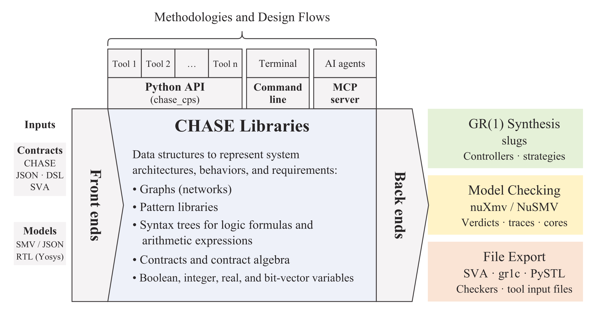

# Overview

CHASE (Contract-based Heterogeneous Analysis and Systems Exploration) is a
framework for requirement capture, formalization, and validation of
cyber-physical systems with assume-guarantee contracts. The requirements of
the components and of the system are written as contracts in linear temporal
logic; CHASE composes them, checks that the components refine the system,
finds the requirements that conflict, and synthesizes controllers.

```
$> pip install chase-cps
```

```python
from chase_cps import Contract, refines

spec = Contract.from_strings(inputs=["req"], outputs=["grant"],
                             assumptions=["G F !req"],
                             guarantees=["G (req -> F grant)"], name="Spec")
impl = Contract.from_strings(inputs=["req"], outputs=["grant"],
                             guarantees=["G (req -> X grant)"], name="Impl")
print(refines(impl, spec).status)    # valid
```

## Three layers

The operations of CHASE are in three layers. Each one depends on more than
the one before.

<div class="layers" markdown>
<div class="layer l1" markdown>
**1. Contract algebra.** Composition, conjunction, quotient, separation,
implication, and the other operations that build a contract from contracts.
They hold for any assume-guarantee contracts and are computed in closed form,
without a solver. [More](contracts/algebra.md)
</div>
<div class="layer l2" markdown>
**2. Checks.** Refinement, compatibility, consistency, and implementation
reduce to the validity and the satisfiability of formulas, which a model
checker decides (nuXmv, for LTL over Boolean, integer, and real variables).
A failed check comes with a counterexample, and a core explains it.
[More](contracts/checks.md)
</div>
<div class="layer l3" markdown>
**3. GR(1) synthesis.** Realizability, controllers, unrealizable cores,
well-separation, and vacuity, for contracts in the GR(1) fragment of LTL,
with slugs. They ask whether a component can be synthesized from a contract.
[More](contracts/synthesis.md)
</div>
<div class="base" markdown>
Front ends: the specification language and console (logics_tool), domain
languages (DSL_tool), Python, the command line, and the MCP server for AI
agents. Back ends: nuXmv, NuSMV, slugs, gr1c.
</div>
</div>

## Where to start

- [Installation](getting-started/install.md): the Python package, the solvers,
  the Docker image, or the sources.
- [A first contract](getting-started/first-contract.md): write two contracts,
  compose them, check a refinement, and read a counterexample.
- [Demos](demos/index.md): design iterations on real examples, such as an
  arbiter for a shared charging station and the lift modes of a NASA aircraft.
- [MCP server](interfaces/mcp.md): the operations of CHASE as tools for AI
  agents.

{ width="560" }

The figure is from the DATE 2018 paper: the front ends build the CHASE
representation of a design problem, the libraries manipulate systems and
contracts, and the back ends translate the problems for the verification
and synthesis tools.
