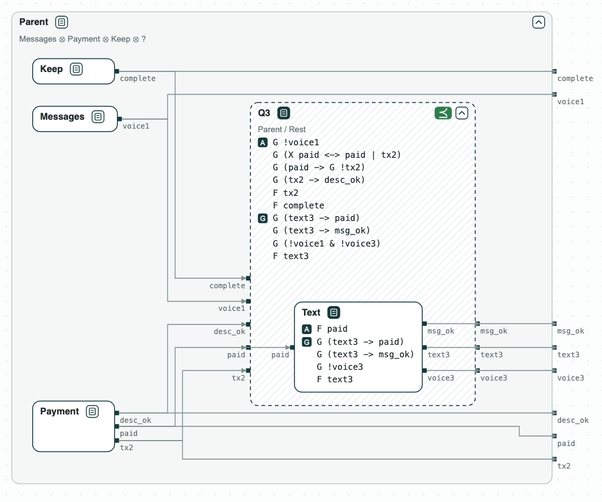

# Diagrams

CHASE draws contracts, components, and systems as a web page, with the
results of the checks on the boxes. The page opens in a browser and works
offline with a local copy of ELK, the layout library.

[](../assets/diagram-payment-assistant-2.png)
_A quotient, drawn as a dashed box, with the part that refines it inside ([Payment assistant](../demos/payment-assistant.md))._

## What is drawn

- A rounded box is a contract; a square box also has a model: RTL read
  with Yosys, a state machine in JSON or SMV, or a controller synthesized
  by slugs. A model with few states opens on its state graph.
- A box drawn inside another refines it, on as many levels as there are
  refinements; the button at the top right of a box folds what is inside.
- The note under a name says how the contract is built: ⊗ composition,
  ∧ conjunction, • merging (viewpoints of one component), / quotient.
- A dashed box is a quotient, with the part that refines it inside.
- An environment is a grey box on the left of what it drives.
- The tags are the results of the checks, green when the check holds and
  red when it does not: ⪯ refinement, A compatible, G consistent, A∧G
  feasible, R realizable, WS well separated, ¬V not vacuous, M ⊨ C the
  model implements the contract, E ⊨ A the environment meets the
  assumptions. A click on a red tag highlights its core in red.

Drag to move the diagram, and use the wheel (or a pinch) to zoom; the key 0
fits it to the window.

## Python

```python
from chase_cps import Component, Contract, System, refines, viz

a = Contract.from_strings(name="A", inputs=["x"], outputs=["y"],
                          guarantees=["G (x -> X y)"])
b = Contract.from_strings(name="B", inputs=["y"], outputs=["z"],
                          guarantees=["G (y -> z)"])
top = Contract.from_strings(name="Top", inputs=["x"], outputs=["y", "z"],
                            guarantees=["G (x -> X z)"])
s = System("S", [Component("a", a), Component("b", b)], contract=top)
s.check()                          # the composition against Top
q = top.divide(a, name="Q")        # what the part next to a must do
d = viz.diagram(s, q, refines=[(b, q, refines(b, q))], open=[q])
viz.save(d, "plan.html")           # viz.show(d) opens a browser
```

`checks` adds the results of `verify`, `is_realizable`,
`is_well_separated`, and `is_vacuous` to a box, `environments` draws
environments, and `open` lists the boxes drawn open when the page loads.
In Jupyter, a system or a contract draws itself.

## Command line, MCP, and VS Code

`chase-cps view FILE` draws a specification file: `--refines R A` draws R
inside A, `--check`, `--verify`, and `--realizable` add the checks, `--open`
names the contracts drawn open, and `--serve` draws the page again when the
file changes. The `visualize` tool of the [MCP server](mcp.md) draws the
same diagrams for an agent. An extension for VS Code, which shows the
diagram beside the editor, will follow.
